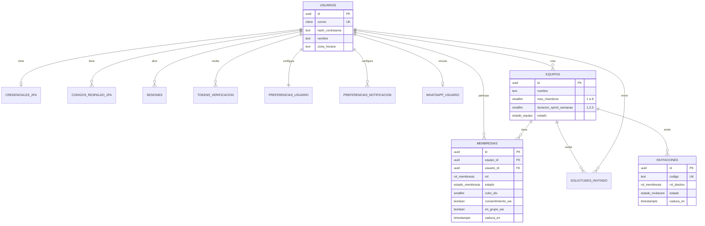
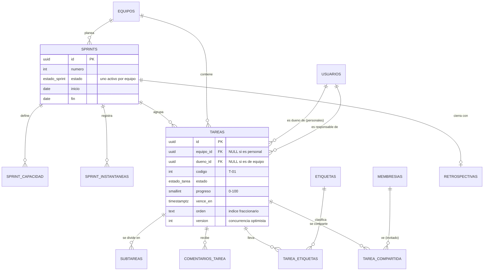
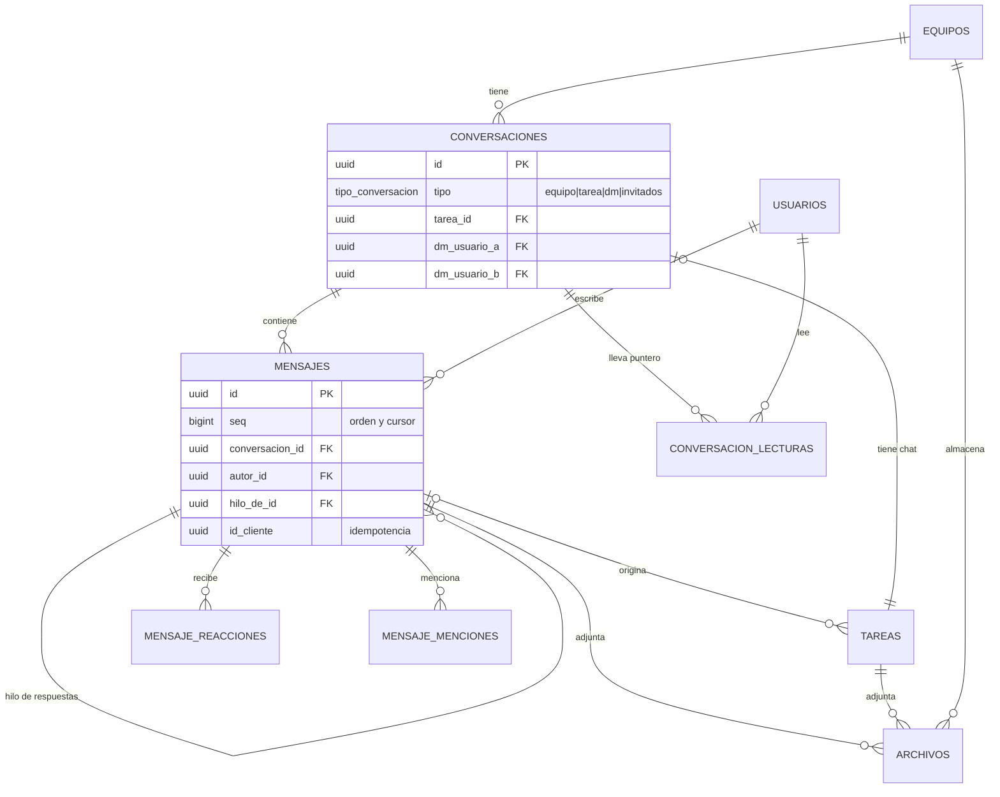
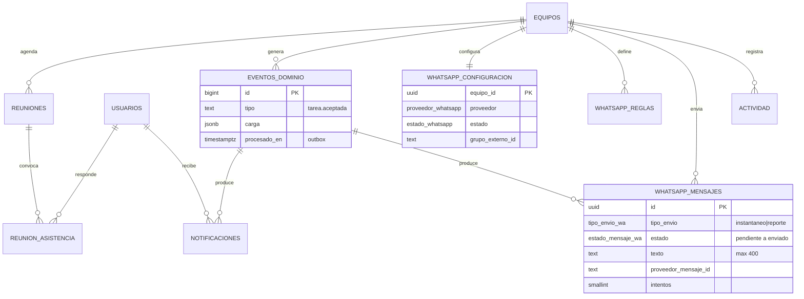
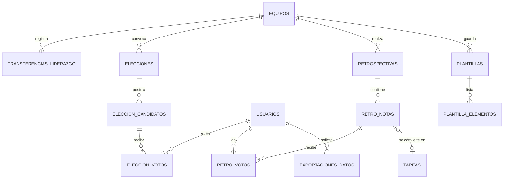

# Nexo · Diseño de la base de datos

> **Documento 02 de 06** · Versión 1.0 · Estado: listo para implementar
> Complementa a `01_Contexto_y_Especificaciones.md` (que contiene un resumen de este diseño) y alimenta el plan `03_Plan_de_Accion.md` (Fase 0 y Fase 1).
> **Este documento es la fuente de verdad del esquema.** Si el resumen del documento 01 y este texto discrepan, manda este.

**Estado de validación.** El esquema (47 tablas, 3 vistas, 7 funciones propias y 9 disparadores) se ejecutó en PostgreSQL 16.15 durante el diseño: se cargó la semilla, pasaron las pruebas de integridad de la sección 16 y se verificó con dos conexiones simultáneas que el límite de 8 miembros resiste la concurrencia. Después los archivos se reconstruyeron para este entregable y **no se volvieron a ejecutar**: la primera tarea de la Fase 0 es correr los tres scripts sobre una base vacía y confirmar las 11 líneas `OK` de la sección 16.

---

## 0. Cómo leer este documento

**Para personas.** Las secciones 1 a 4 explican qué se guarda y por qué se eligió PostgreSQL. Las secciones 5 a 8 son el diseño formal (diagramas, cardinalidades, normalización, reglas). Las secciones 9 a 14 cubren operación (concurrencia, índices, seguridad, migraciones, consultas). La sección 15 contiene los scripts, la 16 las pruebas y la 17 el diccionario de datos.

**Para agentes de IA.** Reglas de uso (obligatorias):

1. El esquema se implementa **copiando el script de la sección 15.1 tal cual** a `apps/api/db/migrations/0001_esquema.sql` (más la semilla en `apps/api/db/seeds/`). No se reescribe ni se «mejora» a criterio propio.
2. Un cambio de esquema **solo** se hace con una migración nueva (`0002_…sql`, `0003_…sql`). **Nunca** se edita una migración ya aplicada.
3. Los tipos TypeScript de acceso a datos se **generan** desde la base real (`kysely-codegen`); no se escriben a mano.
4. Toda regla marcada «en la BD» en la sección 8 debe seguir viviendo en la BD; la aplicación solo traduce el error a un mensaje (códigos `NX001`, `NX002`, `NX003`).
5. Si el diseño no cubre un caso, se registra como decisión pendiente en `docs/DECISIONES.md` y se pregunta al equipo; no se inventan tablas.

**Convenciones del esquema.**

| Aspecto | Convención |
|---|---|
| Idioma | Tablas y columnas en español, `snake_case`, sin acentos ni «ñ» (`tamano_bytes`, `contrasena`) |
| Claves primarias | `uuid` con `gen_random_uuid()`. Excepciones: `eventos_dominio.id` (identidad `bigint`, necesita orden total) y claves compuestas en tablas puente |
| Tiempo | `timestamptz` siempre en UTC; la zona horaria se aplica solo al presentar. Las fechas de sprint son `date` |
| Borrado | Borrado lógico (`eliminado_en`) en `usuarios` y `archivos`; el resto usa `ON DELETE CASCADE` desde el equipo o `SET NULL` para conservar historia |
| Conjuntos cerrados | Tipos `ENUM` de PostgreSQL (nombres en `snake_case`, valores sin acentos) |
| Marcas de tiempo | Se prefiere una marca (`leida_en`, `cancelada_en`) a un booleano cuando importa *cuándo* ocurrió |
| Comentarios | Cada tabla tiene `COMMENT ON TABLE`; el diccionario (sección 17) se deriva de ellos |

---

## 1. Resumen ejecutivo

- **Motor:** PostgreSQL 16 (compatible con 17).
- **Tamaño:** 47 tablas, 3 vistas, 34 tipos enumerados, 7 funciones propias, 9 disparadores.
- **Dominios:** identidad y cuenta · equipos y membresías · sprints · tareas · chat · archivos · calendario · eventos y notificaciones · WhatsApp · liderazgo y elecciones · retrospectiva · plantillas y misceláneos.
- **Decisiones de diseño más importantes:**
  1. Las reglas que no pueden romperse nunca (un solo líder, un solo sprint activo, máximo 8 miembros, color único por integrante, un voto por votante) están **en la base de datos**, no solo en el código. Una condición de carrera o un error del front no las viola.
  2. El **estado en memoria del prototipo se normalizó**: los arreglos (`etiquetas[]`, `subtareas[]`, `reacciones{}`, `leidoPor[]`, `participantes[]`) pasan a tablas hijas o a un puntero de lectura.
  3. **Concurrencia optimista** en tareas (`version`) y **orden por índice fraccionario** (`orden`) para que dos personas que mueven tarjetas no se pisen.
  4. **Bandeja de salida (outbox):** cada acción de negocio guarda un `eventos_dominio` en la misma transacción; un proceso aparte lo convierte en notificación, actividad, mensaje de sistema y aviso de WhatsApp. Es lo que hacía el «motor de eventos» del reducer del prototipo, ahora tolerante a fallos.
  5. **WhatsApp tiene un solo ciclo de vida** (`whatsapp_mensajes`): la «cola» y el «historial» de la interfaz son filtros por estado.
  6. **Límite de 8 miembros:** cuenta solo a líder e integrantes activos; los invitados (observadores) no cuentan ni entran al grupo de WhatsApp.

---

## 2. Elección del motor de base de datos

### 2.1 Requisitos que condicionan la elección

| # | Requisito | Origen |
|---|---|---|
| R1 | Integridad fuerte y relacional (equipos, roles, tareas, votos) | Dominio |
| R2 | Reglas «uno solo» (un líder, un sprint activo) garantizadas por el motor | Reglas de negocio |
| R3 | Límite de miembros seguro ante concurrencia | Límite de 8 (WhatsApp) |
| R4 | Cola de trabajos y tareas programadas **sin infraestructura extra** | Equipo de 2 programadores, 2–3 semanas |
| R5 | Datos semiestructurados (carga de eventos, detalle de actividad) sin abandonar el modelo relacional | Eventos de dominio |
| R6 | Búsqueda de texto en español en el chat | Pantalla CH-08 |
| R7 | Plan gratuito o muy barato en nube y ejecución local con Docker | Proyecto académico |
| R8 | Ecosistema con tipado (migraciones, generación de tipos) | Stack TypeScript de extremo a extremo |

### 2.2 Alternativas evaluadas

| Criterio | **PostgreSQL 16** | MySQL 8 | SQLite | MongoDB |
|---|---|---|---|---|
| Integridad relacional y `CHECK` | Excelente | Buena (`CHECK` desde 8.0.16) | Buena | Débil (sin FK) |
| Índices únicos **parciales** (R2) | **Nativos** | No nativos (se emulan con columnas generadas) | Sí | No aplica |
| Bloqueos de aplicación (`advisory locks`) (R3) | **Sí** | `GET_LOCK` (menos integrado) | No | No |
| JSONB indexable (R5) | **Excelente** | JSON (menos potente) | JSON básico | Nativo |
| Búsqueda de texto en español (R6) | **Integrada** (`tsvector`) | `FULLTEXT` limitado | FTS5 | Atlas Search |
| Cola sin infraestructura extra (R4) | **Sí** (`pg-boss`, `SKIP LOCKED`) | Posible, menos común | No | No |
| Disponibilidad gratuita en nube (R7) | Alta | Media | No es servidor | Alta |
| Familiaridad actual del equipo | Media | **Alta** | Media | Baja |
| **Veredicto** | **Elegido** | Plan B | Solo pruebas | Descartado |

### 2.3 Decisión y justificación

**Se elige PostgreSQL 16.** Las reglas del producto («solo un líder», «solo un sprint activo», «máximo 8 miembros», «color único por integrante activo») se expresan de forma directa y segura con **índices únicos parciales** y **bloqueos de aplicación**, que PostgreSQL ofrece de forma nativa y que en MySQL exigirían emulaciones. Además la cola de trabajos (`pg-boss`) vive en la misma base y evita desplegar Redis. La familiaridad previa con MySQL 8 se valoró (es el Plan B), pero el costo de emular las reglas no compensa en un proyecto de 2–3 semanas.

**Por qué no un servicio «todo en uno».** El equipo necesita un backend propio con lógica de WhatsApp, permisos y tareas programadas; usar solo el motor mantiene el control y facilita explicar la arquitectura en el artículo. Un proveedor gestionado (Supabase, Neon u otro) sí puede **alojar** el PostgreSQL sin cambiar el diseño (ver `01_Contexto…`, sección de despliegue).

### 2.4 Extensiones y versión

- Extensión requerida: `citext` (correo y etiquetas sin distinguir mayúsculas). Viene en `postgresql-contrib` y en los servicios gestionados habituales.
- `gen_random_uuid()` es nativa desde PostgreSQL 13; no se necesita `pgcrypto`.
- Versión objetivo 16.x; debe funcionar sin cambios en 17.

---

## 3. Proceso de diseño

### 3.1 Método

1. **Inventario de información** a partir de los tipos del prototipo (`src/store/types.ts`, ~370 líneas, 29 entidades), la matriz de permisos y el inventario de pantallas.
2. **Identificación de entidades y relaciones**, separando *entidad* de *atributo* y de *dato derivado*.
3. **Normalización** hasta 3FN/BCNF, con desnormalizaciones puntuales y justificadas (sección 7).
4. **Traducción de reglas de negocio** a restricciones del motor siempre que sea posible (sección 8).
5. **Diseño por consultas:** se verificó que las pantallas críticas (Hill Chart, tablero, chat, cola de WhatsApp) tienen consulta e índice adecuados (secciones 10 y 13).
6. **Validación ejecutando** el script, la semilla y las pruebas (secciones 15 y 16).

### 3.2 Del estado del prototipo a tablas

El prototipo guardaba todo en un objeto `EstadoApp`. Cada propiedad pasó por esta transformación:

| Estado del prototipo | Destino en la BD | Cambio relevante |
|---|---|---|
| `usuarios` | `usuarios` + `whatsapp_usuario` + `credenciales_2fa` | Número de WhatsApp y 2FA salen a tablas 1:1 (datos sensibles aislados) |
| `equipos` (con `whatsapp` y `reglasWA` anidados) | `equipos` + `whatsapp_configuracion` + `whatsapp_reglas` | Los objetos anidados se separan; las reglas pasan a filas por tipo de evento |
| `membresias` | `membresias` | Se agrega estado e historial (se puede salir y volver) |
| `tareas` (con `subtareas`, `adjuntos`, `comentarios`, `historial`, `etiquetas[]`) | `tareas`, `subtareas`, `archivos`, `comentarios_tarea`, `actividad`, `etiquetas`, `tarea_etiquetas` | Se eliminan arreglos incrustados (1FN); el historial se unifica con `actividad` |
| `sprints` (con `capacidad{}`, `completadas`, `total`) | `sprints`, `sprint_capacidad`, `sprint_instantaneas` | `completadas/total` se derivan; el burndown usa fotos diarias |
| `conversaciones` (con `participantes[]`, `fijadaPor[]`, `leidoHasta{}`) | `conversaciones` + `conversacion_lecturas` | Participantes derivados de la membresía o de las columnas DM; lectura y fijado por persona |
| `mensajes` (con `reacciones{}`, `leidoPor[]`, adjunto incrustado) | `mensajes`, `mensaje_reacciones`, `mensaje_menciones`, `archivos` | «Leído por N» se calcula contra el puntero de lectura |
| `eventos` | `reuniones` + `reunion_asistencia` | Se renombra para no confundir con eventos de dominio |
| `notificaciones` | `notificaciones` | `leida` booleana → `leida_en` |
| `colaWA` + `historialWA` | `whatsapp_mensajes` | Un solo ciclo de vida con estados |
| `actividad`, `archivos` | `actividad`, `archivos` | Ámbito personal y `detalle jsonb`; `storage_key`, `mime`, `sha256` |
| `invitaciones`, `solicitudes` | `invitaciones`, `solicitudes_invitado` | Se agrega duración del acceso del invitado |
| `elecciones` (con `candidatos[]`, `votos{}`) | `elecciones`, `eleccion_candidatos`, `eleccion_votos` | Voto con clave compuesta (uno por votante y ronda) |
| `transferencias` | `transferencias_liderazgo` | Estados `aceptada`/`cancelada` y unicidad de la pendiente |
| `retros` (con `notas[]`, `votos[]`) | `retrospectivas`, `retro_notas`, `retro_votos` | Límite de 3 votos por persona en la BD |
| `plantillas` (con `elementos[]`) | `plantillas` + `plantilla_elementos` | 1FN |
| `preferencias`, `sesiones` | `preferencias_usuario`, `preferencias_notificacion`, `sesiones`, `tokens_verificacion` | La sesión pasa a ser de servidor real |
| `sim`, `borradores`, `escribiendo`, `accesoTerminado`, `exportacion` | **No se persisten** (o se derivan) | Son del Simulador o estado efímero. «Acceso terminado» se deriva de `caduca_en`; «escribiendo…» y presencia viajan por WebSocket |

**Datos que se decidió NO guardar en la BD:** presencia «en línea» y «escribiendo…» (efímeros, viven en el servidor de WebSocket), borradores de formularios (almacenamiento local del navegador), contenido de los artículos de ayuda (estático en el front) y consentimiento de cookies (navegador).

---

## 4. Qué información se almacena (por dominio)

| Dominio | Tablas | Qué guarda |
|---|---|---|
| Identidad y cuenta | `usuarios`, `credenciales_2fa`, `codigos_respaldo_2fa`, `sesiones`, `tokens_verificacion`, `preferencias_usuario`, `preferencias_notificacion`, `whatsapp_usuario` | Quién es la persona, cómo entra, sus preferencias y su número de WhatsApp con consentimiento |
| Equipos | `equipos`, `membresias`, `invitaciones`, `solicitudes_invitado` | Equipos (máx. 8 miembros activos), rol y color de cada persona, invitaciones y solicitudes de invitados |
| Sprints | `sprints`, `sprint_capacidad`, `sprint_instantaneas` | Ciclos de trabajo, capacidad y serie diaria para el burndown |
| Tareas | `tareas`, `subtareas`, `etiquetas`, `tarea_etiquetas`, `tarea_compartida`, `comentarios_tarea` | Trabajo, estado, avance, responsable, vencimiento, etiquetas y lo compartido con invitados |
| Chat | `conversaciones`, `mensajes`, `mensaje_reacciones`, `mensaje_menciones`, `conversacion_lecturas` | Canales, mensajes, hilos, reacciones, menciones y lecturas |
| Archivos | `archivos` | Metadatos de adjuntos (el binario vive fuera de la BD) |
| Calendario | `reuniones`, `reunion_asistencia` | Reuniones y respuestas de asistencia |
| Eventos y avisos | `eventos_dominio`, `actividad`, `notificaciones` | Hechos de negocio, registro de actividad y notificaciones en la app |
| WhatsApp | `whatsapp_configuracion`, `whatsapp_reglas`, `whatsapp_mensajes`, `whatsapp_webhook_eventos` | Conexión por equipo, reglas, avisos con su ciclo de vida y webhooks recibidos |
| Liderazgo | `transferencias_liderazgo`, `elecciones`, `eleccion_candidatos`, `eleccion_votos` | Rutas A (transferencia) y B (votación) de cambio de líder |
| Retrospectiva | `retrospectivas`, `retro_notas`, `retro_votos` | Notas, agrupaciones y votos |
| Misceláneos | `plantillas`, `plantilla_elementos`, `exportaciones_datos`, `contacto_mensajes` | Plantillas, exportación de datos personales y formulario de contacto |

---

## 5. Modelo entidad-relación

El modelo completo no cabe en una sola imagen legible, así que se presenta en cinco diagramas por dominio. `USUARIOS`, `EQUIPOS` y `TAREAS` aparecen en varios y son las mismas entidades. Los diagramas están en Mermaid (renderizables con `mmdc` o en cualquier visor de Markdown compatible). Notación: `||` uno y solo uno · `o|` cero o uno · `o{` cero o muchos · `|{` uno o muchos.

### 5.1 Identidad, equipos y membresías



**Cómo leerlo.** Un `USUARIO` participa en muchos equipos a través de `MEMBRESIAS` (relación N:M resuelta con una tabla que además lleva rol, color y estado). `MEMBRESIAS` es la entidad más importante del dominio: de ella salen los permisos, el color de cada integrante y el cupo de 8.

### 5.2 Tareas y sprints



**Cómo leerlo.** `TAREAS` pertenece a un equipo **o** a una persona (tarea personal), nunca a ambos (`CHECK`). Las etiquetas son N:M. Las tareas compartidas con invitados son N:M contra `MEMBRESIAS` (no contra usuarios) para que el acceso termine cuando termina la membresía.

### 5.3 Chat y archivos



**Cómo leerlo.** Una `CONVERSACION` es de tipo `equipo`, `tarea`, `dm` o `invitados`. Los participantes no se guardan: se derivan de la membresía (equipo, invitados), del acceso a la tarea (tarea) o de las dos columnas `dm_usuario_a/b` (mensaje directo). `CONVERSACION_LECTURAS` guarda, por persona, hasta qué mensaje leyó.

### 5.4 Calendario, eventos de dominio, notificaciones y WhatsApp



**Cómo leerlo.** `EVENTOS_DOMINIO` es el punto de convergencia: un hecho (por ejemplo `tarea.aceptada`) produce notificaciones, un registro de actividad y —según las reglas del equipo— un `WHATSAPP_MENSAJES`.

### 5.5 Liderazgo, retrospectiva y misceláneos



**Cómo leerlo.** `ELECCION_VOTOS` referencia a `ELECCION_CANDIDATOS` con clave compuesta: es imposible votar por alguien que no es candidato de *esa* elección.

---

## 6. Cardinalidades

Notación: **A → B** se lee «cada A se relaciona con…». *Part.* indica participación obligatoria (O) u opcional (P) del lado B.

| # | Relación | Cardinalidad | Part. | Implementación | Justificación |
|---|---|---|---|---|---|
| 1 | Usuario — Membresía | 1 : N | P | `membresias.usuario_id` FK | Una persona puede estar en varios equipos y volver a uno tras salir (historial) |
| 2 | Equipo — Membresía | 1 : N | O (≥1 líder) | `membresias.equipo_id` FK + índices parciales | Todo equipo activo tiene exactamente un líder activo |
| 3 | Usuario — Equipo | N : M | — | Tabla `membresias` | Con atributos propios (rol, color, estado, caducidad) |
| 4 | Usuario — Equipo (creador) | 1 : N | O | `equipos.creado_por` | Auditoría |
| 5 | Equipo — Invitación | 1 : N | P | `invitaciones.equipo_id` | Un equipo emite muchos códigos |
| 6 | Equipo — Sprint | 1 : N | P | `sprints.equipo_id`, `UNIQUE(equipo_id, numero)` | Numeración propia por equipo; un solo activo |
| 7 | Sprint — Usuario (capacidad) | N : M | P | `sprint_capacidad` | Horas por persona y sprint |
| 8 | Sprint — Instantánea | 1 : N | P | `sprint_instantaneas` (PK compuesta con `dia`) | Una foto por día |
| 9 | Equipo — Tarea | 1 : N | P | `tareas.equipo_id` | Tareas del equipo |
| 10 | Usuario — Tarea (dueño) | 1 : N | P | `tareas.dueno_id` | Tareas personales; excluyente con 9 |
| 11 | Usuario — Tarea (responsable) | 1 : N | P | `tareas.responsable_id` | Una tarea tiene 0 o 1 responsable |
| 12 | Sprint — Tarea | 1 : N | P | `tareas.sprint_id` | Una tarea está en un sprint a la vez |
| 13 | Tarea — Subtarea | 1 : N | P | `subtareas.tarea_id` | Pasos |
| 14 | Tarea — Etiqueta | N : M | P | `tarea_etiquetas` | Varias etiquetas por tarea y viceversa |
| 15 | Tarea — Membresía (invitado) | N : M | P | `tarea_compartida` | Qué ve cada invitado |
| 16 | Tarea — Comentario | 1 : N | P | `comentarios_tarea.tarea_id` | |
| 17 | Equipo — Conversación | 1 : N | P | `conversaciones.equipo_id` + índices parciales | Un canal «equipo» y uno «invitados» por equipo |
| 18 | Tarea — Conversación | 1 : 0..1 | P | `conversaciones.tarea_id` + índice parcial | Chat por tarea |
| 19 | Conversación — Mensaje | 1 : N | P | `mensajes.conversacion_id` | |
| 20 | Mensaje — Mensaje (hilo) | 1 : N (auto) | P | `mensajes.hilo_de_id` | Respuestas en hilo |
| 21 | Mensaje — Usuario (reacción) | N : M | P | `mensaje_reacciones` | Una reacción de cada tipo por persona |
| 22 | Mensaje — Usuario (mención) | N : M | P | `mensaje_menciones` | Dispara notificación |
| 23 | Conversación — Usuario (lectura) | N : M | P | `conversacion_lecturas` | Puntero de lectura |
| 24 | Mensaje — Tarea (origen) | 1 : 0..N | P | `tareas.mensaje_origen_id` | «Convertir mensaje en tarea» |
| 25 | Mensaje / Tarea — Archivo | 1 : N | P | `archivos.mensaje_id`, `archivos.tarea_id` (excluyentes) | Un adjunto pertenece a uno u otro |
| 26 | Equipo — Reunión | 1 : N | P | `reuniones.equipo_id` | O reunión personal (`dueno_id`) |
| 27 | Reunión — Usuario (asistencia) | N : M | P | `reunion_asistencia` | Respuesta por persona |
| 28 | Equipo — Evento de dominio | 1 : N | P | `eventos_dominio.equipo_id` | Outbox |
| 29 | Evento — Notificación | 1 : N | P | `notificaciones.evento_id` | Un hecho notifica a varios |
| 30 | Evento — Aviso WhatsApp | 1 : N | P | `whatsapp_mensajes.evento_id` | |
| 31 | Equipo — Config. WhatsApp | 1 : 0..1 | P | `whatsapp_configuracion.equipo_id` PK | |
| 32 | Equipo — Regla WhatsApp | 1 : N | P | `whatsapp_reglas` PK `(equipo_id, tipo_evento)` | Máximo 6 filas por equipo |
| 33 | Usuario — WhatsApp personal | 1 : 0..1 | P | `whatsapp_usuario.usuario_id` PK | Número único en el sistema |
| 34 | Equipo — Elección | 1 : N (una abierta) | P | `elecciones` + índice parcial | |
| 35 | Elección — Candidato — Voto | 1 : N : N | P | `eleccion_candidatos`, `eleccion_votos` (FK compuesta) | |
| 36 | Sprint — Retrospectiva | 1 : 0..1 | P | `retrospectivas.sprint_id UNIQUE` | |
| 37 | Retrospectiva — Nota — Voto | 1 : N : N | P | `retro_notas`, `retro_votos` | |
| 38 | Usuario — Sesión / Token | 1 : N | P | `sesiones`, `tokens_verificacion` | |

---

## 7. Normalización

### 7.1 Primera forma normal (1FN): sin grupos repetitivos ni valores compuestos

El prototipo violaba 1FN en varios puntos (era un objeto JavaScript). Todos se corrigieron:

| Violación en el prototipo | Corrección |
|---|---|
| `Tarea.etiquetas: string[]` | `etiquetas` + `tarea_etiquetas` |
| `Tarea.subtareas[]`, `.comentarios[]`, `.adjuntos[]`, `.historial[]` | `subtareas`, `comentarios_tarea`, `archivos`, `actividad` |
| `Mensaje.reacciones: Record<Reaccion, string[]>` | `mensaje_reacciones` |
| `Mensaje.leidoPor: string[]` | Se calcula con `conversacion_lecturas` |
| `Conversacion.participantes: string[]` | Derivado de membresía / `dm_usuario_a/b` |
| `Plantilla.elementos: string[]` | `plantilla_elementos` con `orden` |
| `Eleccion.candidatos[]`, `.votos{}` | `eleccion_candidatos`, `eleccion_votos` |
| `Retro.notas[]`, `NotaRetro.votos[]` | `retro_notas`, `retro_votos` |
| `Evento.respuestas: Record` | `reunion_asistencia` |
| `Sprint.capacidad: Record` | `sprint_capacidad` |

### 7.2 Segunda forma normal (2FN): sin dependencias parciales

Las tablas con clave compuesta tienen todos sus atributos dependientes de la clave completa:

- `sprint_capacidad (sprint_id, usuario_id) → horas`
- `eleccion_votos (eleccion_id, ronda, votante_id) → candidato_id, emitido_en`
- `whatsapp_reglas (equipo_id, tipo_evento) → modo`
- `preferencias_notificacion (usuario_id, evento) → por_app, por_whatsapp, por_correo`
- `plantilla_elementos (plantilla_id, orden) → texto`

El nombre de la persona **no** se repite en `membresias` ni en `mensajes`: se obtiene con la FK.

### 7.3 Tercera forma normal y BCNF: sin dependencias transitivas

- `membresias` no guarda el nombre del equipo ni el de la persona (dependen de `equipo_id` / `usuario_id`, no de la clave `id`).
- El **rol** vive en `membresias` y no en `usuarios`, porque depende del par persona-equipo (líder en un equipo, invitada en otro).
- El **color** depende del lugar de la persona en *ese* equipo: `membresias.color_idx`.
- `tareas` no guarda el nombre del responsable ni del sprint.
- Los únicos determinantes alternos (`usuarios.correo`, `invitaciones.codigo`, `sesiones.token_hash`) son claves candidatas declaradas `UNIQUE`; por tanto todo determinante es superclave y el esquema cumple BCNF.

### 7.4 Desnormalizaciones deliberadas (y por qué)

| Elemento | Qué se desnormaliza | Justificación | Cómo se mantiene consistente |
|---|---|---|---|
| `tareas.codigo` (T-01) | Número legible por equipo | La interfaz y WhatsApp lo muestran; debe ser estable | Disparador `fn_tarea_asignar_codigo` con bloqueo; único por equipo |
| `tareas.orden` | Texto de índice fraccionario | Reordenar tarjetas con una sola escritura, sin renumerar ni colisiones entre dos personas | Lo calcula la aplicación con una biblioteca estándar |
| `tareas.version` | Contador | Concurrencia optimista | Disparador `fn_tarea_antes_de_actualizar` |
| `conversaciones.dm_usuario_a/b` | Par ordenado de personas | Garantizar un solo DM por pareja con un índice único | `CHECK (a < b)` fuerza el orden canónico |
| `sprint_instantaneas` | Valores derivables del histórico | Un burndown fiel exige la foto de cada día | Job nocturno que escribe una fila por sprint activo |
| `whatsapp_mensajes` | Fusión de cola e historial | Un aviso es uno solo con distintos estados | `CHECK` de estado coherente |
| `eventos_dominio.carga`, `actividad.detalle` | `jsonb` | Cargas heterogéneas por tipo de evento; no se consultan por columnas | Esquemas Zod compartidos |
| `membresias.en_grupo_wa` | Estado de la integración | Evita consultar a Meta en cada render | Webhooks y acción del líder |

---

## 8. Reglas de negocio e integridad

### 8.1 Reglas garantizadas por la base de datos

| ID | Regla | Mecanismo | Error |
|---|---|---|---|
| RN-EQP-01 | Máximo 8 miembros activos (líder + integrantes); los invitados no cuentan | Disparador `trg_limite_miembros` con `pg_advisory_xact_lock` + `CHECK (max_miembros BETWEEN 1 AND 8)` | `NX001` |
| RN-EQP-02 | Un solo líder activo por equipo | Índice único parcial `ux_un_lider_activo` | `23505` |
| RN-EQP-03 | Una sola membresía activa por persona y equipo | `ux_membresia_activa_usuario` | `23505` |
| RN-EQP-04 | Color distinto por integrante activo | `ux_color_activo` | `23505` |
| RN-EQP-05 | Solo los invitados caducan y solo ellos pueden carecer de color | `CHECK` en `membresias` | `23514` |
| RN-SPR-01 | Un solo sprint activo por equipo | `ux_un_sprint_activo` | `23505` |
| RN-SPR-02 | El sprint termina después de empezar; numeración única por equipo | `CHECK (fin > inicio)`, `UNIQUE(equipo_id, numero)` | `23514` / `23505` |
| RN-SPR-07 | Máximo 3 votos por persona en una retrospectiva | `trg_retro_limite_votos` | `NX003` |
| RN-TAR-01 | Una tarea es de un equipo o personal, nunca ambas ni ninguna | Dos `CHECK` | `23514` |
| RN-TAR-02 | Atascar o rechazar exige motivo | `CHECK` | `23514` |
| RN-TAR-03 | Completada ⇔ fecha de cierre, resultado y 100 % | Tres `CHECK` | `23514` |
| RN-TAR-04 | Código T-nn consecutivo y único por equipo | Disparador + índice único | `23505` |
| RN-TAR-05 | Cada actualización incrementa `version` | Disparador | — |
| RN-LID-01 | Una sola transferencia pendiente y una sola elección abierta por equipo | Índices únicos parciales | `23505` |
| RN-LID-04 | Se vota una vez por ronda | PK `(eleccion_id, ronda, votante_id)` | `23505` |
| RN-LID-05 | El líder saliente no vota | `trg_voto_valido` | `NX002` |
| RN-LID-06 | Solo se vota por candidatos de esa elección | FK compuesta | `23503` |
| RN-CHT-01 | Un canal «equipo» y uno «invitados» por equipo; un chat por tarea; un DM por pareja | Cuatro índices únicos parciales | `23505` |
| RN-CHT-02 | Reenviar un mensaje (conexión inestable) no lo duplica | Índice único `(conversacion_id, id_cliente)` | `23505` |
| RN-WA-01 | Un aviso de WhatsApp mide como máximo 400 caracteres | `CHECK` | `23514` |
| RN-WA-02 | Un número de WhatsApp pertenece a una sola persona y tiene formato E.164 | `UNIQUE` + `CHECK` regex | `23505` / `23514` |

### 8.2 Reglas que viven en la aplicación (y por qué no en la BD)

| Regla | Por qué en la aplicación |
|---|---|
| Matriz de permisos por rol (~45 acciones) | Depende del contexto (propia, compartida) y se comparte con el front; vive en `packages/shared` y se aplica **también en el servidor** |
| Transiciones válidas de estado de tarea | Dependen del rol y del responsable; se prueban con tablas de casos (ver `01_Contexto…`) |
| El responsable debe ser miembro activo del equipo | Una FK compuesta no es posible porque `membresias` guarda historial; se valida en el servicio con prueba automatizada |
| Un invitado solo ve lo compartido | Filtrado en cada consulta (y probado) |
| Caducidad de invitados, plazos de votación, reportes de WhatsApp | Tareas programadas (`pg-boss`), no disparadores: deben tolerar reintentos y avisar |
| Consentimiento de WhatsApp antes de mencionar o incluir a alguien | Regla de producto con efectos externos |

---

## 9. Concurrencia y consistencia

| Escenario | Estrategia |
|---|---|
| Dos personas editan la misma tarea | **Concurrencia optimista:** `UPDATE … WHERE id = $1 AND version = $2`. Si no actualiza ninguna fila, la API responde `409 Conflict` con el estado actual y el front muestra «Alguien cambió esta tarea» |
| Dos personas arrastran tarjetas a la vez | `orden` fraccionario: cada movimiento escribe solo la tarjeta movida, calculando su `orden` entre las dos vecinas; no hay renumeración masiva |
| Dos solicitudes ocupan el último lugar del equipo | El disparador toma `pg_advisory_xact_lock(equipo)`; la segunda espera y es rechazada con `NX001` |
| Reintento de envío de mensaje con mala conexión | `id_cliente` único por conversación: el reenvío devuelve el mismo mensaje |
| Dos workers toman el mismo aviso de WhatsApp | `SELECT … FOR UPDATE SKIP LOCKED` y cambio a `enviando` en la misma transacción |
| Un hecho de negocio y sus efectos | **Outbox transaccional:** el cambio y su `eventos_dominio` se confirman juntos; si el proceso cae, el evento sigue pendiente (`procesado_en IS NULL`) y se reintenta. Los consumidores son idempotentes |
| Webhook duplicado de Meta | `whatsapp_webhook_eventos.proveedor_evento_id UNIQUE`: el segundo se ignora |

**Aislamiento.** Se usa `READ COMMITTED` (por defecto). Las reglas que requieren más (cupo, códigos consecutivos) se resuelven con bloqueos de aplicación y no con `SERIALIZABLE`, para evitar reintentos generalizados.

---

## 10. Índices y rendimiento

Principio: un índice por cada consulta crítica de una pantalla y **no más**. Los índices parciales reducen tamaño y reflejan reglas.

| Pantalla / proceso | Consulta | Índice |
|---|---|---|
| Tablero, lista, backlog (EQ-02…04) | Tareas del equipo por estado | `ix_tareas_equipo_estado (equipo_id, estado) WHERE NOT archivada` |
| Sprint activo, Hill Chart | Tareas de un sprint | `ix_tareas_sprint` |
| Mis tareas | Tareas de una persona | `ix_tareas_responsable`, `ix_tareas_dueno` |
| Semáforo y recordatorios | Tareas que vencen pronto | `ix_tareas_vence` |
| Chat | Últimos mensajes de una conversación | `ix_mensajes_conv_seq (conversacion_id, seq DESC)` |
| Chat | Hilos y fijados | `ix_mensajes_hilo`, `ix_mensajes_fijados` |
| Chat | Búsqueda (CH-08) | `ix_mensajes_busqueda` (GIN sobre `to_tsvector('spanish', texto)`) |
| Notificaciones | No leídas de una persona | `ix_notif_usuario_no_leidas` |
| WhatsApp | Cola por equipo y estado | `ix_wa_msj_equipo_estado`, `ix_wa_msj_programados` |
| Outbox | Eventos pendientes | `ix_eventos_pendientes WHERE procesado_en IS NULL` |
| Actividad | Registro del equipo / historial de una tarea | `ix_actividad_equipo`, `ix_actividad_objeto` |
| Sesión | Sesiones vigentes de una persona | `ix_sesiones_usuario_vigentes` |

**Regla de revisión.** Antes de cerrar la Fase 5, ejecutar `EXPLAIN (ANALYZE, BUFFERS)` sobre las 7 consultas de la sección 13 con la semilla ampliada (14.3) y confirmar que ninguna hace barrido secuencial sobre tablas grandes.

---

## 11. Seguridad y privacidad de los datos

| Tema | Decisión |
|---|---|
| Contraseñas | Solo `hash_contrasena` con **Argon2id**; nunca texto plano ni cifrado reversible |
| Sesiones y tokens | Se guarda el **hash** (SHA-256) del token; el valor real solo viaja en la cookie `HttpOnly; Secure; SameSite=Lax` |
| Secretos 2FA | `secreto_cifrado` con AES-256-GCM; la clave vive en una variable de entorno, no en la BD |
| Enlace de invitación del grupo de WhatsApp | `whatsapp_configuracion.enlace_invitacion` se cifra a nivel de aplicación (da acceso al grupo) |
| Número de WhatsApp | Dato personal: columna aislada en `whatsapp_usuario`, formato E.164, nunca se muestra completo a otros miembros (solo los últimos 4 dígitos) |
| Roles de base de datos | `nexo_migrador` (DDL, solo en despliegue) y `nexo_app` (solo `SELECT/INSERT/UPDATE/DELETE`; sin `DROP`) |
| Eliminación de cuenta | Borrado lógico + anonimización de nombre y correo; los mensajes se conservan con autor anonimizado |
| Exportación de datos | `exportaciones_datos` genera un archivo con los datos de la persona; expira |
| Retención | Sesiones y tokens expirados se purgan con job; webhooks a los 30 días; actividad mientras exista el equipo |
| Copias de seguridad | Diarias con retención mínima de 7 días y **una prueba de restauración** documentada antes de la entrega final |
| Notas legales | El aviso de privacidad y el consentimiento explícito para WhatsApp son obligatorios en el producto. Este documento no es asesoría legal; el equipo debe revisar la normativa de protección de datos personales aplicable |

---

## 12. Migraciones y ciclo de vida del esquema

- Herramienta: **`node-pg-migrate`** con migraciones en SQL puro (`apps/api/db/migrations/NNNN_nombre.sql`).
- `0001_esquema.sql` = script de la sección 15.1. `0002_…` en adelante = cambios.
- Cada migración es **transaccional** y tiene su `down` cuando es posible.
- Tras migrar en local se regeneran los tipos: `pnpm --filter api db:types` (ejecuta `kysely-codegen` y escribe `apps/api/src/db/tipos.ts`, que **sí se versiona**).
- La semilla se carga con `pnpm --filter api db:seed`; el reinicio completo con `pnpm db:reset` (solo en desarrollo; falla si `NODE_ENV=production`).
- Nombres: índices `ix_<tabla>_<columna>`, únicos `ux_<descripción>`, disparadores `trg_<tabla>_<propósito>`, funciones `fn_<propósito>`, errores de negocio `SQLSTATE NXnnn`.

**Códigos de error propios (la API los traduce a mensajes).**

| SQLSTATE | Significado | Mensaje sugerido al usuario |
|---|---|---|
| `NX001` | Equipo lleno | «Este equipo ya tiene 8 miembros activos.» |
| `NX002` | El líder saliente no vota | «El líder saliente no participa en la votación.» |
| `NX003` | Límite de votos de retro | «Ya usaste tus 3 votos.» |

---

## 13. Consultas clave

**Q1 · Datos del Hill Chart** (un punto por tarea del sprint activo, con el color de su responsable):

```sql
SELECT t.codigo, t.titulo, t.estado, t.progreso, m.color_idx
  FROM tareas t
  JOIN sprints s ON s.id = t.sprint_id AND s.estado = 'activo'
  LEFT JOIN membresias m ON m.equipo_id = t.equipo_id
                        AND m.usuario_id = t.responsable_id AND m.estado = 'activa'
 WHERE t.equipo_id = $1 AND NOT t.archivada
 ORDER BY t.codigo;
```

**Q2 · Conteo del tablero por estado:** `SELECT estado, count(*) FROM tareas WHERE equipo_id = $1 GROUP BY estado;`

**Q3 · Mensajes no leídos de una persona en una conversación:**

```sql
SELECT count(*) AS no_leidos
  FROM mensajes m
  JOIN conversacion_lecturas l ON l.conversacion_id = m.conversacion_id
 WHERE l.usuario_id = $1 AND m.seq > l.ultimo_leido_seq
   AND m.autor_id IS DISTINCT FROM l.usuario_id;
```

**Q4 · Siguiente lote para el worker de WhatsApp** (varios workers sin duplicar):

```sql
SELECT id, tipo_evento, texto FROM whatsapp_mensajes
 WHERE estado = 'pendiente' AND seleccionado AND tipo_envio = 'instantaneo'
 ORDER BY creado_en
 FOR UPDATE SKIP LOCKED LIMIT 10;
```

**Q5 · Semáforo de entregas del equipo:** `SELECT semaforo, count(*) FROM v_tareas_semaforo WHERE equipo_id = $1 GROUP BY semaforo;`

**Q6 · Tareas visibles para un invitado:**

```sql
SELECT t.codigo, t.titulo FROM tareas t
  JOIN tarea_compartida tc ON tc.tarea_id = t.id
  JOIN membresias m ON m.id = tc.membresia_id AND m.estado = 'activa'
 WHERE m.usuario_id = $1 ORDER BY t.codigo;
```

**Q7 · Búsqueda de texto en el chat:** `… WHERE to_tsvector('spanish', texto) @@ plainto_tsquery('spanish', $1)`.

**Notas de uso.**
- Todas las consultas usan **parámetros** (`$1`), nunca concatenan texto (inyección SQL).
- Las consultas de tareas para el rol invitado **siempre** pasan por `tarea_compartida` (Q6).

---

## 14. Datos de prueba y evolución

### 14.1 Semilla
Reproduce el «Equipo Nexo» del prototipo: 11 personas, 1 equipo con **8 miembros activos** (líder + 7 integrantes, cupo completo a propósito) y 2 invitados, 4 sprints (2 cerrados, 1 activo, 1 planificado), 9 tareas de equipo en distintos estados, 2 tareas personales, etiquetas, chat y la configuración de WhatsApp en modo **simulado** con sus 6 reglas. Los usuarios de la semilla **no tienen contraseña**: se entra con el inicio de sesión de desarrollo (ver `01_Contexto…`).

### 14.2 Qué no cubre la semilla
No incluye avisos de WhatsApp enviados, elecciones activas ni retrospectivas: se crean con el uso o con pruebas.

### 14.3 Semilla ampliada para rendimiento
Generar con un script de Node (`apps/api/db/seeds/volumen.ts`): 50 equipos, 500 usuarios, 20 000 tareas y 200 000 mensajes.

### 14.4 Evolución prevista (fuera del alcance actual)
Particionar `mensajes` y `actividad` por mes si crecen; seguridad a nivel de fila (RLS) como defensa adicional; reuniones recurrentes con excepciones; varios números de WhatsApp por equipo.

---

## 15. Scripts

Los tres scripts van en orden sobre una base vacía de PostgreSQL 16. Se entregan también como archivos `.sql` sueltos con exactamente este contenido.

### 15.1 Esquema (`apps/api/db/migrations/0001_esquema.sql`)

```sql
-- =====================================================================
-- NEXO · Esquema de base de datos · PostgreSQL 16
-- Fuente de verdad del modelo de datos. Ver docs/02_Base_de_Datos.md
-- Convenciones: tablas y columnas en español, snake_case, sin acentos ni ñ.
-- Tiempos: timestamptz (UTC). Claves primarias: uuid (gen_random_uuid()).
-- =====================================================================

CREATE EXTENSION IF NOT EXISTS citext;

-- ---------------------------------------------------------------------
-- 0. TIPOS ENUMERADOS (conjuntos cerrados y estables)
-- ---------------------------------------------------------------------
CREATE TYPE rol_membresia          AS ENUM ('lider', 'integrante', 'invitado');
CREATE TYPE estado_membresia       AS ENUM ('activa', 'salio', 'expulsada', 'caducada');
CREATE TYPE estado_equipo          AS ENUM ('activo', 'archivado');
CREATE TYPE politica_propuestas    AS ENUM ('triaje', 'libre');
CREATE TYPE estado_tarea           AS ENUM ('propuesta', 'backlog', 'aceptada', 'habilitada', 'en_curso', 'atascada', 'completada', 'rechazada');
CREATE TYPE prioridad_tarea        AS ENUM ('alta', 'media', 'baja');
CREATE TYPE resultado_tarea        AS ENUM ('a_tiempo', 'con_retraso');
CREATE TYPE origen_tarea           AS ENUM ('propuesta', 'directa');
CREATE TYPE rechazo_por            AS ENUM ('lider', 'responsable');
CREATE TYPE estado_sprint          AS ENUM ('planificado', 'activo', 'cerrado');
CREATE TYPE tipo_conversacion      AS ENUM ('equipo', 'tarea', 'dm', 'invitados');
CREATE TYPE tipo_reaccion          AS ENUM ('ok', 'corazon', 'risa', 'fiesta', 'visto', 'hecho');
CREATE TYPE repeticion_reunion     AS ENUM ('ninguna', 'diaria_lv', 'semanal');
CREATE TYPE respuesta_asistencia   AS ENUM ('pendiente', 'si', 'no', 'quiza');
CREATE TYPE categoria_notificacion AS ENUM ('menciones', 'tareas', 'equipo');
CREATE TYPE estado_invitacion      AS ENUM ('pendiente', 'aceptada', 'revocada', 'caducada');
CREATE TYPE tipo_solicitud_invitado AS ENUM ('ampliacion', 'conversion');
CREATE TYPE estado_solicitud       AS ENUM ('pendiente', 'aprobada', 'rechazada');
CREATE TYPE fase_eleccion          AS ENUM ('postulacion', 'votacion', 'resultado', 'empate', 'sin_votos');
CREATE TYPE estado_transferencia   AS ENUM ('pendiente', 'aceptada', 'rechazada', 'cancelada');
CREATE TYPE columna_retro          AS ENUM ('bien', 'mejorar', 'acciones');
CREATE TYPE tipo_plantilla         AS ENUM ('sprint', 'proyecto', 'retro');
CREATE TYPE tipo_archivo           AS ENUM ('pdf', 'imagen', 'doc', 'hoja', 'otro');
CREATE TYPE tipo_token             AS ENUM ('verificar_correo', 'restablecer_contrasena');
CREATE TYPE tema_ui                AS ENUM ('sistema', 'claro', 'oscuro');
CREATE TYPE densidad_ui            AS ENUM ('comoda', 'compacta');
CREATE TYPE tamano_texto_ui        AS ENUM ('pequeno', 'normal', 'grande');
CREATE TYPE estado_whatsapp        AS ENUM ('sin_configurar', 'conectado', 'error', 'pausado');
CREATE TYPE proveedor_whatsapp     AS ENUM ('simulado', 'cloud_api_grupos', 'cloud_api_directo');
CREATE TYPE tipo_envio_wa          AS ENUM ('instantaneo', 'reporte');
CREATE TYPE estado_mensaje_wa      AS ENUM ('pendiente', 'programado', 'enviando', 'enviado', 'fallido', 'cancelado');
CREATE TYPE modo_regla_wa          AS ENUM ('instantaneo', 'reporte', 'apagado');
CREATE TYPE frecuencia_reporte     AS ENUM ('diario', 'semanal');
CREATE TYPE estado_exportacion     AS ENUM ('preparando', 'lista', 'expirada');

-- ---------------------------------------------------------------------
-- 1. FUNCIONES GENÉRICAS
-- ---------------------------------------------------------------------
CREATE OR REPLACE FUNCTION fn_tocar_actualizado() RETURNS trigger AS $$
BEGIN
  NEW.actualizado_en := now();
  RETURN NEW;
END $$ LANGUAGE plpgsql;

-- ---------------------------------------------------------------------
-- 2. IDENTIDAD Y CUENTA
-- ---------------------------------------------------------------------
CREATE TABLE usuarios (
  id                 uuid PRIMARY KEY DEFAULT gen_random_uuid(),
  correo             citext NOT NULL UNIQUE,
  correo_verificado_en timestamptz,
  hash_contrasena    text,                         -- NULL si solo usa Google
  google_sub         text UNIQUE,
  nombre             text NOT NULL CHECK (char_length(nombre) BETWEEN 2 AND 80),
  cargo              text NOT NULL DEFAULT '',
  descripcion        text NOT NULL DEFAULT '',
  zona_horaria       text NOT NULL DEFAULT 'America/Mexico_City',
  avatar_url         text,
  intentos_fallidos  smallint NOT NULL DEFAULT 0,
  bloqueado_hasta    timestamptz,
  ultima_actividad_en timestamptz,
  creado_en          timestamptz NOT NULL DEFAULT now(),
  actualizado_en     timestamptz NOT NULL DEFAULT now(),
  eliminado_en       timestamptz
);
CREATE TRIGGER trg_usuarios_tocar BEFORE UPDATE ON usuarios
  FOR EACH ROW EXECUTE FUNCTION fn_tocar_actualizado();

CREATE TABLE credenciales_2fa (
  usuario_id      uuid PRIMARY KEY REFERENCES usuarios(id) ON DELETE CASCADE,
  secreto_cifrado text NOT NULL,
  confirmado_en   timestamptz
);

CREATE TABLE codigos_respaldo_2fa (
  id          uuid PRIMARY KEY DEFAULT gen_random_uuid(),
  usuario_id  uuid NOT NULL REFERENCES usuarios(id) ON DELETE CASCADE,
  hash_codigo text NOT NULL,
  usado_en    timestamptz
);
CREATE INDEX ix_codigos_respaldo_usuario ON codigos_respaldo_2fa(usuario_id);

CREATE TABLE sesiones (
  id                  uuid PRIMARY KEY DEFAULT gen_random_uuid(),
  usuario_id          uuid NOT NULL REFERENCES usuarios(id) ON DELETE CASCADE,
  token_hash          bytea NOT NULL UNIQUE,
  dispositivo         text NOT NULL DEFAULT '',
  ip                  inet,
  lugar               text NOT NULL DEFAULT '',
  creada_en           timestamptz NOT NULL DEFAULT now(),
  ultima_actividad_en timestamptz NOT NULL DEFAULT now(),
  expira_en           timestamptz NOT NULL,
  revocada_en         timestamptz
);
CREATE INDEX ix_sesiones_usuario_vigentes ON sesiones(usuario_id) WHERE revocada_en IS NULL;

CREATE TABLE tokens_verificacion (
  id          uuid PRIMARY KEY DEFAULT gen_random_uuid(),
  usuario_id  uuid NOT NULL REFERENCES usuarios(id) ON DELETE CASCADE,
  tipo        tipo_token NOT NULL,
  token_hash  bytea NOT NULL UNIQUE,
  expira_en   timestamptz NOT NULL,
  usado_en    timestamptz,
  creado_en   timestamptz NOT NULL DEFAULT now()
);
CREATE INDEX ix_tokens_usuario_tipo ON tokens_verificacion(usuario_id, tipo);

CREATE TABLE preferencias_usuario (
  usuario_id          uuid PRIMARY KEY REFERENCES usuarios(id) ON DELETE CASCADE,
  tema                tema_ui NOT NULL DEFAULT 'sistema',
  densidad            densidad_ui NOT NULL DEFAULT 'comoda',
  tamano_texto        tamano_texto_ui NOT NULL DEFAULT 'normal',
  reducir_movimiento  boolean NOT NULL DEFAULT false,
  idioma              text NOT NULL DEFAULT 'es-MX',
  formato_hora        text NOT NULL DEFAULT '24h' CHECK (formato_hora IN ('24h', '12h')),
  formato_fecha       text NOT NULL DEFAULT 'dd/mm' CHECK (formato_fecha IN ('dd/mm', 'mm/dd')),
  primer_dia          text NOT NULL DEFAULT 'lunes' CHECK (primer_dia IN ('lunes', 'domingo')),
  silencio_desde      time,
  silencio_hasta      time,
  resumen_diario      boolean NOT NULL DEFAULT false,
  estado_visible      boolean NOT NULL DEFAULT true,
  tour_visto          boolean NOT NULL DEFAULT false
);

CREATE TABLE preferencias_notificacion (
  usuario_id  uuid NOT NULL REFERENCES usuarios(id) ON DELETE CASCADE,
  evento      text NOT NULL,
  por_app     boolean NOT NULL DEFAULT true,
  por_whatsapp boolean NOT NULL DEFAULT false,
  por_correo  boolean NOT NULL DEFAULT false,
  PRIMARY KEY (usuario_id, evento)
);

CREATE TABLE whatsapp_usuario (
  usuario_id                 uuid PRIMARY KEY REFERENCES usuarios(id) ON DELETE CASCADE,
  numero_e164                text NOT NULL UNIQUE CHECK (numero_e164 ~ '^\+[1-9][0-9]{7,14}$'),
  verificado_en              timestamptz,
  consentimiento_en          timestamptz,
  consentimiento_revocado_en timestamptz
);

-- ---------------------------------------------------------------------
-- 3. EQUIPOS, MEMBRESÍAS E INVITACIONES
-- ---------------------------------------------------------------------
CREATE TABLE equipos (
  id                      uuid PRIMARY KEY DEFAULT gen_random_uuid(),
  nombre                  text NOT NULL CHECK (char_length(nombre) BETWEEN 2 AND 60),
  descripcion             text NOT NULL DEFAULT '',
  duracion_sprint_semanas smallint NOT NULL DEFAULT 2 CHECK (duracion_sprint_semanas IN (1, 2, 3)),
  zona_horaria            text NOT NULL DEFAULT 'America/Mexico_City',
  politica_propuestas     politica_propuestas NOT NULL DEFAULT 'triaje',
  votacion_plazo_horas    smallint NOT NULL DEFAULT 72 CHECK (votacion_plazo_horas BETWEEN 1 AND 336),
  votacion_desempate_horas smallint NOT NULL DEFAULT 24 CHECK (votacion_desempate_horas BETWEEN 1 AND 168),
  max_miembros            smallint NOT NULL DEFAULT 8 CHECK (max_miembros BETWEEN 1 AND 8),
  estado                  estado_equipo NOT NULL DEFAULT 'activo',
  creado_por              uuid NOT NULL REFERENCES usuarios(id),
  creado_en               timestamptz NOT NULL DEFAULT now(),
  actualizado_en          timestamptz NOT NULL DEFAULT now(),
  archivado_en            timestamptz
);
CREATE TRIGGER trg_equipos_tocar BEFORE UPDATE ON equipos
  FOR EACH ROW EXECUTE FUNCTION fn_tocar_actualizado();

CREATE TABLE membresias (
  id                uuid PRIMARY KEY DEFAULT gen_random_uuid(),
  equipo_id         uuid NOT NULL REFERENCES equipos(id) ON DELETE CASCADE,
  usuario_id        uuid NOT NULL REFERENCES usuarios(id) ON DELETE CASCADE,
  rol               rol_membresia NOT NULL,
  estado            estado_membresia NOT NULL DEFAULT 'activa',
  color_idx         smallint CHECK (color_idx >= 0),
  consentimiento_wa boolean,                        -- NULL = no respondió
  en_grupo_wa       boolean NOT NULL DEFAULT false,
  caduca_en         timestamptz,                    -- solo invitados
  desde             timestamptz NOT NULL DEFAULT now(),
  hasta             timestamptz,
  CHECK (rol = 'invitado' OR color_idx IS NOT NULL),
  CHECK (rol = 'invitado' OR caduca_en IS NULL),
  CHECK ((estado = 'activa') = (hasta IS NULL))
);
-- Un usuario tiene como máximo una membresía ACTIVA por equipo (conserva historial).
CREATE UNIQUE INDEX ux_membresia_activa_usuario ON membresias(equipo_id, usuario_id) WHERE estado = 'activa';
-- Un solo líder activo por equipo.
CREATE UNIQUE INDEX ux_un_lider_activo ON membresias(equipo_id) WHERE rol = 'lider' AND estado = 'activa';
-- Color distinto por integrante activo (no aplica a invitados).
CREATE UNIQUE INDEX ux_color_activo ON membresias(equipo_id, color_idx) WHERE estado = 'activa' AND rol <> 'invitado';
CREATE INDEX ix_membresias_usuario ON membresias(usuario_id) WHERE estado = 'activa';

-- Límite de miembros (líder + integrantes; los invitados no cuentan). Seguro ante concurrencia.
CREATE OR REPLACE FUNCTION fn_limite_miembros() RETURNS trigger AS $$
DECLARE
  v_max      smallint;
  v_actuales integer;
BEGIN
  IF NEW.estado = 'activa' AND NEW.rol IN ('lider', 'integrante') THEN
    PERFORM pg_advisory_xact_lock(hashtextextended(NEW.equipo_id::text, 0));
    SELECT max_miembros INTO v_max FROM equipos WHERE id = NEW.equipo_id;
    SELECT count(*) INTO v_actuales
      FROM membresias
     WHERE equipo_id = NEW.equipo_id AND estado = 'activa'
       AND rol IN ('lider', 'integrante') AND id <> NEW.id;
    IF v_actuales >= v_max THEN
      RAISE EXCEPTION 'LIMITE_MIEMBROS: el equipo ya tiene % miembros activos', v_max
        USING ERRCODE = 'NX001';
    END IF;
  END IF;
  RETURN NEW;
END $$ LANGUAGE plpgsql;
CREATE TRIGGER trg_limite_miembros
  BEFORE INSERT OR UPDATE OF estado, rol ON membresias
  FOR EACH ROW EXECUTE FUNCTION fn_limite_miembros();

-- Primer color libre (0, 1, 2…) para un integrante nuevo del equipo.
CREATE OR REPLACE FUNCTION fn_siguiente_color_idx(p_equipo uuid) RETURNS smallint AS $$
  SELECT g::smallint FROM generate_series(0, 63) AS g
   WHERE NOT EXISTS (SELECT 1 FROM membresias m
                      WHERE m.equipo_id = p_equipo AND m.estado = 'activa'
                        AND m.rol <> 'invitado' AND m.color_idx = g)
   ORDER BY g LIMIT 1;
$$ LANGUAGE sql STABLE;

CREATE TABLE invitaciones (
  id           uuid PRIMARY KEY DEFAULT gen_random_uuid(),
  equipo_id    uuid NOT NULL REFERENCES equipos(id) ON DELETE CASCADE,
  codigo       text NOT NULL UNIQUE,
  rol_destino  rol_membresia NOT NULL CHECK (rol_destino IN ('integrante', 'invitado')),
  correo       citext,
  caduca_en    timestamptz NOT NULL,
  duracion_invitado_dias smallint CHECK (duracion_invitado_dias > 0),
  estado       estado_invitacion NOT NULL DEFAULT 'pendiente',
  creada_por   uuid NOT NULL REFERENCES usuarios(id),
  creada_en    timestamptz NOT NULL DEFAULT now(),
  aceptada_por uuid REFERENCES usuarios(id),
  aceptada_en  timestamptz
);
CREATE INDEX ix_invitaciones_equipo ON invitaciones(equipo_id, estado);

CREATE TABLE solicitudes_invitado (
  id          uuid PRIMARY KEY DEFAULT gen_random_uuid(),
  equipo_id   uuid NOT NULL REFERENCES equipos(id) ON DELETE CASCADE,
  usuario_id  uuid NOT NULL REFERENCES usuarios(id) ON DELETE CASCADE,
  tipo        tipo_solicitud_invitado NOT NULL,
  estado      estado_solicitud NOT NULL DEFAULT 'pendiente',
  creada_en   timestamptz NOT NULL DEFAULT now(),
  resuelta_por uuid REFERENCES usuarios(id),
  resuelta_en timestamptz
);
CREATE UNIQUE INDEX ux_solicitud_pendiente ON solicitudes_invitado(equipo_id, usuario_id, tipo) WHERE estado = 'pendiente';

-- ---------------------------------------------------------------------
-- 4. SPRINTS
-- ---------------------------------------------------------------------
CREATE TABLE sprints (
  id         uuid PRIMARY KEY DEFAULT gen_random_uuid(),
  equipo_id  uuid NOT NULL REFERENCES equipos(id) ON DELETE CASCADE,
  numero     integer NOT NULL CHECK (numero > 0),
  objetivo   text NOT NULL DEFAULT '',
  inicio     date NOT NULL,
  fin        date NOT NULL,
  estado     estado_sprint NOT NULL DEFAULT 'planificado',
  cerrado_en timestamptz,
  creado_en  timestamptz NOT NULL DEFAULT now(),
  UNIQUE (equipo_id, numero),
  CHECK (fin > inicio)
);
-- Solo un sprint activo por equipo.
CREATE UNIQUE INDEX ux_un_sprint_activo ON sprints(equipo_id) WHERE estado = 'activo';

CREATE TABLE sprint_capacidad (
  sprint_id  uuid NOT NULL REFERENCES sprints(id) ON DELETE CASCADE,
  usuario_id uuid NOT NULL REFERENCES usuarios(id) ON DELETE CASCADE,
  horas      smallint NOT NULL CHECK (horas >= 0),
  PRIMARY KEY (sprint_id, usuario_id)
);

-- Una fila por día del sprint (la llena el job nocturno): alimenta el burndown.
CREATE TABLE sprint_instantaneas (
  sprint_id   uuid NOT NULL REFERENCES sprints(id) ON DELETE CASCADE,
  dia         date NOT NULL,
  total       integer NOT NULL,
  completadas integer NOT NULL,
  PRIMARY KEY (sprint_id, dia),
  CHECK (completadas <= total)
);

-- ---------------------------------------------------------------------
-- 5. TAREAS
-- ---------------------------------------------------------------------
CREATE TABLE tareas (
  id                   uuid PRIMARY KEY DEFAULT gen_random_uuid(),
  equipo_id            uuid REFERENCES equipos(id) ON DELETE CASCADE,   -- NULL = tarea personal
  dueno_id             uuid REFERENCES usuarios(id) ON DELETE CASCADE,  -- dueño de tarea personal
  codigo               integer NOT NULL,                                 -- T-01, T-02… (por equipo o por dueño)
  titulo               text NOT NULL CHECK (char_length(titulo) BETWEEN 1 AND 140),
  descripcion          text NOT NULL DEFAULT '',
  responsable_id       uuid REFERENCES usuarios(id) ON DELETE SET NULL,
  proponente_id        uuid REFERENCES usuarios(id) ON DELETE SET NULL,
  estado               estado_tarea NOT NULL DEFAULT 'backlog',
  progreso             smallint NOT NULL DEFAULT 0 CHECK (progreso BETWEEN 0 AND 100),
  vence_en             timestamptz,
  prioridad            prioridad_tarea NOT NULL DEFAULT 'media',
  sprint_id            uuid REFERENCES sprints(id) ON DELETE SET NULL,
  motivo               text,                      -- obligatorio al atascar o rechazar
  rechazo_por          rechazo_por,
  cambios_pedidos      text,
  resultado            resultado_tarea,
  asignacion_pendiente boolean NOT NULL DEFAULT false,
  origen               origen_tarea NOT NULL DEFAULT 'directa',
  mensaje_origen_id    uuid,                      -- FK diferida (ver ALTER en la sección 6)
  orden                text NOT NULL DEFAULT 'a0',   -- índice fraccionario (reordenar sin colisiones)
  version              integer NOT NULL DEFAULT 1,   -- concurrencia optimista
  archivada            boolean NOT NULL DEFAULT false,
  creada_por           uuid REFERENCES usuarios(id) ON DELETE SET NULL,
  creado_en            timestamptz NOT NULL DEFAULT now(),
  actualizado_en       timestamptz NOT NULL DEFAULT now(),
  completada_en        timestamptz,
  CHECK (equipo_id IS NOT NULL OR dueno_id IS NOT NULL),
  CHECK (equipo_id IS NULL OR dueno_id IS NULL),
  CHECK (estado NOT IN ('atascada', 'rechazada') OR motivo IS NOT NULL),
  CHECK ((estado = 'completada') = (completada_en IS NOT NULL)),
  CHECK ((estado = 'completada') = (resultado IS NOT NULL)),
  CHECK (estado <> 'completada' OR progreso = 100)
);
CREATE UNIQUE INDEX ux_tarea_codigo_equipo ON tareas(equipo_id, codigo) WHERE equipo_id IS NOT NULL;
CREATE UNIQUE INDEX ux_tarea_codigo_dueno  ON tareas(dueno_id, codigo)  WHERE dueno_id IS NOT NULL;
CREATE INDEX ix_tareas_equipo_estado ON tareas(equipo_id, estado) WHERE NOT archivada;
CREATE INDEX ix_tareas_sprint        ON tareas(sprint_id) WHERE sprint_id IS NOT NULL;
CREATE INDEX ix_tareas_responsable   ON tareas(responsable_id, estado) WHERE responsable_id IS NOT NULL;
CREATE INDEX ix_tareas_vence         ON tareas(vence_en) WHERE vence_en IS NOT NULL AND estado <> 'completada';
CREATE INDEX ix_tareas_dueno         ON tareas(dueno_id, estado) WHERE dueno_id IS NOT NULL;

CREATE OR REPLACE FUNCTION fn_tarea_antes_de_actualizar() RETURNS trigger AS $$
BEGIN
  NEW.version := OLD.version + 1;
  NEW.actualizado_en := now();
  RETURN NEW;
END $$ LANGUAGE plpgsql;
CREATE TRIGGER trg_tareas_version BEFORE UPDATE ON tareas
  FOR EACH ROW EXECUTE FUNCTION fn_tarea_antes_de_actualizar();

-- Número consecutivo de tarea por equipo (T-01…) sin huecos por concurrencia.
CREATE OR REPLACE FUNCTION fn_tarea_asignar_codigo() RETURNS trigger AS $$
DECLARE v_clave text;
BEGIN
  v_clave := COALESCE(NEW.equipo_id::text, NEW.dueno_id::text);
  PERFORM pg_advisory_xact_lock(hashtextextended(v_clave, 1));
  IF NEW.codigo IS NULL OR NEW.codigo = 0 THEN
    SELECT COALESCE(max(codigo), 0) + 1 INTO NEW.codigo FROM tareas
     WHERE (NEW.equipo_id IS NOT NULL AND equipo_id = NEW.equipo_id)
        OR (NEW.equipo_id IS NULL AND dueno_id = NEW.dueno_id);
  END IF;
  RETURN NEW;
END $$ LANGUAGE plpgsql;
CREATE TRIGGER trg_tareas_codigo BEFORE INSERT ON tareas
  FOR EACH ROW EXECUTE FUNCTION fn_tarea_asignar_codigo();

CREATE TABLE subtareas (
  id        uuid PRIMARY KEY DEFAULT gen_random_uuid(),
  tarea_id  uuid NOT NULL REFERENCES tareas(id) ON DELETE CASCADE,
  titulo    text NOT NULL CHECK (char_length(titulo) BETWEEN 1 AND 140),
  hecha     boolean NOT NULL DEFAULT false,
  orden     text NOT NULL DEFAULT 'a0'
);
CREATE INDEX ix_subtareas_tarea ON subtareas(tarea_id);

CREATE TABLE etiquetas (
  id         uuid PRIMARY KEY DEFAULT gen_random_uuid(),
  equipo_id  uuid REFERENCES equipos(id) ON DELETE CASCADE,
  usuario_id uuid REFERENCES usuarios(id) ON DELETE CASCADE,
  nombre     citext NOT NULL CHECK (char_length(nombre) BETWEEN 1 AND 30),
  CHECK ((equipo_id IS NULL) <> (usuario_id IS NULL))
);
CREATE UNIQUE INDEX ux_etiqueta_equipo  ON etiquetas(equipo_id, nombre)  WHERE equipo_id IS NOT NULL;
CREATE UNIQUE INDEX ux_etiqueta_usuario ON etiquetas(usuario_id, nombre) WHERE usuario_id IS NOT NULL;

CREATE TABLE tarea_etiquetas (
  tarea_id    uuid NOT NULL REFERENCES tareas(id) ON DELETE CASCADE,
  etiqueta_id uuid NOT NULL REFERENCES etiquetas(id) ON DELETE CASCADE,
  PRIMARY KEY (tarea_id, etiqueta_id)
);

-- Tareas visibles para un invitado concreto (relación N:M con su membresía).
CREATE TABLE tarea_compartida (
  tarea_id     uuid NOT NULL REFERENCES tareas(id) ON DELETE CASCADE,
  membresia_id uuid NOT NULL REFERENCES membresias(id) ON DELETE CASCADE,
  PRIMARY KEY (tarea_id, membresia_id)
);

CREATE TABLE comentarios_tarea (
  id         uuid PRIMARY KEY DEFAULT gen_random_uuid(),
  tarea_id   uuid NOT NULL REFERENCES tareas(id) ON DELETE CASCADE,
  autor_id   uuid REFERENCES usuarios(id) ON DELETE SET NULL,
  texto      text NOT NULL CHECK (char_length(texto) BETWEEN 1 AND 4000),
  creado_en  timestamptz NOT NULL DEFAULT now(),
  editado_en timestamptz
);
CREATE INDEX ix_comentarios_tarea ON comentarios_tarea(tarea_id, creado_en);

-- ---------------------------------------------------------------------
-- 6. CHAT
-- ---------------------------------------------------------------------
CREATE TABLE conversaciones (
  id          uuid PRIMARY KEY DEFAULT gen_random_uuid(),
  equipo_id   uuid NOT NULL REFERENCES equipos(id) ON DELETE CASCADE,
  tipo        tipo_conversacion NOT NULL,
  nombre      text NOT NULL DEFAULT '',
  tarea_id    uuid REFERENCES tareas(id) ON DELETE CASCADE,
  dm_usuario_a uuid REFERENCES usuarios(id) ON DELETE CASCADE,
  dm_usuario_b uuid REFERENCES usuarios(id) ON DELETE CASCADE,
  creada_en   timestamptz NOT NULL DEFAULT now(),
  CHECK ((tipo = 'tarea') = (tarea_id IS NOT NULL)),
  CHECK ((tipo = 'dm') = (dm_usuario_a IS NOT NULL AND dm_usuario_b IS NOT NULL)),
  CHECK (dm_usuario_a IS NULL OR dm_usuario_a < dm_usuario_b)
);
CREATE UNIQUE INDEX ux_conv_equipo     ON conversaciones(equipo_id) WHERE tipo = 'equipo';
CREATE UNIQUE INDEX ux_conv_invitados  ON conversaciones(equipo_id) WHERE tipo = 'invitados';
CREATE UNIQUE INDEX ux_conv_tarea      ON conversaciones(tarea_id)  WHERE tipo = 'tarea';
CREATE UNIQUE INDEX ux_conv_dm         ON conversaciones(equipo_id, dm_usuario_a, dm_usuario_b) WHERE tipo = 'dm';

CREATE TABLE mensajes (
  id              uuid PRIMARY KEY DEFAULT gen_random_uuid(),
  seq             bigint GENERATED ALWAYS AS IDENTITY,          -- orden total y cursor de paginación
  conversacion_id uuid NOT NULL REFERENCES conversaciones(id) ON DELETE CASCADE,
  autor_id        uuid REFERENCES usuarios(id) ON DELETE SET NULL,  -- NULL en mensajes de sistema
  es_sistema      boolean NOT NULL DEFAULT false,
  texto           text NOT NULL DEFAULT '' CHECK (char_length(texto) <= 4000),
  hilo_de_id      uuid REFERENCES mensajes(id) ON DELETE CASCADE,
  tarea_vinculada_id uuid REFERENCES tareas(id) ON DELETE SET NULL,
  fijado          boolean NOT NULL DEFAULT false,
  id_cliente      uuid,                                            -- idempotencia al reenviar
  creado_en       timestamptz NOT NULL DEFAULT now(),
  editado_en      timestamptz,
  eliminado_en    timestamptz,
  eliminado_por   uuid REFERENCES usuarios(id) ON DELETE SET NULL
);
CREATE UNIQUE INDEX ux_mensaje_id_cliente ON mensajes(conversacion_id, id_cliente) WHERE id_cliente IS NOT NULL;
CREATE INDEX ix_mensajes_conv_seq  ON mensajes(conversacion_id, seq DESC);
CREATE INDEX ix_mensajes_hilo      ON mensajes(hilo_de_id) WHERE hilo_de_id IS NOT NULL;
CREATE INDEX ix_mensajes_fijados   ON mensajes(conversacion_id) WHERE fijado;
CREATE INDEX ix_mensajes_busqueda  ON mensajes USING gin (to_tsvector('spanish', texto));

ALTER TABLE tareas ADD CONSTRAINT fk_tarea_mensaje_origen
  FOREIGN KEY (mensaje_origen_id) REFERENCES mensajes(id) ON DELETE SET NULL;

CREATE TABLE mensaje_reacciones (
  mensaje_id uuid NOT NULL REFERENCES mensajes(id) ON DELETE CASCADE,
  usuario_id uuid NOT NULL REFERENCES usuarios(id) ON DELETE CASCADE,
  tipo       tipo_reaccion NOT NULL,
  creada_en  timestamptz NOT NULL DEFAULT now(),
  PRIMARY KEY (mensaje_id, usuario_id, tipo)
);

CREATE TABLE mensaje_menciones (
  mensaje_id uuid NOT NULL REFERENCES mensajes(id) ON DELETE CASCADE,
  usuario_id uuid NOT NULL REFERENCES usuarios(id) ON DELETE CASCADE,
  PRIMARY KEY (mensaje_id, usuario_id)
);

-- Puntero de lectura por persona y conversación ("leído por N" se calcula contra él).
CREATE TABLE conversacion_lecturas (
  conversacion_id  uuid NOT NULL REFERENCES conversaciones(id) ON DELETE CASCADE,
  usuario_id       uuid NOT NULL REFERENCES usuarios(id) ON DELETE CASCADE,
  ultimo_leido_seq bigint NOT NULL DEFAULT 0,
  fijada           boolean NOT NULL DEFAULT false,
  silenciada       boolean NOT NULL DEFAULT false,
  PRIMARY KEY (conversacion_id, usuario_id)
);

-- ---------------------------------------------------------------------
-- 7. ARCHIVOS
-- ---------------------------------------------------------------------
CREATE TABLE archivos (
  id            uuid PRIMARY KEY DEFAULT gen_random_uuid(),
  equipo_id     uuid REFERENCES equipos(id) ON DELETE CASCADE,
  subido_por    uuid REFERENCES usuarios(id) ON DELETE SET NULL,
  nombre        text NOT NULL,
  mime          text NOT NULL,
  tamano_bytes  bigint NOT NULL CHECK (tamano_bytes >= 0),
  storage_key   text NOT NULL UNIQUE,
  sha256        text,
  tipo          tipo_archivo NOT NULL DEFAULT 'otro',
  tarea_id      uuid REFERENCES tareas(id) ON DELETE CASCADE,
  mensaje_id    uuid REFERENCES mensajes(id) ON DELETE CASCADE,
  creado_en     timestamptz NOT NULL DEFAULT now(),
  eliminado_en  timestamptz,
  CHECK (tarea_id IS NULL OR mensaje_id IS NULL)
);
CREATE INDEX ix_archivos_equipo  ON archivos(equipo_id, creado_en DESC) WHERE eliminado_en IS NULL;
CREATE INDEX ix_archivos_tarea   ON archivos(tarea_id)   WHERE tarea_id IS NOT NULL;
CREATE INDEX ix_archivos_mensaje ON archivos(mensaje_id) WHERE mensaje_id IS NOT NULL;

-- ---------------------------------------------------------------------
-- 8. CALENDARIO
-- ---------------------------------------------------------------------
CREATE TABLE reuniones (
  id             uuid PRIMARY KEY DEFAULT gen_random_uuid(),
  equipo_id      uuid REFERENCES equipos(id) ON DELETE CASCADE,
  dueno_id       uuid REFERENCES usuarios(id) ON DELETE CASCADE,
  titulo         text NOT NULL CHECK (char_length(titulo) BETWEEN 1 AND 120),
  inicio         timestamptz NOT NULL,
  duracion_min   smallint NOT NULL DEFAULT 30 CHECK (duracion_min BETWEEN 5 AND 720),
  repeticion     repeticion_reunion NOT NULL DEFAULT 'ninguna',
  lugar          text NOT NULL DEFAULT '',
  descripcion    text NOT NULL DEFAULT '',
  recordatorio_min smallint NOT NULL DEFAULT 15,
  avisar_wa      boolean NOT NULL DEFAULT false,
  creada_por     uuid REFERENCES usuarios(id) ON DELETE SET NULL,
  cancelada_en   timestamptz,
  creada_en      timestamptz NOT NULL DEFAULT now(),
  actualizado_en timestamptz NOT NULL DEFAULT now(),
  CHECK (equipo_id IS NOT NULL OR dueno_id IS NOT NULL),
  CHECK (equipo_id IS NULL OR dueno_id IS NULL)
);
CREATE TRIGGER trg_reuniones_tocar BEFORE UPDATE ON reuniones
  FOR EACH ROW EXECUTE FUNCTION fn_tocar_actualizado();
CREATE INDEX ix_reuniones_equipo_inicio ON reuniones(equipo_id, inicio) WHERE equipo_id IS NOT NULL;
CREATE INDEX ix_reuniones_dueno_inicio  ON reuniones(dueno_id, inicio)  WHERE dueno_id IS NOT NULL;

CREATE TABLE reunion_asistencia (
  reunion_id uuid NOT NULL REFERENCES reuniones(id) ON DELETE CASCADE,
  usuario_id uuid NOT NULL REFERENCES usuarios(id) ON DELETE CASCADE,
  respuesta  respuesta_asistencia NOT NULL DEFAULT 'pendiente',
  PRIMARY KEY (reunion_id, usuario_id)
);

-- ---------------------------------------------------------------------
-- 9. EVENTOS DE DOMINIO (outbox), ACTIVIDAD Y NOTIFICACIONES
-- ---------------------------------------------------------------------
CREATE TABLE eventos_dominio (
  id            bigint GENERATED ALWAYS AS IDENTITY PRIMARY KEY,
  equipo_id     uuid REFERENCES equipos(id) ON DELETE CASCADE,
  tipo          text NOT NULL,           -- p. ej. 'tarea.aceptada', 'reunion.creada'
  objeto_tipo   text NOT NULL,
  objeto_id     uuid NOT NULL,
  actor_id      uuid REFERENCES usuarios(id) ON DELETE SET NULL,
  carga         jsonb NOT NULL DEFAULT '{}'::jsonb,
  creado_en     timestamptz NOT NULL DEFAULT now(),
  procesado_en  timestamptz,
  intentos      smallint NOT NULL DEFAULT 0,
  ultimo_error  text
);
CREATE INDEX ix_eventos_pendientes ON eventos_dominio(id) WHERE procesado_en IS NULL;
CREATE INDEX ix_eventos_equipo     ON eventos_dominio(equipo_id, creado_en DESC);

CREATE TABLE actividad (
  id          uuid PRIMARY KEY DEFAULT gen_random_uuid(),
  equipo_id   uuid REFERENCES equipos(id) ON DELETE CASCADE,
  usuario_id  uuid REFERENCES usuarios(id) ON DELETE CASCADE,   -- ámbito personal
  autor_id    uuid REFERENCES usuarios(id) ON DELETE SET NULL,
  tipo        text NOT NULL CHECK (tipo IN ('tarea', 'chat', 'reunion', 'equipo', 'sprint', 'whatsapp')),
  accion      text NOT NULL,
  objeto_tipo text NOT NULL,
  objeto_id   uuid,
  resumen     text NOT NULL,
  detalle     jsonb NOT NULL DEFAULT '{}'::jsonb,
  creado_en   timestamptz NOT NULL DEFAULT now(),
  CHECK (equipo_id IS NOT NULL OR usuario_id IS NOT NULL)
);
CREATE INDEX ix_actividad_equipo ON actividad(equipo_id, creado_en DESC);
CREATE INDEX ix_actividad_objeto ON actividad(objeto_tipo, objeto_id, creado_en DESC);

CREATE TABLE notificaciones (
  id          uuid PRIMARY KEY DEFAULT gen_random_uuid(),
  usuario_id  uuid NOT NULL REFERENCES usuarios(id) ON DELETE CASCADE,
  equipo_id   uuid REFERENCES equipos(id) ON DELETE CASCADE,
  categoria   categoria_notificacion NOT NULL,
  icono       text NOT NULL DEFAULT 'bell',
  titulo      text NOT NULL,
  texto       text NOT NULL DEFAULT '',
  enlace      text,
  accion_tipo text CHECK (accion_tipo IN ('aceptar_tarea', 'ver_reunion', 'abrir_chat', 'ver_eleccion', 'liderazgo')),
  accion_ref  text,
  evento_id   bigint REFERENCES eventos_dominio(id) ON DELETE SET NULL,
  creada_en   timestamptz NOT NULL DEFAULT now(),
  leida_en    timestamptz
);
CREATE INDEX ix_notif_usuario_no_leidas ON notificaciones(usuario_id, creada_en DESC) WHERE leida_en IS NULL;
CREATE INDEX ix_notif_usuario ON notificaciones(usuario_id, creada_en DESC);

-- ---------------------------------------------------------------------
-- 10. WHATSAPP
-- ---------------------------------------------------------------------
CREATE TABLE whatsapp_configuracion (
  equipo_id         uuid PRIMARY KEY REFERENCES equipos(id) ON DELETE CASCADE,
  proveedor         proveedor_whatsapp NOT NULL DEFAULT 'simulado',
  estado            estado_whatsapp NOT NULL DEFAULT 'sin_configurar',
  grupo_externo_id  text,
  grupo_nombre      text,
  enlace_invitacion text,
  causa_error       text,
  ultimo_envio_en   timestamptz,
  reporte_frecuencia frecuencia_reporte NOT NULL DEFAULT 'diario',
  reporte_hora      time NOT NULL DEFAULT '18:00',
  reporte_dia       smallint NOT NULL DEFAULT 5 CHECK (reporte_dia BETWEEN 1 AND 7),
  agrupar           boolean NOT NULL DEFAULT true,
  silencio_desde    time,
  silencio_hasta    time,
  actualizado_en    timestamptz NOT NULL DEFAULT now()
);
CREATE TRIGGER trg_wa_config_tocar BEFORE UPDATE ON whatsapp_configuracion
  FOR EACH ROW EXECUTE FUNCTION fn_tocar_actualizado();

-- Reglas por tipo de evento: ¿se avisa al instante, va al reporte o está apagado?
CREATE TABLE whatsapp_reglas (
  equipo_id   uuid NOT NULL REFERENCES equipos(id) ON DELETE CASCADE,
  tipo_evento text NOT NULL CHECK (tipo_evento IN ('reunion', 'urgente', 'aceptada', 'asignacion', 'actualizacion', 'triaje')),
  modo        modo_regla_wa NOT NULL,
  PRIMARY KEY (equipo_id, tipo_evento)
);

-- Un solo ciclo de vida por aviso: pendiente → (programado) → enviando → enviado | fallido | cancelado.
-- La "cola" y el "historial" de la interfaz son filtros por estado sobre esta tabla.
CREATE TABLE whatsapp_mensajes (
  id                   uuid PRIMARY KEY DEFAULT gen_random_uuid(),
  equipo_id            uuid NOT NULL REFERENCES equipos(id) ON DELETE CASCADE,
  evento_id            bigint REFERENCES eventos_dominio(id) ON DELETE SET NULL,
  tipo_evento          text NOT NULL,
  motivo               text NOT NULL DEFAULT '',
  texto                text NOT NULL CHECK (char_length(texto) BETWEEN 1 AND 400),
  tipo_envio           tipo_envio_wa NOT NULL,
  estado               estado_mensaje_wa NOT NULL DEFAULT 'pendiente',
  seleccionado         boolean NOT NULL DEFAULT true,
  programado_para      timestamptz,
  enviado_por          uuid REFERENCES usuarios(id) ON DELETE SET NULL,   -- NULL = enviado por el sistema
  enviado_en           timestamptz,
  proveedor_mensaje_id text,
  intentos             smallint NOT NULL DEFAULT 0,
  ultimo_error         text,
  creado_en            timestamptz NOT NULL DEFAULT now(),
  CHECK (estado <> 'enviado' OR enviado_en IS NOT NULL),
  CHECK (estado <> 'programado' OR programado_para IS NOT NULL)
);
CREATE INDEX ix_wa_msj_equipo_estado ON whatsapp_mensajes(equipo_id, estado, creado_en DESC);
CREATE INDEX ix_wa_msj_programados   ON whatsapp_mensajes(programado_para) WHERE estado = 'programado';

-- Bitácora idempotente de webhooks de Meta (solicitudes de unión, estados de entrega, etc.).
CREATE TABLE whatsapp_webhook_eventos (
  id                   uuid PRIMARY KEY DEFAULT gen_random_uuid(),
  proveedor_evento_id  text UNIQUE,
  tipo                 text NOT NULL,
  carga                jsonb NOT NULL,
  recibido_en          timestamptz NOT NULL DEFAULT now(),
  procesado_en         timestamptz,
  error                text
);

-- ---------------------------------------------------------------------
-- 11. LIDERAZGO: TRANSFERENCIA Y ELECCIÓN
-- ---------------------------------------------------------------------
CREATE TABLE transferencias_liderazgo (
  id          uuid PRIMARY KEY DEFAULT gen_random_uuid(),
  equipo_id   uuid NOT NULL REFERENCES equipos(id) ON DELETE CASCADE,
  de_id       uuid NOT NULL REFERENCES usuarios(id),
  a_id        uuid NOT NULL REFERENCES usuarios(id),
  saldra      boolean NOT NULL DEFAULT false,
  estado      estado_transferencia NOT NULL DEFAULT 'pendiente',
  creada_en   timestamptz NOT NULL DEFAULT now(),
  resuelta_en timestamptz,
  CHECK (de_id <> a_id)
);
CREATE UNIQUE INDEX ux_transferencia_pendiente ON transferencias_liderazgo(equipo_id) WHERE estado = 'pendiente';

CREATE TABLE elecciones (
  id          uuid PRIMARY KEY DEFAULT gen_random_uuid(),
  equipo_id   uuid NOT NULL REFERENCES equipos(id) ON DELETE CASCADE,
  fase        fase_eleccion NOT NULL DEFAULT 'postulacion',
  ronda       smallint NOT NULL DEFAULT 1 CHECK (ronda IN (1, 2)),
  plazo_en    timestamptz NOT NULL,
  saliente_id uuid NOT NULL REFERENCES usuarios(id),
  ganador_id  uuid REFERENCES usuarios(id),
  creada_en   timestamptz NOT NULL DEFAULT now(),
  cerrada_en  timestamptz
);
-- Una sola elección abierta por equipo.
CREATE UNIQUE INDEX ux_eleccion_abierta ON elecciones(equipo_id) WHERE cerrada_en IS NULL;

CREATE TABLE eleccion_candidatos (
  eleccion_id uuid NOT NULL REFERENCES elecciones(id) ON DELETE CASCADE,
  usuario_id  uuid NOT NULL REFERENCES usuarios(id),
  PRIMARY KEY (eleccion_id, usuario_id)
);

CREATE TABLE eleccion_votos (
  eleccion_id  uuid NOT NULL,
  ronda        smallint NOT NULL CHECK (ronda IN (1, 2)),
  votante_id   uuid NOT NULL REFERENCES usuarios(id),
  candidato_id uuid NOT NULL,
  emitido_en   timestamptz NOT NULL DEFAULT now(),
  PRIMARY KEY (eleccion_id, ronda, votante_id),
  FOREIGN KEY (eleccion_id, candidato_id) REFERENCES eleccion_candidatos(eleccion_id, usuario_id) ON DELETE CASCADE
);

-- El líder saliente no vota (regla de negocio RN-LID-05).
CREATE OR REPLACE FUNCTION fn_voto_valido() RETURNS trigger AS $$
DECLARE v_saliente uuid;
BEGIN
  SELECT saliente_id INTO v_saliente FROM elecciones WHERE id = NEW.eleccion_id;
  IF NEW.votante_id = v_saliente THEN
    RAISE EXCEPTION 'VOTO_INVALIDO: el líder saliente no vota' USING ERRCODE = 'NX002';
  END IF;
  RETURN NEW;
END $$ LANGUAGE plpgsql;
CREATE TRIGGER trg_voto_valido BEFORE INSERT ON eleccion_votos
  FOR EACH ROW EXECUTE FUNCTION fn_voto_valido();

-- ---------------------------------------------------------------------
-- 12. RETROSPECTIVA
-- ---------------------------------------------------------------------
CREATE TABLE retrospectivas (
  id               uuid PRIMARY KEY DEFAULT gen_random_uuid(),
  equipo_id        uuid NOT NULL REFERENCES equipos(id) ON DELETE CASCADE,
  sprint_id        uuid NOT NULL UNIQUE REFERENCES sprints(id) ON DELETE CASCADE,
  votacion_cerrada boolean NOT NULL DEFAULT false,
  cerrada          boolean NOT NULL DEFAULT false,
  creada_en        timestamptz NOT NULL DEFAULT now()
);

CREATE TABLE retro_notas (
  id        uuid PRIMARY KEY DEFAULT gen_random_uuid(),
  retro_id  uuid NOT NULL REFERENCES retrospectivas(id) ON DELETE CASCADE,
  columna   columna_retro NOT NULL,
  texto     text NOT NULL CHECK (char_length(texto) BETWEEN 1 AND 500),
  autor_id  uuid REFERENCES usuarios(id) ON DELETE SET NULL,   -- NULL = nota anónima (no se guarda quién fue)
  grupo     text,
  tarea_id  uuid REFERENCES tareas(id) ON DELETE SET NULL,
  creada_en timestamptz NOT NULL DEFAULT now()
);
CREATE INDEX ix_retro_notas_retro ON retro_notas(retro_id, columna);

CREATE TABLE retro_votos (
  nota_id    uuid NOT NULL REFERENCES retro_notas(id) ON DELETE CASCADE,
  usuario_id uuid NOT NULL REFERENCES usuarios(id) ON DELETE CASCADE,
  PRIMARY KEY (nota_id, usuario_id)
);

-- Máximo 3 puntos de voto por persona y retrospectiva (RN-SPR-07).
CREATE OR REPLACE FUNCTION fn_retro_limite_votos() RETURNS trigger AS $$
DECLARE v_retro uuid; v_usados integer;
BEGIN
  SELECT retro_id INTO v_retro FROM retro_notas WHERE id = NEW.nota_id;
  SELECT count(*) INTO v_usados FROM retro_votos rv JOIN retro_notas rn ON rn.id = rv.nota_id
   WHERE rn.retro_id = v_retro AND rv.usuario_id = NEW.usuario_id;
  IF v_usados >= 3 THEN
    RAISE EXCEPTION 'LIMITE_VOTOS: máximo 3 votos por persona' USING ERRCODE = 'NX003';
  END IF;
  RETURN NEW;
END $$ LANGUAGE plpgsql;
CREATE TRIGGER trg_retro_limite_votos BEFORE INSERT ON retro_votos
  FOR EACH ROW EXECUTE FUNCTION fn_retro_limite_votos();

-- ---------------------------------------------------------------------
-- 13. PLANTILLAS, EXPORTACIONES Y CONTACTO
-- ---------------------------------------------------------------------
CREATE TABLE plantillas (
  id          uuid PRIMARY KEY DEFAULT gen_random_uuid(),
  equipo_id   uuid REFERENCES equipos(id) ON DELETE CASCADE,
  usuario_id  uuid REFERENCES usuarios(id) ON DELETE CASCADE,
  nombre      text NOT NULL CHECK (char_length(nombre) BETWEEN 1 AND 80),
  tipo        tipo_plantilla NOT NULL,
  descripcion text NOT NULL DEFAULT '',
  creada_en   timestamptz NOT NULL DEFAULT now(),
  CHECK ((equipo_id IS NULL) <> (usuario_id IS NULL))
);

CREATE TABLE plantilla_elementos (
  plantilla_id uuid NOT NULL REFERENCES plantillas(id) ON DELETE CASCADE,
  orden        smallint NOT NULL,
  texto        text NOT NULL,
  PRIMARY KEY (plantilla_id, orden)
);

CREATE TABLE exportaciones_datos (
  id           uuid PRIMARY KEY DEFAULT gen_random_uuid(),
  usuario_id   uuid NOT NULL REFERENCES usuarios(id) ON DELETE CASCADE,
  estado       estado_exportacion NOT NULL DEFAULT 'preparando',
  archivo_id   uuid REFERENCES archivos(id) ON DELETE SET NULL,
  solicitada_en timestamptz NOT NULL DEFAULT now(),
  lista_en     timestamptz,
  expira_en    timestamptz
);

CREATE TABLE contacto_mensajes (
  id        uuid PRIMARY KEY DEFAULT gen_random_uuid(),
  nombre    text NOT NULL,
  correo    citext NOT NULL,
  asunto    text NOT NULL,
  mensaje   text NOT NULL CHECK (char_length(mensaje) BETWEEN 10 AND 4000),
  creado_en timestamptz NOT NULL DEFAULT now(),
  atendido_en timestamptz
);

-- ---------------------------------------------------------------------
-- 14. VISTAS DE APOYO (solo lectura)
-- ---------------------------------------------------------------------
CREATE VIEW v_miembros_activos AS
SELECT m.equipo_id, m.id AS membresia_id, m.usuario_id, u.nombre, m.rol, m.color_idx, m.en_grupo_wa, m.consentimiento_wa
  FROM membresias m JOIN usuarios u ON u.id = m.usuario_id
 WHERE m.estado = 'activa';

CREATE VIEW v_equipo_cupo AS
SELECT e.id AS equipo_id, e.max_miembros,
       count(*) FILTER (WHERE m.estado = 'activa' AND m.rol IN ('lider', 'integrante')) AS miembros_activos,
       count(*) FILTER (WHERE m.estado = 'activa' AND m.rol = 'invitado')               AS invitados_activos
  FROM equipos e LEFT JOIN membresias m ON m.equipo_id = e.id
 GROUP BY e.id;

-- Semáforo de entrega (RN-TAR-08): verde a tiempo, ámbar < 48 h, rojo vencida.
CREATE VIEW v_tareas_semaforo AS
SELECT t.*,
       CASE
         WHEN t.estado = 'completada' AND t.resultado = 'con_retraso' THEN 'ambar'
         WHEN t.estado = 'completada'                                  THEN 'verde'
         WHEN t.vence_en IS NULL                                       THEN NULL
         WHEN t.vence_en < now()                                       THEN 'rojo'
         WHEN t.vence_en < now() + interval '48 hours'                 THEN 'ambar'
         ELSE 'verde'
       END AS semaforo
  FROM tareas t;

-- ---------------------------------------------------------------------
-- 15. COMENTARIOS (alimentan el diccionario de datos de docs/02_Base_de_Datos.md)
-- ---------------------------------------------------------------------
COMMENT ON TABLE usuarios IS 'Cuenta de persona. Borrado lógico con eliminado_en.';
COMMENT ON TABLE credenciales_2fa IS 'Secreto TOTP cifrado de la verificación en dos pasos.';
COMMENT ON TABLE codigos_respaldo_2fa IS 'Códigos de respaldo de un solo uso (solo se guarda su hash).';
COMMENT ON TABLE sesiones IS 'Sesiones de servidor; la cookie lleva un token opaco y aquí vive su hash.';
COMMENT ON TABLE tokens_verificacion IS 'Tokens de un solo uso para verificar correo y restablecer contraseña (hash).';
COMMENT ON TABLE preferencias_usuario IS 'Apariencia, formatos y silencio horario de cada persona (1:1 con usuarios).';
COMMENT ON TABLE preferencias_notificacion IS 'Matriz evento × canal (app, WhatsApp, correo) por persona.';
COMMENT ON TABLE whatsapp_usuario IS 'Número de WhatsApp de la persona, su verificación y su consentimiento.';
COMMENT ON TABLE equipos IS 'Equipo de trabajo. max_miembros (≤ 8) limita líder + integrantes activos.';
COMMENT ON TABLE membresias IS 'Pertenencia de una persona a un equipo con rol, color y estado. Conserva historial.';
COMMENT ON TABLE invitaciones IS 'Códigos o enlaces para unirse como integrante o invitado.';
COMMENT ON TABLE solicitudes_invitado IS 'Solicitudes de un invitado: ampliar su acceso o convertirse en integrante.';
COMMENT ON TABLE sprints IS 'Sprint de un equipo. Solo uno activo por equipo (índice parcial).';
COMMENT ON TABLE sprint_capacidad IS 'Horas disponibles por persona en la planeación de un sprint.';
COMMENT ON TABLE sprint_instantaneas IS 'Foto diaria (total y completadas) para el burndown; la llena un job nocturno.';
COMMENT ON TABLE tareas IS 'Tarea de equipo (equipo_id) o personal (dueno_id). version permite concurrencia optimista.';
COMMENT ON TABLE subtareas IS 'Pasos de una tarea.';
COMMENT ON TABLE etiquetas IS 'Etiquetas de un equipo o de una persona.';
COMMENT ON TABLE tarea_etiquetas IS 'Relación N:M entre tareas y etiquetas.';
COMMENT ON TABLE tarea_compartida IS 'Tareas visibles para una membresía de invitado concreta (N:M).';
COMMENT ON TABLE comentarios_tarea IS 'Comentarios de la pestaña Comentarios del detalle de tarea.';
COMMENT ON TABLE conversaciones IS 'Canal de chat: equipo, tarea, mensaje directo o invitados.';
COMMENT ON TABLE mensajes IS 'Mensajes de chat. seq da orden total y cursor de paginación.';
COMMENT ON TABLE mensaje_reacciones IS 'Reacciones (6 tipos) por persona y mensaje.';
COMMENT ON TABLE mensaje_menciones IS 'Personas mencionadas con @ en un mensaje (genera notificación).';
COMMENT ON TABLE conversacion_lecturas IS 'Puntero de lectura por persona; de él salen no leídos y "leído por N".';
COMMENT ON TABLE archivos IS 'Metadatos de archivos; el binario vive en almacenamiento de objetos (storage_key).';
COMMENT ON TABLE reuniones IS 'Reuniones de equipo o personales, con repetición simple.';
COMMENT ON TABLE reunion_asistencia IS 'Respuesta de cada convocado (Asistiré / No asistiré / Quizá).';
COMMENT ON TABLE eventos_dominio IS 'Bandeja de salida (outbox): hechos de negocio pendientes de procesar a notificaciones, actividad, chat y WhatsApp.';
COMMENT ON TABLE actividad IS 'Registro de actividad del equipo; también el historial de cada tarea.';
COMMENT ON TABLE notificaciones IS 'Notificaciones dentro de la app.';
COMMENT ON TABLE whatsapp_configuracion IS 'Configuración de la integración con WhatsApp por equipo (1:1).';
COMMENT ON TABLE whatsapp_reglas IS 'Para cada tipo de evento: aviso instantáneo, reporte o apagado.';
COMMENT ON TABLE whatsapp_mensajes IS 'Avisos de WhatsApp con ciclo de vida único (cola e historial son filtros por estado).';
COMMENT ON TABLE whatsapp_webhook_eventos IS 'Bitácora idempotente de webhooks de Meta.';
COMMENT ON TABLE transferencias_liderazgo IS 'Ruta A: el líder propone ceder el liderazgo a un integrante.';
COMMENT ON TABLE elecciones IS 'Ruta B: elección de liderazgo por votación (72 h + desempate de 24 h).';
COMMENT ON TABLE eleccion_candidatos IS 'Candidatos de una elección.';
COMMENT ON TABLE eleccion_votos IS 'Un voto por votante y ronda; el líder saliente no vota.';
COMMENT ON TABLE retrospectivas IS 'Retrospectiva de un sprint (una por sprint).';
COMMENT ON TABLE retro_notas IS 'Notas Bien / Mejorar / Acciones; autor NULL = anónima.';
COMMENT ON TABLE retro_votos IS 'Puntos de voto sobre notas (máximo 3 por persona).';
COMMENT ON TABLE plantillas IS 'Plantillas de sprint, proyecto o retro.';
COMMENT ON TABLE plantilla_elementos IS 'Elementos ordenados de una plantilla.';
COMMENT ON TABLE exportaciones_datos IS 'Solicitudes de exportación de datos personales.';
COMMENT ON TABLE contacto_mensajes IS 'Mensajes del formulario público de contacto.';
```

### 15.2 Semilla de desarrollo (`apps/api/db/seeds/semilla.sql`)

```sql
-- =====================================================================
-- NEXO · Datos semilla de demostración (Equipo Nexo del prototipo)
-- Solo para desarrollo y demos. Nunca cargar en producción.
-- =====================================================================
BEGIN;

INSERT INTO usuarios (id, correo, correo_verificado_en, nombre, cargo, descripcion) VALUES
 ('00000000-0000-4000-8000-000000000001','valeria@nexo.mx', now(),'Valeria Mendoza','Líder de proyecto','Coordino el equipo y el contacto con la asesora.'),
 ('00000000-0000-4000-8000-000000000002','carlos@nexo.mx',  now(),'Carlos Ramírez','Desarrollo backend','API, notificaciones y base de datos.'),
 ('00000000-0000-4000-8000-000000000003','daniela@nexo.mx', now(),'Daniela Torres','Diseño UX',''),
 ('00000000-0000-4000-8000-000000000004','emilio@nexo.mx',  now(),'Emilio Cruz','Integraciones',''),
 ('00000000-0000-4000-8000-000000000005','fernanda@nexo.mx',now(),'Fernanda Ruiz','Desarrollo frontend',''),
 ('00000000-0000-4000-8000-000000000006','gabriel@nexo.mx', now(),'Gabriel Soto','Desarrollo frontend',''),
 ('00000000-0000-4000-8000-000000000007','hilda@nexo.mx',   now(),'Hilda Vargas','Desarrollo full stack',''),
 ('00000000-0000-4000-8000-000000000008','ivan@nexo.mx',    now(),'Iván Pérez','QA y documentación',''),
 ('00000000-0000-4000-8000-000000000009','mariana.lozano@universidad.mx', now(),'Mariana Lozano','Asesora académica',''),
 ('00000000-0000-4000-8000-000000000010','jorge@salas-consultores.mx',    now(),'Jorge Salas','Cliente',''),
 ('00000000-0000-4000-8000-000000000011','paola.reyes@nexo.mx', now(),'Paola Reyes','Estudiante de Ingeniería','Organizo mis materias y entregas.');

INSERT INTO preferencias_usuario (usuario_id) SELECT id FROM usuarios;

INSERT INTO whatsapp_usuario (usuario_id, numero_e164, verificado_en, consentimiento_en) VALUES
 ('00000000-0000-4000-8000-000000000001','+525512345678', now(), now()),
 ('00000000-0000-4000-8000-000000000002','+525523456789', now(), now());

INSERT INTO equipos (id, nombre, descripcion, creado_por) VALUES
 ('10000000-0000-4000-8000-000000000001','Equipo Nexo','Equipo demo del prototipo','00000000-0000-4000-8000-000000000001');

-- Líder + 7 integrantes = 8 miembros activos (cupo completo). Después, 2 invitados.
INSERT INTO membresias (equipo_id, usuario_id, rol, color_idx, consentimiento_wa, en_grupo_wa) VALUES
 ('10000000-0000-4000-8000-000000000001','00000000-0000-4000-8000-000000000001','lider',     0, true,  true),
 ('10000000-0000-4000-8000-000000000001','00000000-0000-4000-8000-000000000002','integrante', 1, true,  true),
 ('10000000-0000-4000-8000-000000000001','00000000-0000-4000-8000-000000000003','integrante', 2, true,  true),
 ('10000000-0000-4000-8000-000000000001','00000000-0000-4000-8000-000000000004','integrante', 3, true,  true),
 ('10000000-0000-4000-8000-000000000001','00000000-0000-4000-8000-000000000005','integrante', 4, false, false),
 ('10000000-0000-4000-8000-000000000001','00000000-0000-4000-8000-000000000006','integrante', 5, NULL,  false),
 ('10000000-0000-4000-8000-000000000001','00000000-0000-4000-8000-000000000007','integrante', 6, true,  true),
 ('10000000-0000-4000-8000-000000000001','00000000-0000-4000-8000-000000000008','integrante', 7, NULL,  false);
INSERT INTO membresias (equipo_id, usuario_id, rol, caduca_en) VALUES
 ('10000000-0000-4000-8000-000000000001','00000000-0000-4000-8000-000000000009','invitado', now() + interval '12 days'),
 ('10000000-0000-4000-8000-000000000001','00000000-0000-4000-8000-000000000010','invitado', now() + interval '2 days');

INSERT INTO sprints (id, equipo_id, numero, objetivo, inicio, fin, estado, cerrado_en) VALUES
 ('20000000-0000-4000-8000-000000000001','10000000-0000-4000-8000-000000000001',1,'Cimientos del proyecto', current_date-44, current_date-31,'cerrado', now()-interval '31 days'),
 ('20000000-0000-4000-8000-000000000002','10000000-0000-4000-8000-000000000001',2,'Tablero y roles',       current_date-30, current_date-17,'cerrado', now()-interval '17 days'),
 ('20000000-0000-4000-8000-000000000003','10000000-0000-4000-8000-000000000001',3,'Hill Chart y WhatsApp',  current_date-6,  current_date+7, 'activo',  NULL),
 ('20000000-0000-4000-8000-000000000004','10000000-0000-4000-8000-000000000001',4,'Chat y reportes',       current_date+8,  current_date+21,'planificado', NULL);

-- Tareas del equipo (el código T-01, T-02… lo asigna el trigger).
INSERT INTO tareas (equipo_id, titulo, descripcion, responsable_id, proponente_id, estado, progreso, vence_en, prioridad, sprint_id, motivo, resultado, completada_en, origen, creada_por) VALUES
 ('10000000-0000-4000-8000-000000000001','Diseñar el Hill Chart','Curva, figuras y anticolisión','00000000-0000-4000-8000-000000000003',NULL,'en_curso',60, now()+interval '3 days','alta','20000000-0000-4000-8000-000000000003',NULL,NULL,NULL,'directa','00000000-0000-4000-8000-000000000001'),
 ('10000000-0000-4000-8000-000000000001','API de tareas','CRUD y transiciones','00000000-0000-4000-8000-000000000002',NULL,'en_curso',40, now()+interval '5 days','alta','20000000-0000-4000-8000-000000000003',NULL,NULL,NULL,'directa','00000000-0000-4000-8000-000000000001'),
 ('10000000-0000-4000-8000-000000000001','Cola de WhatsApp','Eventos instantáneos y reporte','00000000-0000-4000-8000-000000000004',NULL,'atascada',25, now()+interval '20 hours','alta','20000000-0000-4000-8000-000000000003','Esperando verificación de la cuenta de Meta',NULL,NULL,'directa','00000000-0000-4000-8000-000000000001'),
 ('10000000-0000-4000-8000-000000000001','Pantalla de ajustes','Perfil y apariencia','00000000-0000-4000-8000-000000000005',NULL,'habilitada',0, now()+interval '9 days','media','20000000-0000-4000-8000-000000000003',NULL,NULL,NULL,'directa','00000000-0000-4000-8000-000000000001'),
 ('10000000-0000-4000-8000-000000000001','Modelo de datos','Esquema y migraciones','00000000-0000-4000-8000-000000000007',NULL,'completada',100, now()-interval '1 day','alta','20000000-0000-4000-8000-000000000003',NULL,'a_tiempo', now()-interval '2 days','directa','00000000-0000-4000-8000-000000000001'),
 ('10000000-0000-4000-8000-000000000001','Guía de estilos','Tokens y componentes','00000000-0000-4000-8000-000000000003',NULL,'completada',100, now()-interval '5 days','media','20000000-0000-4000-8000-000000000003',NULL,'con_retraso', now()-interval '3 days','directa','00000000-0000-4000-8000-000000000001'),
 ('10000000-0000-4000-8000-000000000001','Modo sin conexión','Cola local de mensajes','00000000-0000-4000-8000-000000000002','00000000-0000-4000-8000-000000000008','aceptada',0, now()+interval '10 days','media','20000000-0000-4000-8000-000000000003',NULL,NULL,NULL,'propuesta','00000000-0000-4000-8000-000000000001'),
 ('10000000-0000-4000-8000-000000000001','Exportar reportes en CSV','',NULL,'00000000-0000-4000-8000-000000000006','propuesta',0, NULL,'baja',NULL,NULL,NULL,NULL,'propuesta','00000000-0000-4000-8000-000000000006'),
 ('10000000-0000-4000-8000-000000000001','Atajos de teclado','',NULL,'00000000-0000-4000-8000-000000000008','backlog',0, NULL,'baja',NULL,NULL,NULL,NULL,'propuesta','00000000-0000-4000-8000-000000000001');

-- Tareas personales de Paola (sin equipo).
INSERT INTO tareas (dueno_id, titulo, estado, vence_en, prioridad, creada_por) VALUES
 ('00000000-0000-4000-8000-000000000011','Entregar práctica de Redes','en_curso', now()+interval '2 days','alta','00000000-0000-4000-8000-000000000011'),
 ('00000000-0000-4000-8000-000000000011','Estudiar para el examen','habilitada', now()+interval '6 days','media','00000000-0000-4000-8000-000000000011');

INSERT INTO etiquetas (equipo_id, nombre) VALUES
 ('10000000-0000-4000-8000-000000000001','diseño'),('10000000-0000-4000-8000-000000000001','backend'),
 ('10000000-0000-4000-8000-000000000001','whatsapp'),('10000000-0000-4000-8000-000000000001','qa');
INSERT INTO tarea_etiquetas (tarea_id, etiqueta_id)
SELECT t.id, e.id FROM tareas t JOIN etiquetas e ON e.equipo_id = t.equipo_id
 WHERE (t.codigo = 1 AND e.nombre = 'diseño') OR (t.codigo = 2 AND e.nombre = 'backend') OR (t.codigo = 3 AND e.nombre = 'whatsapp');
INSERT INTO tarea_compartida (tarea_id, membresia_id)
SELECT t.id, m.id FROM tareas t, membresias m
 WHERE t.equipo_id = m.equipo_id AND m.rol = 'invitado' AND t.codigo IN (1, 5);

INSERT INTO conversaciones (id, equipo_id, tipo, nombre) VALUES
 ('30000000-0000-4000-8000-000000000001','10000000-0000-4000-8000-000000000001','equipo','Equipo Nexo'),
 ('30000000-0000-4000-8000-000000000002','10000000-0000-4000-8000-000000000001','invitados','Invitados');
INSERT INTO mensajes (conversacion_id, autor_id, texto) VALUES
 ('30000000-0000-4000-8000-000000000001','00000000-0000-4000-8000-000000000001','Buenos días, equipo. Hoy cerramos el Hill Chart.'),
 ('30000000-0000-4000-8000-000000000001','00000000-0000-4000-8000-000000000002','Yo termino la API de tareas esta tarde.');
INSERT INTO mensajes (conversacion_id, es_sistema, texto) VALUES
 ('30000000-0000-4000-8000-000000000001', true, 'Valeria inició el Sprint 3.');
INSERT INTO conversacion_lecturas (conversacion_id, usuario_id)
SELECT '30000000-0000-4000-8000-000000000001', usuario_id FROM membresias WHERE estado = 'activa' AND rol <> 'invitado';

INSERT INTO whatsapp_configuracion (equipo_id, proveedor, estado, grupo_nombre) VALUES
 ('10000000-0000-4000-8000-000000000001','simulado','conectado','Nexo · Equipo');
INSERT INTO whatsapp_reglas (equipo_id, tipo_evento, modo) VALUES
 ('10000000-0000-4000-8000-000000000001','reunion','instantaneo'),
 ('10000000-0000-4000-8000-000000000001','urgente','instantaneo'),
 ('10000000-0000-4000-8000-000000000001','aceptada','reporte'),
 ('10000000-0000-4000-8000-000000000001','asignacion','reporte'),
 ('10000000-0000-4000-8000-000000000001','actualizacion','reporte'),
 ('10000000-0000-4000-8000-000000000001','triaje','reporte');
INSERT INTO whatsapp_mensajes (equipo_id, tipo_evento, motivo, texto, tipo_envio) VALUES
 ('10000000-0000-4000-8000-000000000001','urgente','Vence en menos de 24 h','⏰ «Cola de WhatsApp» vence mañana. Responsable: Emilio Cruz.','instantaneo');

COMMIT;
```

## 16. Pruebas de integridad

Ejecutar después del esquema y la semilla: `psql -v ON_ERROR_STOP=1 -d nexo -f 03_pruebas.sql`. **Salida esperada:** once líneas `NOTICE: OK …` (pruebas 1, 2, 3, 4, 5, 6, 7, 7b, 8, 9 y 10). Cualquier fallo aborta con `FALLO: …`. Deben automatizarse en la CI (Fase 0).

```sql
-- Pruebas de integridad: cada bloque debe terminar con NOTICE 'OK ...'. Cualquier fallo aborta.
\set ON_ERROR_STOP on
SET client_min_messages = notice;

-- 1. Límite de 8: el noveno miembro activo (líder/integrante) es rechazado.
DO $$ BEGIN
  INSERT INTO usuarios (id, correo, nombre) VALUES ('00000000-0000-4000-8000-000000000099','extra@nexo.mx','Extra Uno');
  BEGIN
    INSERT INTO membresias (equipo_id, usuario_id, rol, color_idx)
    VALUES ('10000000-0000-4000-8000-000000000001','00000000-0000-4000-8000-000000000099','integrante', 8);
    RAISE EXCEPTION 'FALLO: debió rechazar el noveno miembro';
  EXCEPTION WHEN SQLSTATE 'NX001' THEN RAISE NOTICE 'OK 1: noveno miembro rechazado (NX001)';
  END;
END $$;

-- 2. Los invitados no cuentan para el límite.
DO $$ BEGIN
  INSERT INTO membresias (equipo_id, usuario_id, rol, caduca_en)
  VALUES ('10000000-0000-4000-8000-000000000001','00000000-0000-4000-8000-000000000099','invitado', now()+interval '5 days');
  RAISE NOTICE 'OK 2: un invitado adicional sí entra con el cupo lleno';
END $$;

-- 3. Un solo líder activo por equipo.
DO $$ BEGIN
  BEGIN
    UPDATE membresias SET rol='lider' WHERE usuario_id='00000000-0000-4000-8000-000000000002' AND equipo_id='10000000-0000-4000-8000-000000000001';
    RAISE EXCEPTION 'FALLO: aceptó dos líderes';
  EXCEPTION WHEN unique_violation THEN RAISE NOTICE 'OK 3: segundo líder rechazado';
  END;
END $$;

-- 4. Un solo sprint activo por equipo.
DO $$ BEGIN
  BEGIN
    UPDATE sprints SET estado='activo' WHERE numero=4;
    RAISE EXCEPTION 'FALLO: aceptó dos sprints activos';
  EXCEPTION WHEN unique_violation THEN RAISE NOTICE 'OK 4: segundo sprint activo rechazado';
  END;
END $$;

-- 5. Atascar exige motivo.
DO $$ BEGIN
  BEGIN
    UPDATE tareas SET estado='atascada', motivo=NULL WHERE codigo=1 AND equipo_id IS NOT NULL;
    RAISE EXCEPTION 'FALLO: atascó sin motivo';
  EXCEPTION WHEN check_violation THEN RAISE NOTICE 'OK 5: atascada sin motivo rechazada';
  END;
END $$;

-- 6. Versionado optimista: cada UPDATE incrementa version.
DO $$ DECLARE v1 int; v2 int; BEGIN
  SELECT version INTO v1 FROM tareas WHERE equipo_id IS NOT NULL AND codigo=2;
  UPDATE tareas SET progreso = 45 WHERE equipo_id IS NOT NULL AND codigo=2;
  SELECT version INTO v2 FROM tareas WHERE equipo_id IS NOT NULL AND codigo=2;
  IF v2 <> v1 + 1 THEN RAISE EXCEPTION 'FALLO: version no incrementó (% -> %)', v1, v2; END IF;
  RAISE NOTICE 'OK 6: version % -> %', v1, v2;
END $$;

-- 7. El líder saliente no vota y solo se vota por candidatos de esa elección.
DO $$ BEGIN
  INSERT INTO elecciones (id, equipo_id, fase, plazo_en, saliente_id)
  VALUES ('40000000-0000-4000-8000-000000000001','10000000-0000-4000-8000-000000000001','votacion', now()+interval '72 hours','00000000-0000-4000-8000-000000000001');
  INSERT INTO eleccion_candidatos VALUES ('40000000-0000-4000-8000-000000000001','00000000-0000-4000-8000-000000000002');
  BEGIN
    INSERT INTO eleccion_votos (eleccion_id, ronda, votante_id, candidato_id)
    VALUES ('40000000-0000-4000-8000-000000000001',1,'00000000-0000-4000-8000-000000000001','00000000-0000-4000-8000-000000000002');
    RAISE EXCEPTION 'FALLO: el saliente votó';
  EXCEPTION WHEN SQLSTATE 'NX002' THEN RAISE NOTICE 'OK 7: voto del líder saliente rechazado';
  END;
  INSERT INTO eleccion_votos (eleccion_id, ronda, votante_id, candidato_id)
  VALUES ('40000000-0000-4000-8000-000000000001',1,'00000000-0000-4000-8000-000000000003','00000000-0000-4000-8000-000000000002');
  BEGIN
    INSERT INTO eleccion_votos (eleccion_id, ronda, votante_id, candidato_id)
    VALUES ('40000000-0000-4000-8000-000000000001',1,'00000000-0000-4000-8000-000000000004','00000000-0000-4000-8000-000000000008');
    RAISE EXCEPTION 'FALLO: votó por un no candidato';
  EXCEPTION WHEN foreign_key_violation THEN RAISE NOTICE 'OK 7b: voto por no candidato rechazado';
  END;
END $$;

-- 8. Códigos de tarea consecutivos por equipo.
DO $$ DECLARE n int; mx int; BEGIN
  SELECT count(*), max(codigo) INTO n, mx FROM tareas WHERE equipo_id='10000000-0000-4000-8000-000000000001';
  IF n <> mx THEN RAISE EXCEPTION 'FALLO: códigos con huecos (% tareas, máximo %)', n, mx; END IF;
  RAISE NOTICE 'OK 8: códigos T-01..T-% consecutivos', lpad(mx::text, 2, '0');
END $$;

-- 9. Cupo visible en la vista.
DO $$ DECLARE a int; i int; BEGIN
  SELECT miembros_activos, invitados_activos INTO a, i FROM v_equipo_cupo WHERE equipo_id='10000000-0000-4000-8000-000000000001';
  IF a <> 8 THEN RAISE EXCEPTION 'FALLO: miembros_activos=%', a; END IF;
  RAISE NOTICE 'OK 9: cupo = % miembros activos y % invitados', a, i;
END $$;

-- 10. Una tarea personal no puede pertenecer también a un equipo.
DO $$ BEGIN
  BEGIN
    INSERT INTO tareas (equipo_id, dueno_id, titulo) VALUES ('10000000-0000-4000-8000-000000000001','00000000-0000-4000-8000-000000000011','x');
    RAISE EXCEPTION 'FALLO: tarea con equipo y dueño';
  EXCEPTION WHEN check_violation THEN RAISE NOTICE 'OK 10: tarea con equipo y dueño rechazada';
  END;
END $$;
```

**Prueba de concurrencia del límite de 8 (manual).** Con 7 miembros activos, una sesión inicia una transacción, inserta el octavo miembro y espera 2 s antes de confirmar; una segunda sesión intenta insertar otro integrante a los 0.6 s. Resultado esperado: la segunda queda bloqueada y, al confirmarse la primera, recibe `LIMITE_MIEMBROS: el equipo ya tiene 8 miembros activos`. El equipo termina con exactamente 8. (Verificado durante el diseño.)

## 17. Diccionario de datos

Extraído del script de la sección 15.1: una entrada por tabla con su propósito (`COMMENT ON TABLE`), columnas con tipo, nulabilidad, valor por defecto y referencias, y restricciones de tabla. **Si el esquema cambia, regenerar esta sección** (`pnpm --filter api db:diccionario`, que debe consultar el catálogo de PostgreSQL).

#### `usuarios`

Cuenta de persona. Borrado lógico con eliminado_en.

| Columna | Definición | Notas |
|---|---|---|
| `id` | `uuid PRIMARY KEY DEFAULT gen_random_uuid()` |  |
| `correo` | `citext NOT NULL UNIQUE` |  |
| `correo_verificado_en` | `timestamptz` |  |
| `hash_contrasena` | `text` | NULL si solo usa Google |
| `google_sub` | `text UNIQUE` |  |
| `nombre` | `text NOT NULL CHECK (char_length(nombre) BETWEEN 2 AND 80)` |  |
| `cargo` | `text NOT NULL DEFAULT ''` |  |
| `descripcion` | `text NOT NULL DEFAULT ''` |  |
| `zona_horaria` | `text NOT NULL DEFAULT 'America/Mexico_City'` |  |
| `avatar_url` | `text` |  |
| `intentos_fallidos` | `smallint NOT NULL DEFAULT 0` |  |
| `bloqueado_hasta` | `timestamptz` |  |
| `ultima_actividad_en` | `timestamptz` |  |
| `creado_en` | `timestamptz NOT NULL DEFAULT now()` |  |
| `actualizado_en` | `timestamptz NOT NULL DEFAULT now()` |  |
| `eliminado_en` | `timestamptz` |  |

#### `credenciales_2fa`

Secreto TOTP cifrado de la verificación en dos pasos.

| Columna | Definición | Notas |
|---|---|---|
| `usuario_id` | `uuid PRIMARY KEY REFERENCES usuarios(id) ON DELETE CASCADE` |  |
| `secreto_cifrado` | `text NOT NULL` |  |
| `confirmado_en` | `timestamptz` |  |

#### `codigos_respaldo_2fa`

Códigos de respaldo de un solo uso (solo se guarda su hash).

| Columna | Definición | Notas |
|---|---|---|
| `id` | `uuid PRIMARY KEY DEFAULT gen_random_uuid()` |  |
| `usuario_id` | `uuid NOT NULL REFERENCES usuarios(id) ON DELETE CASCADE` |  |
| `hash_codigo` | `text NOT NULL` |  |
| `usado_en` | `timestamptz` |  |

#### `sesiones`

Sesiones de servidor; la cookie lleva un token opaco y aquí vive su hash.

| Columna | Definición | Notas |
|---|---|---|
| `id` | `uuid PRIMARY KEY DEFAULT gen_random_uuid()` |  |
| `usuario_id` | `uuid NOT NULL REFERENCES usuarios(id) ON DELETE CASCADE` |  |
| `token_hash` | `bytea NOT NULL UNIQUE` |  |
| `dispositivo` | `text NOT NULL DEFAULT ''` |  |
| `ip` | `inet` |  |
| `lugar` | `text NOT NULL DEFAULT ''` |  |
| `creada_en` | `timestamptz NOT NULL DEFAULT now()` |  |
| `ultima_actividad_en` | `timestamptz NOT NULL DEFAULT now()` |  |
| `expira_en` | `timestamptz NOT NULL` |  |
| `revocada_en` | `timestamptz` |  |

#### `tokens_verificacion`

Tokens de un solo uso para verificar correo y restablecer contraseña (hash).

| Columna | Definición | Notas |
|---|---|---|
| `id` | `uuid PRIMARY KEY DEFAULT gen_random_uuid()` |  |
| `usuario_id` | `uuid NOT NULL REFERENCES usuarios(id) ON DELETE CASCADE` |  |
| `tipo` | `tipo_token NOT NULL` |  |
| `token_hash` | `bytea NOT NULL UNIQUE` |  |
| `expira_en` | `timestamptz NOT NULL` |  |
| `usado_en` | `timestamptz` |  |
| `creado_en` | `timestamptz NOT NULL DEFAULT now()` |  |

#### `preferencias_usuario`

Apariencia, formatos y silencio horario de cada persona (1:1 con usuarios).

| Columna | Definición | Notas |
|---|---|---|
| `usuario_id` | `uuid PRIMARY KEY REFERENCES usuarios(id) ON DELETE CASCADE` |  |
| `tema` | `tema_ui NOT NULL DEFAULT 'sistema'` |  |
| `densidad` | `densidad_ui NOT NULL DEFAULT 'comoda'` |  |
| `tamano_texto` | `tamano_texto_ui NOT NULL DEFAULT 'normal'` |  |
| `reducir_movimiento` | `boolean NOT NULL DEFAULT false` |  |
| `idioma` | `text NOT NULL DEFAULT 'es-MX'` |  |
| `formato_hora` | `text NOT NULL DEFAULT '24h' CHECK (formato_hora IN ('24h', '12h'))` |  |
| `formato_fecha` | `text NOT NULL DEFAULT 'dd/mm' CHECK (formato_fecha IN ('dd/mm', 'mm/dd'))` |  |
| `primer_dia` | `text NOT NULL DEFAULT 'lunes' CHECK (primer_dia IN ('lunes', 'domingo'))` |  |
| `silencio_desde` | `time` |  |
| `silencio_hasta` | `time` |  |
| `resumen_diario` | `boolean NOT NULL DEFAULT false` |  |
| `estado_visible` | `boolean NOT NULL DEFAULT true` |  |
| `tour_visto` | `boolean NOT NULL DEFAULT false` |  |

#### `preferencias_notificacion`

Matriz evento × canal (app, WhatsApp, correo) por persona.

| Columna | Definición | Notas |
|---|---|---|
| `usuario_id` | `uuid NOT NULL REFERENCES usuarios(id) ON DELETE CASCADE` |  |
| `evento` | `text NOT NULL` |  |
| `por_app` | `boolean NOT NULL DEFAULT true` |  |
| `por_whatsapp` | `boolean NOT NULL DEFAULT false` |  |
| `por_correo` | `boolean NOT NULL DEFAULT false` |  |

Restricciones de tabla: `PRIMARY KEY (usuario_id, evento)`

#### `whatsapp_usuario`

Número de WhatsApp de la persona, su verificación y su consentimiento.

| Columna | Definición | Notas |
|---|---|---|
| `usuario_id` | `uuid PRIMARY KEY REFERENCES usuarios(id) ON DELETE CASCADE` |  |
| `numero_e164` | `text NOT NULL UNIQUE CHECK (numero_e164 ~ '^\+[1-9][0-9]{7,14}$')` |  |
| `verificado_en` | `timestamptz` |  |
| `consentimiento_en` | `timestamptz` |  |
| `consentimiento_revocado_en` | `timestamptz` |  |

#### `equipos`

Equipo de trabajo. max_miembros (≤ 8) limita líder + integrantes activos.

| Columna | Definición | Notas |
|---|---|---|
| `id` | `uuid PRIMARY KEY DEFAULT gen_random_uuid()` |  |
| `nombre` | `text NOT NULL CHECK (char_length(nombre) BETWEEN 2 AND 60)` |  |
| `descripcion` | `text NOT NULL DEFAULT ''` |  |
| `duracion_sprint_semanas` | `smallint NOT NULL DEFAULT 2 CHECK (duracion_sprint_semanas IN (1, 2, 3))` |  |
| `zona_horaria` | `text NOT NULL DEFAULT 'America/Mexico_City'` |  |
| `politica_propuestas` | `politica_propuestas NOT NULL DEFAULT 'triaje'` |  |
| `votacion_plazo_horas` | `smallint NOT NULL DEFAULT 72 CHECK (votacion_plazo_horas BETWEEN 1 AND 336)` |  |
| `votacion_desempate_horas` | `smallint NOT NULL DEFAULT 24 CHECK (votacion_desempate_horas BETWEEN 1 AND 168)` |  |
| `max_miembros` | `smallint NOT NULL DEFAULT 8 CHECK (max_miembros BETWEEN 1 AND 8)` |  |
| `estado` | `estado_equipo NOT NULL DEFAULT 'activo'` |  |
| `creado_por` | `uuid NOT NULL REFERENCES usuarios(id)` |  |
| `creado_en` | `timestamptz NOT NULL DEFAULT now()` |  |
| `actualizado_en` | `timestamptz NOT NULL DEFAULT now()` |  |
| `archivado_en` | `timestamptz` |  |

#### `membresias`

Pertenencia de una persona a un equipo con rol, color y estado. Conserva historial.

| Columna | Definición | Notas |
|---|---|---|
| `id` | `uuid PRIMARY KEY DEFAULT gen_random_uuid()` |  |
| `equipo_id` | `uuid NOT NULL REFERENCES equipos(id) ON DELETE CASCADE` |  |
| `usuario_id` | `uuid NOT NULL REFERENCES usuarios(id) ON DELETE CASCADE` |  |
| `rol` | `rol_membresia NOT NULL` |  |
| `estado` | `estado_membresia NOT NULL DEFAULT 'activa'` |  |
| `color_idx` | `smallint CHECK (color_idx >= 0)` |  |
| `consentimiento_wa` | `boolean` | NULL = no respondió |
| `en_grupo_wa` | `boolean NOT NULL DEFAULT false` |  |
| `caduca_en` | `timestamptz` | solo invitados |
| `desde` | `timestamptz NOT NULL DEFAULT now()` |  |
| `hasta` | `timestamptz` |  |

Restricciones de tabla: `CHECK (rol = 'invitado' OR color_idx IS NOT NULL)`; `CHECK (rol = 'invitado' OR caduca_en IS NULL)`; `CHECK ((estado = 'activa') = (hasta IS NULL))`

#### `invitaciones`

Códigos o enlaces para unirse como integrante o invitado.

| Columna | Definición | Notas |
|---|---|---|
| `id` | `uuid PRIMARY KEY DEFAULT gen_random_uuid()` |  |
| `equipo_id` | `uuid NOT NULL REFERENCES equipos(id) ON DELETE CASCADE` |  |
| `codigo` | `text NOT NULL UNIQUE` |  |
| `rol_destino` | `rol_membresia NOT NULL CHECK (rol_destino IN ('integrante', 'invitado'))` |  |
| `correo` | `citext` |  |
| `caduca_en` | `timestamptz NOT NULL` |  |
| `duracion_invitado_dias` | `smallint CHECK (duracion_invitado_dias > 0)` |  |
| `estado` | `estado_invitacion NOT NULL DEFAULT 'pendiente'` |  |
| `creada_por` | `uuid NOT NULL REFERENCES usuarios(id)` |  |
| `creada_en` | `timestamptz NOT NULL DEFAULT now()` |  |
| `aceptada_por` | `uuid REFERENCES usuarios(id)` |  |
| `aceptada_en` | `timestamptz` |  |

#### `solicitudes_invitado`

Solicitudes de un invitado: ampliar su acceso o convertirse en integrante.

| Columna | Definición | Notas |
|---|---|---|
| `id` | `uuid PRIMARY KEY DEFAULT gen_random_uuid()` |  |
| `equipo_id` | `uuid NOT NULL REFERENCES equipos(id) ON DELETE CASCADE` |  |
| `usuario_id` | `uuid NOT NULL REFERENCES usuarios(id) ON DELETE CASCADE` |  |
| `tipo` | `tipo_solicitud_invitado NOT NULL` |  |
| `estado` | `estado_solicitud NOT NULL DEFAULT 'pendiente'` |  |
| `creada_en` | `timestamptz NOT NULL DEFAULT now()` |  |
| `resuelta_por` | `uuid REFERENCES usuarios(id)` |  |
| `resuelta_en` | `timestamptz` |  |

#### `sprints`

Sprint de un equipo. Solo uno activo por equipo (índice parcial).

| Columna | Definición | Notas |
|---|---|---|
| `id` | `uuid PRIMARY KEY DEFAULT gen_random_uuid()` |  |
| `equipo_id` | `uuid NOT NULL REFERENCES equipos(id) ON DELETE CASCADE` |  |
| `numero` | `integer NOT NULL CHECK (numero > 0)` |  |
| `objetivo` | `text NOT NULL DEFAULT ''` |  |
| `inicio` | `date NOT NULL` |  |
| `fin` | `date NOT NULL` |  |
| `estado` | `estado_sprint NOT NULL DEFAULT 'planificado'` |  |
| `cerrado_en` | `timestamptz` |  |
| `creado_en` | `timestamptz NOT NULL DEFAULT now()` |  |

Restricciones de tabla: `UNIQUE (equipo_id, numero)`; `CHECK (fin > inicio)`

#### `sprint_capacidad`

Horas disponibles por persona en la planeación de un sprint.

| Columna | Definición | Notas |
|---|---|---|
| `sprint_id` | `uuid NOT NULL REFERENCES sprints(id) ON DELETE CASCADE` |  |
| `usuario_id` | `uuid NOT NULL REFERENCES usuarios(id) ON DELETE CASCADE` |  |
| `horas` | `smallint NOT NULL CHECK (horas >= 0)` |  |

Restricciones de tabla: `PRIMARY KEY (sprint_id, usuario_id)`

#### `sprint_instantaneas`

Foto diaria (total y completadas) para el burndown; la llena un job nocturno.

| Columna | Definición | Notas |
|---|---|---|
| `sprint_id` | `uuid NOT NULL REFERENCES sprints(id) ON DELETE CASCADE` |  |
| `dia` | `date NOT NULL` |  |
| `total` | `integer NOT NULL` |  |
| `completadas` | `integer NOT NULL` |  |

Restricciones de tabla: `PRIMARY KEY (sprint_id, dia)`; `CHECK (completadas <= total)`

#### `tareas`

Tarea de equipo (equipo_id) o personal (dueno_id). version permite concurrencia optimista.

| Columna | Definición | Notas |
|---|---|---|
| `id` | `uuid PRIMARY KEY DEFAULT gen_random_uuid()` |  |
| `equipo_id` | `uuid REFERENCES equipos(id) ON DELETE CASCADE` | NULL = tarea personal |
| `dueno_id` | `uuid REFERENCES usuarios(id) ON DELETE CASCADE` | dueño de tarea personal |
| `codigo` | `integer NOT NULL` | T-01, T-02… (por equipo o por dueño) |
| `titulo` | `text NOT NULL CHECK (char_length(titulo) BETWEEN 1 AND 140)` |  |
| `descripcion` | `text NOT NULL DEFAULT ''` |  |
| `responsable_id` | `uuid REFERENCES usuarios(id) ON DELETE SET NULL` |  |
| `proponente_id` | `uuid REFERENCES usuarios(id) ON DELETE SET NULL` |  |
| `estado` | `estado_tarea NOT NULL DEFAULT 'backlog'` |  |
| `progreso` | `smallint NOT NULL DEFAULT 0 CHECK (progreso BETWEEN 0 AND 100)` |  |
| `vence_en` | `timestamptz` |  |
| `prioridad` | `prioridad_tarea NOT NULL DEFAULT 'media'` |  |
| `sprint_id` | `uuid REFERENCES sprints(id) ON DELETE SET NULL` |  |
| `motivo` | `text` | obligatorio al atascar o rechazar |
| `rechazo_por` | `rechazo_por` |  |
| `cambios_pedidos` | `text` |  |
| `resultado` | `resultado_tarea` |  |
| `asignacion_pendiente` | `boolean NOT NULL DEFAULT false` |  |
| `origen` | `origen_tarea NOT NULL DEFAULT 'directa'` |  |
| `mensaje_origen_id` | `uuid` | FK diferida (ver ALTER en la sección 6) |
| `orden` | `text NOT NULL DEFAULT 'a0'` | índice fraccionario (reordenar sin colisiones) |
| `version` | `integer NOT NULL DEFAULT 1` | concurrencia optimista |
| `archivada` | `boolean NOT NULL DEFAULT false` |  |
| `creada_por` | `uuid REFERENCES usuarios(id) ON DELETE SET NULL` |  |
| `creado_en` | `timestamptz NOT NULL DEFAULT now()` |  |
| `actualizado_en` | `timestamptz NOT NULL DEFAULT now()` |  |
| `completada_en` | `timestamptz` |  |

Restricciones de tabla: `CHECK (equipo_id IS NOT NULL OR dueno_id IS NOT NULL)`; `CHECK (equipo_id IS NULL OR dueno_id IS NULL)`; `CHECK (estado NOT IN ('atascada', 'rechazada') OR motivo IS NOT NULL)`; `CHECK ((estado = 'completada') = (completada_en IS NOT NULL))`; `CHECK ((estado = 'completada') = (resultado IS NOT NULL))`; `CHECK (estado <> 'completada' OR progreso = 100)`

#### `subtareas`

Pasos de una tarea.

| Columna | Definición | Notas |
|---|---|---|
| `id` | `uuid PRIMARY KEY DEFAULT gen_random_uuid()` |  |
| `tarea_id` | `uuid NOT NULL REFERENCES tareas(id) ON DELETE CASCADE` |  |
| `titulo` | `text NOT NULL CHECK (char_length(titulo) BETWEEN 1 AND 140)` |  |
| `hecha` | `boolean NOT NULL DEFAULT false` |  |
| `orden` | `text NOT NULL DEFAULT 'a0'` |  |

#### `etiquetas`

Etiquetas de un equipo o de una persona.

| Columna | Definición | Notas |
|---|---|---|
| `id` | `uuid PRIMARY KEY DEFAULT gen_random_uuid()` |  |
| `equipo_id` | `uuid REFERENCES equipos(id) ON DELETE CASCADE` |  |
| `usuario_id` | `uuid REFERENCES usuarios(id) ON DELETE CASCADE` |  |
| `nombre` | `citext NOT NULL CHECK (char_length(nombre) BETWEEN 1 AND 30)` |  |

Restricciones de tabla: `CHECK ((equipo_id IS NULL) <> (usuario_id IS NULL))`

#### `tarea_etiquetas`

Relación N:M entre tareas y etiquetas.

| Columna | Definición | Notas |
|---|---|---|
| `tarea_id` | `uuid NOT NULL REFERENCES tareas(id) ON DELETE CASCADE` |  |
| `etiqueta_id` | `uuid NOT NULL REFERENCES etiquetas(id) ON DELETE CASCADE` |  |

Restricciones de tabla: `PRIMARY KEY (tarea_id, etiqueta_id)`

#### `tarea_compartida`

Tareas visibles para una membresía de invitado concreta (N:M).

| Columna | Definición | Notas |
|---|---|---|
| `tarea_id` | `uuid NOT NULL REFERENCES tareas(id) ON DELETE CASCADE` |  |
| `membresia_id` | `uuid NOT NULL REFERENCES membresias(id) ON DELETE CASCADE` |  |

Restricciones de tabla: `PRIMARY KEY (tarea_id, membresia_id)`

#### `comentarios_tarea`

Comentarios de la pestaña Comentarios del detalle de tarea.

| Columna | Definición | Notas |
|---|---|---|
| `id` | `uuid PRIMARY KEY DEFAULT gen_random_uuid()` |  |
| `tarea_id` | `uuid NOT NULL REFERENCES tareas(id) ON DELETE CASCADE` |  |
| `autor_id` | `uuid REFERENCES usuarios(id) ON DELETE SET NULL` |  |
| `texto` | `text NOT NULL CHECK (char_length(texto) BETWEEN 1 AND 4000)` |  |
| `creado_en` | `timestamptz NOT NULL DEFAULT now()` |  |
| `editado_en` | `timestamptz` |  |

#### `conversaciones`

Canal de chat: equipo, tarea, mensaje directo o invitados.

| Columna | Definición | Notas |
|---|---|---|
| `id` | `uuid PRIMARY KEY DEFAULT gen_random_uuid()` |  |
| `equipo_id` | `uuid NOT NULL REFERENCES equipos(id) ON DELETE CASCADE` |  |
| `tipo` | `tipo_conversacion NOT NULL` |  |
| `nombre` | `text NOT NULL DEFAULT ''` |  |
| `tarea_id` | `uuid REFERENCES tareas(id) ON DELETE CASCADE` |  |
| `dm_usuario_a` | `uuid REFERENCES usuarios(id) ON DELETE CASCADE` |  |
| `dm_usuario_b` | `uuid REFERENCES usuarios(id) ON DELETE CASCADE` |  |
| `creada_en` | `timestamptz NOT NULL DEFAULT now()` |  |

Restricciones de tabla: `CHECK ((tipo = 'tarea') = (tarea_id IS NOT NULL))`; `CHECK ((tipo = 'dm') = (dm_usuario_a IS NOT NULL AND dm_usuario_b IS NOT NULL))`; `CHECK (dm_usuario_a IS NULL OR dm_usuario_a < dm_usuario_b)`

#### `mensajes`

Mensajes de chat. seq da orden total y cursor de paginación.

| Columna | Definición | Notas |
|---|---|---|
| `id` | `uuid PRIMARY KEY DEFAULT gen_random_uuid()` |  |
| `seq` | `bigint GENERATED ALWAYS AS IDENTITY` | orden total y cursor de paginación |
| `conversacion_id` | `uuid NOT NULL REFERENCES conversaciones(id) ON DELETE CASCADE` |  |
| `autor_id` | `uuid REFERENCES usuarios(id) ON DELETE SET NULL` | NULL en mensajes de sistema |
| `es_sistema` | `boolean NOT NULL DEFAULT false` |  |
| `texto` | `text NOT NULL DEFAULT '' CHECK (char_length(texto) <= 4000)` |  |
| `hilo_de_id` | `uuid REFERENCES mensajes(id) ON DELETE CASCADE` |  |
| `tarea_vinculada_id` | `uuid REFERENCES tareas(id) ON DELETE SET NULL` |  |
| `fijado` | `boolean NOT NULL DEFAULT false` |  |
| `id_cliente` | `uuid` | idempotencia al reenviar |
| `creado_en` | `timestamptz NOT NULL DEFAULT now()` |  |
| `editado_en` | `timestamptz` |  |
| `eliminado_en` | `timestamptz` |  |
| `eliminado_por` | `uuid REFERENCES usuarios(id) ON DELETE SET NULL` |  |

#### `mensaje_reacciones`

Reacciones (6 tipos) por persona y mensaje.

| Columna | Definición | Notas |
|---|---|---|
| `mensaje_id` | `uuid NOT NULL REFERENCES mensajes(id) ON DELETE CASCADE` |  |
| `usuario_id` | `uuid NOT NULL REFERENCES usuarios(id) ON DELETE CASCADE` |  |
| `tipo` | `tipo_reaccion NOT NULL` |  |
| `creada_en` | `timestamptz NOT NULL DEFAULT now()` |  |

Restricciones de tabla: `PRIMARY KEY (mensaje_id, usuario_id, tipo)`

#### `mensaje_menciones`

Personas mencionadas con @ en un mensaje (genera notificación).

| Columna | Definición | Notas |
|---|---|---|
| `mensaje_id` | `uuid NOT NULL REFERENCES mensajes(id) ON DELETE CASCADE` |  |
| `usuario_id` | `uuid NOT NULL REFERENCES usuarios(id) ON DELETE CASCADE` |  |

Restricciones de tabla: `PRIMARY KEY (mensaje_id, usuario_id)`

#### `conversacion_lecturas`

Puntero de lectura por persona; de él salen no leídos y "leído por N".

| Columna | Definición | Notas |
|---|---|---|
| `conversacion_id` | `uuid NOT NULL REFERENCES conversaciones(id) ON DELETE CASCADE` |  |
| `usuario_id` | `uuid NOT NULL REFERENCES usuarios(id) ON DELETE CASCADE` |  |
| `ultimo_leido_seq` | `bigint NOT NULL DEFAULT 0` |  |
| `fijada` | `boolean NOT NULL DEFAULT false` |  |
| `silenciada` | `boolean NOT NULL DEFAULT false` |  |

Restricciones de tabla: `PRIMARY KEY (conversacion_id, usuario_id)`

#### `archivos`

Metadatos de archivos; el binario vive en almacenamiento de objetos (storage_key).

| Columna | Definición | Notas |
|---|---|---|
| `id` | `uuid PRIMARY KEY DEFAULT gen_random_uuid()` |  |
| `equipo_id` | `uuid REFERENCES equipos(id) ON DELETE CASCADE` |  |
| `subido_por` | `uuid REFERENCES usuarios(id) ON DELETE SET NULL` |  |
| `nombre` | `text NOT NULL` |  |
| `mime` | `text NOT NULL` |  |
| `tamano_bytes` | `bigint NOT NULL CHECK (tamano_bytes >= 0)` |  |
| `storage_key` | `text NOT NULL UNIQUE` |  |
| `sha256` | `text` |  |
| `tipo` | `tipo_archivo NOT NULL DEFAULT 'otro'` |  |
| `tarea_id` | `uuid REFERENCES tareas(id) ON DELETE CASCADE` |  |
| `mensaje_id` | `uuid REFERENCES mensajes(id) ON DELETE CASCADE` |  |
| `creado_en` | `timestamptz NOT NULL DEFAULT now()` |  |
| `eliminado_en` | `timestamptz` |  |

Restricciones de tabla: `CHECK (tarea_id IS NULL OR mensaje_id IS NULL)`

#### `reuniones`

Reuniones de equipo o personales, con repetición simple.

| Columna | Definición | Notas |
|---|---|---|
| `id` | `uuid PRIMARY KEY DEFAULT gen_random_uuid()` |  |
| `equipo_id` | `uuid REFERENCES equipos(id) ON DELETE CASCADE` |  |
| `dueno_id` | `uuid REFERENCES usuarios(id) ON DELETE CASCADE` |  |
| `titulo` | `text NOT NULL CHECK (char_length(titulo) BETWEEN 1 AND 120)` |  |
| `inicio` | `timestamptz NOT NULL` |  |
| `duracion_min` | `smallint NOT NULL DEFAULT 30 CHECK (duracion_min BETWEEN 5 AND 720)` |  |
| `repeticion` | `repeticion_reunion NOT NULL DEFAULT 'ninguna'` |  |
| `lugar` | `text NOT NULL DEFAULT ''` |  |
| `descripcion` | `text NOT NULL DEFAULT ''` |  |
| `recordatorio_min` | `smallint NOT NULL DEFAULT 15` |  |
| `avisar_wa` | `boolean NOT NULL DEFAULT false` |  |
| `creada_por` | `uuid REFERENCES usuarios(id) ON DELETE SET NULL` |  |
| `cancelada_en` | `timestamptz` |  |
| `creada_en` | `timestamptz NOT NULL DEFAULT now()` |  |
| `actualizado_en` | `timestamptz NOT NULL DEFAULT now()` |  |

Restricciones de tabla: `CHECK (equipo_id IS NOT NULL OR dueno_id IS NOT NULL)`; `CHECK (equipo_id IS NULL OR dueno_id IS NULL)`

#### `reunion_asistencia`

Respuesta de cada convocado (Asistiré / No asistiré / Quizá).

| Columna | Definición | Notas |
|---|---|---|
| `reunion_id` | `uuid NOT NULL REFERENCES reuniones(id) ON DELETE CASCADE` |  |
| `usuario_id` | `uuid NOT NULL REFERENCES usuarios(id) ON DELETE CASCADE` |  |
| `respuesta` | `respuesta_asistencia NOT NULL DEFAULT 'pendiente'` |  |

Restricciones de tabla: `PRIMARY KEY (reunion_id, usuario_id)`

#### `eventos_dominio`

Bandeja de salida (outbox): hechos de negocio pendientes de procesar a notificaciones, actividad, chat y WhatsApp.

| Columna | Definición | Notas |
|---|---|---|
| `id` | `bigint GENERATED ALWAYS AS IDENTITY PRIMARY KEY` |  |
| `equipo_id` | `uuid REFERENCES equipos(id) ON DELETE CASCADE` |  |
| `tipo` | `text NOT NULL` | p. ej. 'tarea.aceptada', 'reunion.creada' |
| `objeto_tipo` | `text NOT NULL` |  |
| `objeto_id` | `uuid NOT NULL` |  |
| `actor_id` | `uuid REFERENCES usuarios(id) ON DELETE SET NULL` |  |
| `carga` | `jsonb NOT NULL DEFAULT '{}'::jsonb` |  |
| `creado_en` | `timestamptz NOT NULL DEFAULT now()` |  |
| `procesado_en` | `timestamptz` |  |
| `intentos` | `smallint NOT NULL DEFAULT 0` |  |
| `ultimo_error` | `text` |  |

#### `actividad`

Registro de actividad del equipo; también el historial de cada tarea.

| Columna | Definición | Notas |
|---|---|---|
| `id` | `uuid PRIMARY KEY DEFAULT gen_random_uuid()` |  |
| `equipo_id` | `uuid REFERENCES equipos(id) ON DELETE CASCADE` |  |
| `usuario_id` | `uuid REFERENCES usuarios(id) ON DELETE CASCADE` | ámbito personal |
| `autor_id` | `uuid REFERENCES usuarios(id) ON DELETE SET NULL` |  |
| `tipo` | `text NOT NULL CHECK (tipo IN ('tarea', 'chat', 'reunion', 'equipo', 'sprint', 'whatsapp'))` |  |
| `accion` | `text NOT NULL` |  |
| `objeto_tipo` | `text NOT NULL` |  |
| `objeto_id` | `uuid` |  |
| `resumen` | `text NOT NULL` |  |
| `detalle` | `jsonb NOT NULL DEFAULT '{}'::jsonb` |  |
| `creado_en` | `timestamptz NOT NULL DEFAULT now()` |  |

Restricciones de tabla: `CHECK (equipo_id IS NOT NULL OR usuario_id IS NOT NULL)`

#### `notificaciones`

Notificaciones dentro de la app.

| Columna | Definición | Notas |
|---|---|---|
| `id` | `uuid PRIMARY KEY DEFAULT gen_random_uuid()` |  |
| `usuario_id` | `uuid NOT NULL REFERENCES usuarios(id) ON DELETE CASCADE` |  |
| `equipo_id` | `uuid REFERENCES equipos(id) ON DELETE CASCADE` |  |
| `categoria` | `categoria_notificacion NOT NULL` |  |
| `icono` | `text NOT NULL DEFAULT 'bell'` |  |
| `titulo` | `text NOT NULL` |  |
| `texto` | `text NOT NULL DEFAULT ''` |  |
| `enlace` | `text` |  |
| `accion_tipo` | `text CHECK (accion_tipo IN ('aceptar_tarea', 'ver_reunion', 'abrir_chat', 'ver_eleccion', 'liderazgo'))` |  |
| `accion_ref` | `text` |  |
| `evento_id` | `bigint REFERENCES eventos_dominio(id) ON DELETE SET NULL` |  |
| `creada_en` | `timestamptz NOT NULL DEFAULT now()` |  |
| `leida_en` | `timestamptz` |  |

#### `whatsapp_configuracion`

Configuración de la integración con WhatsApp por equipo (1:1).

| Columna | Definición | Notas |
|---|---|---|
| `equipo_id` | `uuid PRIMARY KEY REFERENCES equipos(id) ON DELETE CASCADE` |  |
| `proveedor` | `proveedor_whatsapp NOT NULL DEFAULT 'simulado'` |  |
| `estado` | `estado_whatsapp NOT NULL DEFAULT 'sin_configurar'` |  |
| `grupo_externo_id` | `text` |  |
| `grupo_nombre` | `text` |  |
| `enlace_invitacion` | `text` |  |
| `causa_error` | `text` |  |
| `ultimo_envio_en` | `timestamptz` |  |
| `reporte_frecuencia` | `frecuencia_reporte NOT NULL DEFAULT 'diario'` |  |
| `reporte_hora` | `time NOT NULL DEFAULT '18:00'` |  |
| `reporte_dia` | `smallint NOT NULL DEFAULT 5 CHECK (reporte_dia BETWEEN 1 AND 7)` |  |
| `agrupar` | `boolean NOT NULL DEFAULT true` |  |
| `silencio_desde` | `time` |  |
| `silencio_hasta` | `time` |  |
| `actualizado_en` | `timestamptz NOT NULL DEFAULT now()` |  |

#### `whatsapp_reglas`

Para cada tipo de evento: aviso instantáneo, reporte o apagado.

| Columna | Definición | Notas |
|---|---|---|
| `equipo_id` | `uuid NOT NULL REFERENCES equipos(id) ON DELETE CASCADE` |  |
| `tipo_evento` | `text NOT NULL CHECK (tipo_evento IN ('reunion', 'urgente', 'aceptada', 'asignacion', 'actualizacion', 'triaje'))` |  |
| `modo` | `modo_regla_wa NOT NULL` |  |

Restricciones de tabla: `PRIMARY KEY (equipo_id, tipo_evento)`

#### `whatsapp_mensajes`

Avisos de WhatsApp con ciclo de vida único (cola e historial son filtros por estado).

| Columna | Definición | Notas |
|---|---|---|
| `id` | `uuid PRIMARY KEY DEFAULT gen_random_uuid()` |  |
| `equipo_id` | `uuid NOT NULL REFERENCES equipos(id) ON DELETE CASCADE` |  |
| `evento_id` | `bigint REFERENCES eventos_dominio(id) ON DELETE SET NULL` |  |
| `tipo_evento` | `text NOT NULL` |  |
| `motivo` | `text NOT NULL DEFAULT ''` |  |
| `texto` | `text NOT NULL CHECK (char_length(texto) BETWEEN 1 AND 400)` |  |
| `tipo_envio` | `tipo_envio_wa NOT NULL` |  |
| `estado` | `estado_mensaje_wa NOT NULL DEFAULT 'pendiente'` |  |
| `seleccionado` | `boolean NOT NULL DEFAULT true` |  |
| `programado_para` | `timestamptz` |  |
| `enviado_por` | `uuid REFERENCES usuarios(id) ON DELETE SET NULL` | NULL = enviado por el sistema |
| `enviado_en` | `timestamptz` |  |
| `proveedor_mensaje_id` | `text` |  |
| `intentos` | `smallint NOT NULL DEFAULT 0` |  |
| `ultimo_error` | `text` |  |
| `creado_en` | `timestamptz NOT NULL DEFAULT now()` |  |

Restricciones de tabla: `CHECK (estado <> 'enviado' OR enviado_en IS NOT NULL)`; `CHECK (estado <> 'programado' OR programado_para IS NOT NULL)`

#### `whatsapp_webhook_eventos`

Bitácora idempotente de webhooks de Meta.

| Columna | Definición | Notas |
|---|---|---|
| `id` | `uuid PRIMARY KEY DEFAULT gen_random_uuid()` |  |
| `proveedor_evento_id` | `text UNIQUE` |  |
| `tipo` | `text NOT NULL` |  |
| `carga` | `jsonb NOT NULL` |  |
| `recibido_en` | `timestamptz NOT NULL DEFAULT now()` |  |
| `procesado_en` | `timestamptz` |  |
| `error` | `text` |  |

#### `transferencias_liderazgo`

Ruta A: el líder propone ceder el liderazgo a un integrante.

| Columna | Definición | Notas |
|---|---|---|
| `id` | `uuid PRIMARY KEY DEFAULT gen_random_uuid()` |  |
| `equipo_id` | `uuid NOT NULL REFERENCES equipos(id) ON DELETE CASCADE` |  |
| `de_id` | `uuid NOT NULL REFERENCES usuarios(id)` |  |
| `a_id` | `uuid NOT NULL REFERENCES usuarios(id)` |  |
| `saldra` | `boolean NOT NULL DEFAULT false` |  |
| `estado` | `estado_transferencia NOT NULL DEFAULT 'pendiente'` |  |
| `creada_en` | `timestamptz NOT NULL DEFAULT now()` |  |
| `resuelta_en` | `timestamptz` |  |

Restricciones de tabla: `CHECK (de_id <> a_id)`

#### `elecciones`

Ruta B: elección de liderazgo por votación (72 h + desempate de 24 h).

| Columna | Definición | Notas |
|---|---|---|
| `id` | `uuid PRIMARY KEY DEFAULT gen_random_uuid()` |  |
| `equipo_id` | `uuid NOT NULL REFERENCES equipos(id) ON DELETE CASCADE` |  |
| `fase` | `fase_eleccion NOT NULL DEFAULT 'postulacion'` |  |
| `ronda` | `smallint NOT NULL DEFAULT 1 CHECK (ronda IN (1, 2))` |  |
| `plazo_en` | `timestamptz NOT NULL` |  |
| `saliente_id` | `uuid NOT NULL REFERENCES usuarios(id)` |  |
| `ganador_id` | `uuid REFERENCES usuarios(id)` |  |
| `creada_en` | `timestamptz NOT NULL DEFAULT now()` |  |
| `cerrada_en` | `timestamptz` |  |

#### `eleccion_candidatos`

Candidatos de una elección.

| Columna | Definición | Notas |
|---|---|---|
| `eleccion_id` | `uuid NOT NULL REFERENCES elecciones(id) ON DELETE CASCADE` |  |
| `usuario_id` | `uuid NOT NULL REFERENCES usuarios(id)` |  |

Restricciones de tabla: `PRIMARY KEY (eleccion_id, usuario_id)`

#### `eleccion_votos`

Un voto por votante y ronda; el líder saliente no vota.

| Columna | Definición | Notas |
|---|---|---|
| `eleccion_id` | `uuid NOT NULL` |  |
| `ronda` | `smallint NOT NULL CHECK (ronda IN (1, 2))` |  |
| `votante_id` | `uuid NOT NULL REFERENCES usuarios(id)` |  |
| `candidato_id` | `uuid NOT NULL` |  |
| `emitido_en` | `timestamptz NOT NULL DEFAULT now()` |  |

Restricciones de tabla: `PRIMARY KEY (eleccion_id, ronda, votante_id)`; `FOREIGN KEY (eleccion_id, candidato_id) REFERENCES eleccion_candidatos(eleccion_id, usuario_id) ON DELETE CASCADE`

#### `retrospectivas`

Retrospectiva de un sprint (una por sprint).

| Columna | Definición | Notas |
|---|---|---|
| `id` | `uuid PRIMARY KEY DEFAULT gen_random_uuid()` |  |
| `equipo_id` | `uuid NOT NULL REFERENCES equipos(id) ON DELETE CASCADE` |  |
| `sprint_id` | `uuid NOT NULL UNIQUE REFERENCES sprints(id) ON DELETE CASCADE` |  |
| `votacion_cerrada` | `boolean NOT NULL DEFAULT false` |  |
| `cerrada` | `boolean NOT NULL DEFAULT false` |  |
| `creada_en` | `timestamptz NOT NULL DEFAULT now()` |  |

#### `retro_notas`

Notas Bien / Mejorar / Acciones; autor NULL = anónima.

| Columna | Definición | Notas |
|---|---|---|
| `id` | `uuid PRIMARY KEY DEFAULT gen_random_uuid()` |  |
| `retro_id` | `uuid NOT NULL REFERENCES retrospectivas(id) ON DELETE CASCADE` |  |
| `columna` | `columna_retro NOT NULL` |  |
| `texto` | `text NOT NULL CHECK (char_length(texto) BETWEEN 1 AND 500)` |  |
| `autor_id` | `uuid REFERENCES usuarios(id) ON DELETE SET NULL` | NULL = nota anónima (no se guarda quién fue) |
| `grupo` | `text` |  |
| `tarea_id` | `uuid REFERENCES tareas(id) ON DELETE SET NULL` |  |
| `creada_en` | `timestamptz NOT NULL DEFAULT now()` |  |

#### `retro_votos`

Puntos de voto sobre notas (máximo 3 por persona).

| Columna | Definición | Notas |
|---|---|---|
| `nota_id` | `uuid NOT NULL REFERENCES retro_notas(id) ON DELETE CASCADE` |  |
| `usuario_id` | `uuid NOT NULL REFERENCES usuarios(id) ON DELETE CASCADE` |  |

Restricciones de tabla: `PRIMARY KEY (nota_id, usuario_id)`

#### `plantillas`

Plantillas de sprint, proyecto o retro.

| Columna | Definición | Notas |
|---|---|---|
| `id` | `uuid PRIMARY KEY DEFAULT gen_random_uuid()` |  |
| `equipo_id` | `uuid REFERENCES equipos(id) ON DELETE CASCADE` |  |
| `usuario_id` | `uuid REFERENCES usuarios(id) ON DELETE CASCADE` |  |
| `nombre` | `text NOT NULL CHECK (char_length(nombre) BETWEEN 1 AND 80)` |  |
| `tipo` | `tipo_plantilla NOT NULL` |  |
| `descripcion` | `text NOT NULL DEFAULT ''` |  |
| `creada_en` | `timestamptz NOT NULL DEFAULT now()` |  |

Restricciones de tabla: `CHECK ((equipo_id IS NULL) <> (usuario_id IS NULL))`

#### `plantilla_elementos`

Elementos ordenados de una plantilla.

| Columna | Definición | Notas |
|---|---|---|
| `plantilla_id` | `uuid NOT NULL REFERENCES plantillas(id) ON DELETE CASCADE` |  |
| `orden` | `smallint NOT NULL` |  |
| `texto` | `text NOT NULL` |  |

Restricciones de tabla: `PRIMARY KEY (plantilla_id, orden)`

#### `exportaciones_datos`

Solicitudes de exportación de datos personales.

| Columna | Definición | Notas |
|---|---|---|
| `id` | `uuid PRIMARY KEY DEFAULT gen_random_uuid()` |  |
| `usuario_id` | `uuid NOT NULL REFERENCES usuarios(id) ON DELETE CASCADE` |  |
| `estado` | `estado_exportacion NOT NULL DEFAULT 'preparando'` |  |
| `archivo_id` | `uuid REFERENCES archivos(id) ON DELETE SET NULL` |  |
| `solicitada_en` | `timestamptz NOT NULL DEFAULT now()` |  |
| `lista_en` | `timestamptz` |  |
| `expira_en` | `timestamptz` |  |

#### `contacto_mensajes`

Mensajes del formulario público de contacto.

| Columna | Definición | Notas |
|---|---|---|
| `id` | `uuid PRIMARY KEY DEFAULT gen_random_uuid()` |  |
| `nombre` | `text NOT NULL` |  |
| `correo` | `citext NOT NULL` |  |
| `asunto` | `text NOT NULL` |  |
| `mensaje` | `text NOT NULL CHECK (char_length(mensaje) BETWEEN 10 AND 4000)` |  |
| `creado_en` | `timestamptz NOT NULL DEFAULT now()` |  |
| `atendido_en` | `timestamptz` |  |
