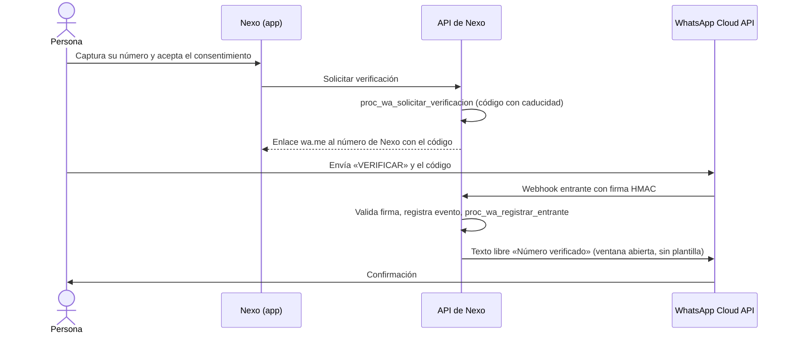
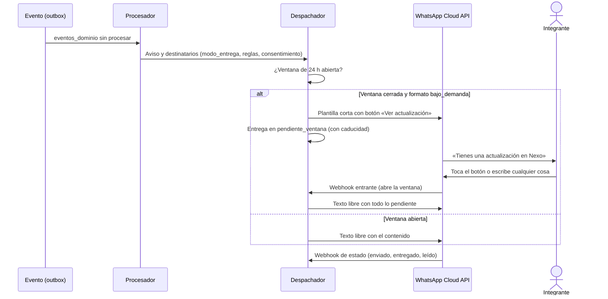

# Nexo · Plan del spike: WhatsApp 1 a 1 (canal directo)

> **Estado:** pista A terminada y reporte en la sección 16 (go técnico, pista B pendiente de Meta); en `Dev_Luis` (aprobado por Luis el 2026-11-21) · **Fecha:** 2026-11-20, actualizado el 2026-11-21
> **Base:** `01_Contexto_y_Especificaciones.md` (§7), `02_Base_de_Datos.md`, `03_Plan_de_Accion.md` (Fase 4), `docs/whatsapp-verificacion.md`, `apps/api/db/migrations/0001_esquema.sql` y `apps/api/src/db/tipos.ts`.
> **Marca `[POR VERIFICAR]`:** dato de Meta o del código que no se confirmó. Se cierra en la pista B del spike (sección 10) o al leer el código (S0).
> **Numeración:** las decisiones nuevas se llaman `P-1…P-6` (propuestas) para no chocar con `D-01…D-03` de `docs/decisiones.md`; se renumeran al aprobarlas.

---

## 1. Objetivo y alcance

**Objetivo.** Comprobar, en una rama corta, que Nexo puede enviar reportes y avisos a **números personales** con la API normal de WhatsApp Cloud (proveedor `cloud_api_directo`), **sin cerrar ni complicar el camino a los grupos** (`cloud_api_grupos`) cuando llegue la verificación del negocio.

**Dentro del spike**
- Reporte personal: cada persona (en equipo o en solitario) se envía su reporte a su número.
- Avisos del líder (tareas, reuniones, actualizaciones…) a cada integrante **por separado**.
- Tres formatos de entrega elegibles: resumen con enlace, PDF y «bajo demanda» (mensaje corto + ventana de 24 h).
- Alta y verificación del número por mensaje entrante, con consentimiento revocable.
- Todo funcionando en modo `simulado` de extremo a extremo, y una pista real con el número de pruebas de Meta.
- Control `modo_entrega` por equipo (`individual` | `grupo` | `ambos`) y regla anti-duplicado.

**Fuera del spike**
- Envío real a grupos, verificación del negocio, cuenta oficial (OBA), pantallas FALT-03/04.
- Precios definitivos en MXN, 2FA, internacionalización.
- Reescribir el artículo y la red de Petri (solo se anota el impacto, sección 13).

**Resultado esperado:** una decisión *go / no-go* con evidencia (sección 10) y una estimación medida del retrabajo.

---

## 2. Acuerdos de diseño (propuestas a ratificar)

| # | Propuesta | Motivo |
|---|---|---|
| P-1 | **Dos canales, no dos versiones.** Grupo y directo conviven; se activan por equipo con `modo_entrega`. | Evita ramas divergentes y un «volver atrás» costoso. |
| P-2 | Al tener grupos validados, **solo se apaga el canal directo de los avisos del líder**; el **reporte personal sigue siendo directo**. | Un reporte personal en un grupo lo vería todo el equipo. |
| P-3 | **Tres formatos elegibles:** el líder fija el predeterminado del equipo y cada persona puede cambiarlo. | Decisión del equipo (2026-11-20). |
| P-4 | En «bajo demanda», la plantilla dice solo «tienes un reporte / una actualización…» y trae un **botón «Ver actualización»**; además **cualquier mensaje entrante** de un número verificado entrega lo pendiente. | La persona no tiene que pensar qué escribir. |
| P-5 | `proveedor` se conserva; el **canal lo decide `modo_entrega` + el destino** (ver 5.3). | Evita tocar el enum con una migración destructiva. |
| P-6 | Rama corta con migración **aditiva** y valores por defecto que **no cambian el comportamiento actual**. | Permite fusionar a `dev` sin riesgo para `produccion`. |

---

## 3. Punto de partida y huecos

### 3.1 Lo que ya existe (leído del repo)

| Pieza | Estado actual |
|---|---|
| `proveedor_whatsapp` | `simulado`, `cloud_api_grupos`, `cloud_api_directo` ya definidos. |
| `whatsapp_configuracion` | Una fila por equipo (PK `equipo_id`) con `proveedor`, `estado`, `grupo_externo_id`, `reporte_*`, `agrupar`, `silencio_desde/hasta`. |
| `whatsapp_reglas` | Por equipo y `tipo_evento` (`reunion`, `urgente`, `aceptada`, `asignacion`, `actualizacion`, `triaje`) con `modo` (`instantaneo`, `reporte`, `apagado`). |
| `whatsapp_mensajes` | Aviso **del equipo**, sin destinatario. Estados `pendiente → programado → enviando → enviado | fallido | cancelado`. `texto` entre 1 y 400 caracteres. `seleccionado` para la cola del líder. |
| `whatsapp_usuario` | `numero_e164` único, `verificado_en`, `consentimiento_en`, `consentimiento_revocado_en`. |
| `preferencias_notificacion` | `(usuario_id, evento)` con `por_app`, `por_whatsapp`, `por_correo`. |
| `whatsapp_webhook_eventos` | Bitácora idempotente (`proveedor_evento_id UNIQUE`). |
| Arquitectura | Outbox `eventos_dominio` → despachador `proc_wa_procesar_eventos` en el ciclo de la API cada minuto (`trabajos/whatsapp.ts`; sin `pg-boss`, DEC-WA-1); capa `ProveedorWhatsApp`; solo `proc_*` desde la API (rol `nexo_app`, DEC-025). |

### 3.2 Huecos que el canal directo obliga a cerrar

| # | Hueco | Efecto |
|---|---|---|
| G1 | `whatsapp_mensajes` no tiene destinatario. | No se puede enviar a una persona ni llevar su estado. |
| G2 | `equipo_id` es `NOT NULL`. | Quien trabaja **en solitario** no podría tener reporte por WhatsApp. |
| G3 | `proveedor` es un solo valor por equipo y mezcla «real vs. simulado» con «grupo vs. directo». | No permite tener los dos canales activos. |
| G4 | `01` §7.4 habla de estados `entregado` y `leido`, pero `estado_mensaje_wa` no los tiene. | Los webhooks de estado no tienen dónde guardarse. |
| G5 | `texto` está limitado a 400 caracteres. | Un reporte completo en texto libre no cabe. |
| G6 | No existe el concepto de **ventana de 24 h**. | Sin él no se puede decidir entre texto libre y plantilla. |
| G7 | No hay verificación del número por mensaje entrante. | Hoy solo hay `verificado_en` sin flujo que lo llene. |
| G8 | `/app/personal/reportes` existe en el router pero no figura en el inventario de pantallas. | Se agrega al inventario con este trabajo. |

> **Resuelto en S0:** `ProveedorWhatsApp` está en `apps/api/src/whatsapp/proveedor.ts` con `enviar(aviso): Promise<string>`; el directo actual manda el mismo texto a cada persona con un solo estado (sección 15.1).

---

## 4. Cambios de esquema

Una **migración nueva** (siguiente número libre; no se edita `0001`). Todo aditivo.

```sql
-- Tipos nuevos
CREATE TYPE modo_entrega_wa    AS ENUM ('individual', 'grupo', 'ambos');
CREATE TYPE formato_wa         AS ENUM ('resumen_enlace', 'pdf', 'bajo_demanda');
CREATE TYPE destino_wa         AS ENUM ('grupo', 'persona');
CREATE TYPE estado_entrega_wa  AS ENUM
  ('pendiente', 'pendiente_ventana', 'enviando', 'enviado',
   'entregado', 'leido', 'fallido', 'caducado', 'cancelado');

-- Configuración por equipo: el comportamiento actual no cambia (default 'grupo')
ALTER TABLE whatsapp_configuracion
  ADD COLUMN modo_entrega    modo_entrega_wa NOT NULL DEFAULT 'grupo',
  ADD COLUMN formato_defecto formato_wa      NOT NULL DEFAULT 'resumen_enlace';

-- Preferencia personal (NULL = usar la del equipo)
ALTER TABLE preferencias_usuario
  ADD COLUMN wa_formato formato_wa;

-- Número: ventana de 24 h, límite de teasers y código de verificación
ALTER TABLE whatsapp_usuario
  ADD COLUMN ultimo_entrante_en timestamptz,
  ADD COLUMN ultimo_teaser_en   timestamptz,
  ADD COLUMN codigo_hash        text,
  ADD COLUMN codigo_expira_en   timestamptz;

-- Aviso personal (reporte de una persona, con o sin equipo)
ALTER TABLE whatsapp_mensajes
  ALTER COLUMN equipo_id DROP NOT NULL,
  ADD COLUMN usuario_id uuid REFERENCES usuarios(id) ON DELETE CASCADE,
  ADD CONSTRAINT ck_wa_msj_ambito CHECK (equipo_id IS NOT NULL OR usuario_id IS NOT NULL);

-- Una fila por destinatario de cada aviso
CREATE TABLE whatsapp_entregas (
  id                   uuid PRIMARY KEY DEFAULT gen_random_uuid(),
  mensaje_id           uuid NOT NULL REFERENCES whatsapp_mensajes(id) ON DELETE CASCADE,
  destino              destino_wa NOT NULL,
  usuario_id           uuid REFERENCES usuarios(id) ON DELETE CASCADE,  -- NULL si destino = 'grupo'
  formato              formato_wa NOT NULL,
  plantilla            text,                                             -- clave de la plantilla usada
  variables            jsonb NOT NULL DEFAULT '{}',
  contenido            text CHECK (contenido IS NULL OR char_length(contenido) <= 4000),
  estado               estado_entrega_wa NOT NULL DEFAULT 'pendiente',
  caduca_en            timestamptz,
  intentos             smallint NOT NULL DEFAULT 0,
  ultimo_error         text,
  proveedor_mensaje_id text,
  enviado_en           timestamptz,
  entregado_en         timestamptz,
  leido_en             timestamptz,
  creado_en            timestamptz NOT NULL DEFAULT now(),
  CHECK ((destino = 'persona') = (usuario_id IS NOT NULL))
);
CREATE UNIQUE INDEX ux_wa_entrega_destinatario ON whatsapp_entregas(mensaje_id, usuario_id)
  WHERE usuario_id IS NOT NULL;
CREATE UNIQUE INDEX ux_wa_entrega_proveedor ON whatsapp_entregas(proveedor_mensaje_id)
  WHERE proveedor_mensaje_id IS NOT NULL;
CREATE INDEX ix_wa_entregas_mensaje ON whatsapp_entregas(mensaje_id);
CREATE INDEX ix_wa_entregas_pend_ventana ON whatsapp_entregas(usuario_id, creado_en)
  WHERE estado = 'pendiente_ventana';
```

**Por qué una tabla de entregas y no una fila por persona en `whatsapp_mensajes`.** La cola del líder (WA-02) sigue mostrando **un aviso**; el reparto a cada integrante y su estado viven en `whatsapp_entregas`. Para el grupo, la entrega es una sola fila con `destino = 'grupo'`. Así los dos canales usan la misma estructura.

**Decisiones de diseño dentro del esquema**
- `texto` (≤ 400) queda como **vista previa** del aviso. El contenido completo, **personalizado por persona**, vive en `whatsapp_entregas.contenido` (tope de 4000, por debajo del máximo de Meta `[POR VERIFICAR]`).
- La ventana de 24 h **no se guarda**: se calcula como `ultimo_entrante_en + 24 h`.
- El estado del aviso se deriva de sus entregas: `enviado` cuando todas están en estado final y al menos una se envió; `fallido` si todas fallaron. Se define en S2.
- `contenido` se borra al caducar una entrega (privacidad); el historial conserva el estado, no el texto.

**Procesos de BD nuevos** (nombres propuestos; se documentan en `08_Procesos_BD.md` y se da `EXECUTE` a `nexo_app`):

| Proceso | Función |
|---|---|
| `proc_wa_solicitar_verificacion` | Guarda número, consentimiento y hash del código con caducidad. |
| `proc_wa_registrar_entrante` | Actualiza `ultimo_entrante_en`, valida el código, devuelve las entregas pendientes de ventana. |
| `proc_wa_expandir_entregas` | Crea las entregas de un aviso según `modo_entrega`, reglas, consentimiento y anti-duplicado. |
| `proc_wa_marcar_entrega` | Aplica un estado de webhook (`enviado`, `entregado`, `leido`, `fallido`). |
| `proc_wa_crear_reporte_personal` | Crea el aviso y su entrega para «enviarme mi reporte». |
| `proc_wa_caducar_pendientes` | Trabajo programado: pasa a `caducado` y limpia `contenido`. |

---

## 5. Proveedor, destino y despachador

### 5.1 Interfaz propuesta

```ts
type Destino =
  | { tipo: 'persona'; numeroE164: string }
  | { tipo: 'grupo'; grupoExternoId: string };

interface ProveedorWhatsApp {
  enviarPlantilla(d: Destino, p: PlantillaEnvio): Promise<ResultadoEnvio>;
  enviarTexto(d: Destino, texto: string): Promise<ResultadoEnvio>; // solo con ventana abierta
}
```

El resto de la aplicación no cambia: solo conoce la interfaz (ya es la regla de `01` §7.2).

### 5.2 Regla del despachador (por entrega a una persona)

```
formato = preferencias_usuario.wa_formato ?? whatsapp_configuracion.formato_defecto
ventana_abierta = ultimo_entrante_en > now() - 24 h

si ventana_abierta Y formato = bajo_demanda:
    enviarTexto(contenido)                        # sin plantilla
si no, según formato:
    resumen_enlace → plantilla nx_resumen_enlace (resumen corto + botón con enlace)
    pdf            → plantilla nx_reporte_pdf (encabezado de documento)
    bajo_demanda   → plantilla nx_aviso_ver (aviso corto + botón «Ver actualización»)
                     entrega → pendiente_ventana, caduca_en = now() + 7 días (P-7)
```

Reglas transversales:
- Respeta `silencio_desde/silencio_hasta` del equipo (usa `programado_para`). El «enviarme mi reporte ahora» **ignora** el silencio porque lo pide la propia persona.
- Sin `consentimiento_en` vigente o con `consentimiento_revocado_en`, **no se crea la entrega**.
- **Un solo aviso corto por persona y por intervalo** (`ultimo_teaser_en`, intervalo configurable, por defecto 12 h): si ya hay un aviso corto sin responder, los eventos nuevos quedan en `pendiente_ventana` sin enviar otro, y al tocar el botón se entrega todo junto. Evita que la gente bloquee o reporte el número.
- Límite de «enviarme mi reporte» por persona y hora (valor por definir; p. ej. 5).

### 5.3 Elección de canal sin tocar el enum (P-5)

`proveedor` pasa a leerse como **«modo del backend»**: `simulado` = nada sale a Meta; cualquier valor `cloud_api_*` = real. El canal lo resuelve `resolverProveedor(config, destino)`:

| `proveedor` | destino | Implementación |
|---|---|---|
| `simulado` | cualquiera | `Simulado` |
| `cloud_api_*` | `persona` | `CloudApiDirecto` |
| `cloud_api_*` | `grupo` | `CloudApiGrupos` |

Queda un valor redundante en el enum. La alternativa limpia (un enum nuevo con `simulado` y `cloud_api`) obliga a una migración de limpieza posterior; se deja como decisión abierta (sección 14).

### 5.4 El proveedor `simulado` debe imitar las reglas de Meta

Para poder probar sin cuenta de Meta, el simulado:
- **Rechaza texto libre fuera de la ventana de 24 h**, igual que la API real.
- Expone `POST /dev/whatsapp/entrante` (solo fuera de producción) y un botón «Simular respuesta» en la interfaz de pruebas, para disparar el mensaje entrante o el botón.
- Permite **adelantar el reloj** (parámetro de prueba) para probar la caducidad y el límite de avisos cortos.

---

## 6. Plantillas de Meta y los tres formatos

Mensajes que Nexo inicia **fuera de la ventana de 24 h** requieren una **plantilla aprobada** por Meta; el texto libre solo vale dentro de la ventana.

| Formato | Qué recibe la persona | Plantilla (clave propuesta) | Pros | Contras |
|---|---|---|---|---|
| **1. Resumen + enlace** | Resumen corto y un botón que abre el reporte en la app. | `nx_resumen_enlace` (variables: título, resumen; botón URL dinámico) | Sin PDF; el enlace exige iniciar sesión; fácil de aprobar. | Requiere la app desplegada para que el enlace funcione. |
| **2. PDF adjunto** | El reporte como documento. | `nx_reporte_pdf` (encabezado de documento; variables: nombre, periodo) | Se lee sin abrir la app; queda en el chat. | Generar el PDF en el servidor; datos personales dentro del archivo. |
| **3. Bajo demanda** | «Tienes un reporte nuevo» / «Nueva actualización» + botón. | `nx_aviso_ver` (una variable con la frase; botón de respuesta rápida «Ver actualización») | Contenido completo y largo en texto libre; la plantilla casi no revela nada. | Hay que tocar el botón para ver el contenido. |

Notas de diseño:
- **Una sola plantilla de aviso corto con una variable** (`Tienes {{1}} en Nexo.` con «un reporte nuevo», «una actualización», «una reunión próxima»…). Si Meta la rechaza por genérica, se separa por tipo de evento (`whatsapp_reglas.tipo_evento` ya tiene seis tipos más el reporte). Esto ajusta lo conversado antes (una plantilla por tipo) para llegar más rápido a la aprobación.
- **Idioma:** `es_MX` `[POR VERIFICAR]`. **Categoría:** utilidad; Meta puede reclasificar a marketing y cobrar distinto `[POR VERIFICAR]`.
- El **PDF se sube con la API de medios** (identificador de medio) en lugar de una URL pública, para no exponer datos personales.
- El mapa «formato + tipo de evento → plantilla + variables» vive **en código** durante el spike (un módulo de plantillas dentro de la capa de WhatsApp; ruta a confirmar en S0). Si crece, pasa a tabla.
- Las variables de plantilla tienen restricciones de formato (sin saltos de línea, el cuerpo no puede empezar ni terminar con variable, límite de longitud) `[POR VERIFICAR]`; por eso el resumen es corto y el contenido largo va como texto libre o PDF.

---

## 7. Verificación del número y flujo «bajo demanda»

### 7.1 Alta y verificación (la persona inicia el contacto)



Efectos: `verificado_en`, `ultimo_entrante_en` (se abre la ventana) y, si el consentimiento ya se aceptó en la app, el número queda activo. El texto del consentimiento es visible y **revocable** desde la app.

### 7.2 Entrega bajo demanda (opción 3)



Reglas del mensaje entrante (`proc_wa_registrar_entrante`):
1. Verificar firma HMAC y registrar en `whatsapp_webhook_eventos` (idempotente por `proveedor_evento_id`).
2. Si el número no está registrado: ignorar (no se responde a desconocidos).
3. Actualizar `ultimo_entrante_en`.
4. Si trae el código de verificación vigente: completar la verificación (7.1).
5. Si hay entregas `pendiente_ventana` de esa persona: entregarlas **todas** en uno o varios textos (límite de longitud).
6. Si no hay nada pendiente: responder un menú corto («No tienes avisos pendientes. Escribe REPORTE para recibir tu reporte actual.»).
7. Si el texto es `BAJA` o `STOP`: registrar `consentimiento_revocado_en` y confirmar.

> `[POR VERIFICAR]` Que el toque del botón de respuesta rápida llegue como mensaje entrante y abra la ventana de 24 h. Si no abriera la ventana, la opción 3 se rediseña con «escribe cualquier cosa» como único disparador.

---

## 8. `modo_entrega` y regla anti-duplicado

### 8.1 Qué hace cada modo

| `modo_entrega` | Avisos del líder | Reporte personal |
|---|---|---|
| `individual` | A cada integrante activo con consentimiento (una entrega por persona). | Directo. |
| `grupo` (predeterminado) | Una entrega al grupo. | Directo. |
| `ambos` | Grupo para quien está en él; directo para quien no. | Directo. |

### 8.2 Reglas

- **R1.** El reporte personal **nunca** va a un grupo.
- **R2.** En `ambos`, **un solo canal por persona y por evento**: grupo si la persona consta como miembro del grupo; directo si no.
- **R3.** Un invitado no recibe avisos (los invitados son observadores y no cuentan para el límite de 8).
- **R4.** El líder nunca ve el número completo de nadie (solo los últimos 4 dígitos); el envío lo hace el servidor.
- **R5.** Quien no tenga número verificado y consentimiento vigente recibe el aviso solo en la app (`notificaciones`).

**Dependencia de R2.** Para saber quién está en el grupo hace falta una tabla `whatsapp_grupo_miembros(equipo_id, usuario_id, unido_en, salio_en)` alimentada por el webhook `group_participants_update` y por la aprobación de solicitudes (FALT-03/04). **No entra al spike:** el resolver de pertenencia se deja como una función que hoy devuelve «nadie está en el grupo» y se prueba con un doble de prueba.

### 8.3 Qué pasa cuando llegue la verificación del negocio

1. Se implementa/activa `CloudApiGrupos` y las pantallas FALT-03/04 (ya estaban pendientes).
2. Se cambia `modo_entrega` de los equipos a `grupo` o `ambos`: **una actualización de configuración, sin migración.**
3. El historial directo se conserva (las filas con `destino = 'persona'` siguen ahí); la interfaz lo filtra.
4. El reporte personal sigue por el canal directo.

---

## 9. Interfaz mínima del spike

| Pantalla | Cambio |
|---|---|
| Ajustes personales de notificaciones | Número de WhatsApp, consentimiento y revocación, estado de verificación (enlace `wa.me`), formato preferido (3 opciones). |
| `/app/personal/reportes` (G8) | Botón «Enviarme mi reporte por WhatsApp». Se agrega al inventario de pantallas. |
| WA-01 panel / WA-05 reglas | Selector de `modo_entrega` y del formato predeterminado del equipo. |
| WA-02 cola detallada | Al enviar, muestra el reparto por persona (estado de cada entrega) en lugar de un solo estado. |
| WA-07 consentimiento | Lista quién está activo, verificado o sin consentimiento (sin mostrar números completos). |
| Pantalla de pruebas (solo fuera de producción) | «Simular respuesta», «Adelantar reloj». |

---

## 10. Pruebas y criterios de salida

### 10.1 Pista A: modo simulado (no requiere cuenta de Meta)

| # | Prueba | Resultado esperado |
|---|---|---|
| A1 | Aviso del líder con `modo_entrega = individual` y 5 integrantes (4 con consentimiento). | 4 entregas; la persona sin consentimiento recibe solo notificación en la app. |
| A2 | Texto libre con la ventana cerrada. | El simulado lo rechaza igual que Meta. |
| A3 | Formato `bajo_demanda`, ventana cerrada. | Plantilla corta enviada; entrega en `pendiente_ventana`. |
| A4 | «Simular respuesta» tras A3. | Se entrega todo lo pendiente; la ventana queda abierta. |
| A5 | Tres eventos seguidos antes de responder. | **Un solo** aviso corto; al responder llegan los tres. |
| A6 | Adelantar el reloj más allá de la caducidad. | Entregas `caducado` y `contenido` borrado. |
| A7 | Mensaje entrante `BAJA`. | `consentimiento_revocado_en` fijado; no se crean entregas nuevas. |
| A8 | `modo_entrega = grupo` con los mismos eventos. | Una sola entrega al grupo; ninguna directa. |
| A9 | Reporte personal de una persona **sin equipo**. | Entrega creada (aviso con `equipo_id` nulo). |
| A10 | Webhook repetido con el mismo `proveedor_evento_id`. | El segundo se ignora. |
| A11 | Webhook con firma HMAC inválida. | Rechazado; nada se procesa. |
| A12 | Matriz de permisos: un miembro de otro equipo consulta entregas; el líder consulta números. | Sin acceso; números solo con 4 dígitos visibles. |
| A13 | **Regresión:** las pruebas de la Fase 4.2 (cola, reglas, reporte programado, consentimiento) sin modificar. | Todas en verde. |

### 10.2 Pista B: número de pruebas de Meta

**Prerrequisitos.** URL pública HTTPS para el webhook: ya existe (`https://api.nexo.lol/whatsapp/webhook`, desplegado en la Fase 3.5); falta suscribirla en Meta y poner el secreto de la app en Render. El enlace del formato 1 apunta a `https://app.nexo.lol`, que ya está en línea.

| # | Prueba | Resultado esperado |
|---|---|---|
| B1 | Enviar una plantilla de utilidad a un número propio autorizado. | Mensaje recibido. |
| B2 | Aprobación de `nx_aviso_ver`, `nx_resumen_enlace` y `nx_reporte_pdf`. | Estado «aprobada» o motivo de rechazo anotado. |
| B3 | Tocar el botón «Ver actualización». | Llega el webhook, se abre la ventana y se entrega el contenido. |
| B4 | PDF con encabezado de documento. | Documento recibido. |
| B5 | Estados `enviado / entregado / leído` por webhook. | `whatsapp_entregas` actualizada. |
| B6 | Verificación del número por `VERIFICAR` y código. | `verificado_en` fijado. |

### 10.3 Criterio *go / no-go*

- **Go:** A1–A13 en verde; B1, B3 y B5 comprobadas **o** documentado por qué no (p. ej. aprobación pendiente); ninguna pantalla existente del prototipo hubo que rehacer; la regresión A13 pasa sin tocar las pruebas.
- **Medición del retrabajo** (se anota en el reporte del spike): archivos y líneas modificados **fuera** de la capa de WhatsApp y de la migración; número de pantallas tocadas; horas reales por tarea frente a la estimación de la sección 12.
- **No-go o rediseño:** las plantillas no se aprueban (sin alternativa de formato), o el botón no abre la ventana y la opción 3 resulta inusable.

---

## 11. Riesgos y datos por verificar

| # | Riesgo o dato | Efecto | Mitigación / cómo se cierra |
|---|---|---|---|
| V1 | Meta rechaza o reclasifica plantillas. | Retrasa la pista B; puede cambiar el costo. | Mandar a aprobar en S0; plantilla genérica de una variable. **Ocurrió:** `nexo_aviso` se reclasificó como marketing y `nx_reporte_pdf` se rechazó por terminar en variable (corregida). |
| V2 | El número de pruebas solo envía a un máximo de destinatarios autorizados (recuerdo 5). | Limita la demostración. | `[POR VERIFICAR]` en B1; suficiente para un equipo de 4. |
| V3 | El botón de respuesta rápida abre la ventana de 24 h. | Define si la opción 3 funciona como se pensó. | `[POR VERIFICAR]` en B3. |
| V4 | Restricciones de variables y de encabezado de documento. | Cambia el diseño del resumen y del PDF. | `[POR VERIFICAR]` en B2 y B4. |
| V5 | Límite de envío sin verificar el negocio. | Tope de pruebas y de la beta. | Para portafolios nuevos es de **250 destinatarios únicos por día fuera de ventana** ([documentación de Meta](https://developers.facebook.com/documentation/business-messaging/whatsapp/messaging-limits), consultada el 2026-11-20); suficiente para la beta. |
| V6 | Costo en MXN por mensaje de utilidad. | Presupuesto. | `docs/whatsapp-verificacion.md` ya dice que las tarifas de grupo y las individuales coinciden por destinatario; la cifra en MXN **no está verificada**. |
| V7 | Webhook sin URL pública hasta el despliegue. | Bloquea la pista B. | **Resuelto:** la API ya está en `api.nexo.lol`. Para la pista B se despliega el spike y se configura el webhook en Meta. |
| V8 | Usuarios que bloquean o reportan el número. | Baja la calidad del número ante Meta. | Un aviso corto por intervalo, `BAJA`/`STOP`, solo eventos de las reglas del equipo. |
| V9 | Conflicto de migraciones con quien trabaja en WhatsApp de la Fase 4. | Números repetidos, esquema roto. | **Resuelto:** la Fase 4 ya terminó y está en producción; el spike usa `0033` y P220–P249. |
| V10 | Aviso corto muy genérico → baja tasa de toque del botón. | La opción 3 pierde utilidad. | Medir en la pista B; permitir elegir formato 1 o 2. |
| V11 | Datos personales dentro de PDF y de `contenido`. | Privacidad. | Subida por API de medios, caducidad de `contenido`, texto de consentimiento visible y revocable. |

---

## 12. Tareas y estimación

Una persona, referencia nominal; se ajusta con las horas reales.

| Paso | Contenido | Días |
|---|---|---|
| **S0** | Acordar P-1…P-6 y la numeración de migraciones con quien lleva WhatsApp en la Fase 4; leer la firma real de `ProveedorWhatsApp`; enviar plantillas a aprobación. | 0.5 |
| **S1** | Migración, procesos `proc_wa_*`, regenerar `tipos.ts`, actualizar `08_Procesos_BD.md` y `02_Base_de_Datos.md`. | 1 |
| **S2** | `resolverProveedor`, expansión de entregas, despachador, simulado con ventana y estados derivados. | 1.5 |
| **S3** | Plantillas y formatos, verificación del número, webhook entrante, `BAJA/STOP`, generación de PDF. | 1.5 |
| **S4** | Interfaz mínima (sección 9). | 1 |
| **S5** | Pista B con el número de pruebas (requiere túnel). | 1 |
| **S6** | Pruebas, reporte del spike y decisión *go / no-go*. | 0.5 |
| | **Total** | **≈ 7 días de trabajo** (5 a 7 según cuánto de S5 dependa de Meta) |

Lista de control:

- [x] S0 · Decisiones ratificadas y numeración de migraciones acordada (DEC-039)
- [x] S0 · Plantillas enviadas a aprobación (sección 15.3)
- [x] S1 · Migración aplicada en local y en CI (los tres scripts SQL más la nueva)
- [x] S1 · Procesos documentados y con `EXECUTE` para `nexo_app`
- [x] S2 · A1–A13 en verde en el simulado
- [x] S3 · Flujo de verificación y entrega bajo demanda funcionando
- [x] S4 · Pantallas de la sección 9
- [x] S5 · B1, B3 y B5 comprobadas o justificadas (sección 16.2: B1 parcial; B3 y B5 justificadas, pendientes de token permanente y webhook)
- [x] S6 · Reporte del spike con la medición del retrabajo y la decisión (sección 16)

---

## 13. Coordinación, ramas y documentos a actualizar

**Ramas.** Se respeta el flujo `Dev_<Nombre> → dev → main → produccion`, solo por PR. El spike vive en la rama personal de quien lo haga. Como la migración es aditiva y los valores por defecto no cambian el comportamiento (`modo_entrega = 'grupo'`, `proveedor = 'simulado'`), puede fusionarse a `dev` en cuanto pase el *go*, sin una rama larga que se aleje de lo que avanza la Fase 4.

**Reparto** *(actualizado: la Fase 4 ya terminó y la conexión la lleva el mismo equipo de `Dev_Luis`, así que todo el spike lo escribe una sola persona y no hay contrato que acordar)*

| Pieza | Responsable propuesto |
|---|---|
| `CloudApiGrupos`, webhooks de grupo, FALT-03/04 | Quien lleva la conexión de la Fase 4. |
| `CloudApiDirecto`, entregas, formatos, verificación del número | El spike. |
| Endpoint de webhook (HMAC), `whatsapp_webhook_eventos`, `resolverProveedor` | **Compartido:** se acuerda el contrato en S0 y lo escribe una sola persona. |

**Documentos que se actualizan al cerrar el spike**

| Documento | Cambio |
|---|---|
| `01_Contexto_y_Especificaciones.md` | §7.2 (resolución de canal), §7.4 (estados de entrega y ventana de 24 h), nueva decisión sobre el canal directo. |
| `02_Base_de_Datos.md` | Tablas y columnas nuevas, diagrama de la sección 5.4, pruebas de integridad. |
| `03_Plan_de_Accion.md` | Fase 4.3: el envío real mínimo puede ser directo o a grupo; criterios de terminado. |
| `08_Procesos_BD.md` | Los `proc_wa_*` nuevos. |
| Inventario de pantallas | `/app/personal/reportes` (G8). |
| `04_Articulo.md` y red de Petri | **Seguimiento, no parte del spike.** El *proclet* «Aviso a WhatsApp» gana lugares como «En espera de ventana» y «Respuesta de la persona»; el artículo presenta la contribución como grupos con consentimiento individual, así que habrá que decidir cómo se cuenta el canal directo. |

---

## 14. Decisiones abiertas

| # | Decisión | Opciones | Recomendación |
|---|---|---|---|
| P-5 | ¿Qué significa `proveedor`? | (a) Dejar el enum y leerlo como «backend»; (b) enum nuevo con los valores `simulado` y `cloud_api`, y migración de limpieza. | (a) durante el spike; (b) si el canal directo se queda. |
| P-7 | Caducidad de entregas `pendiente_ventana`. | 3, 7 o 14 días. | 7 días. |
| P-8 | Intervalo entre avisos cortos por persona. | 6, 12 o 24 h. | 12 h, configurable. |
| P-9 | Generación del PDF. | Librería sin navegador (más ligera para Render) o navegador headless. | Librería sin navegador. |
| P-10 | ¿Una plantilla de aviso corto o una por tipo de evento? | Una con variable o varias. | Una; separar solo si Meta la rechaza. |
| P-11 | ¿El texto libre dentro de la ventana respeta el formato 1 y 2 o siempre se envía completo? | Respetar formato o enviar completo. | Respetar el formato elegido; solo «bajo demanda» entrega completo en la ventana. |

---

## 15. Resultado de S0 (2026-11-21)

### 15.1 Lo que el plan suponía y el código real

| Supuesto del plan | Realidad en el repositorio | Consecuencia |
|---|---|---|
| Cola con `pg-boss` | No se usa: el ciclo de WhatsApp corre cada minuto en la API (`trabajos/whatsapp.ts`, DEC-WA-1) | La caducidad de entregas y el reparto entran en ese mismo ciclo |
| Despliegue (Fase 3.5) pendiente; hace falta un túnel para el webhook | Ya está en línea: `https://api.nexo.lol/whatsapp/webhook` (GET de verificación y POST con firma HMAC e idempotencia) | V7 se resuelve sin túnel cuando se configure el webhook en Meta (requiere el secreto de la app en Render) |
| `ProveedorWhatsApp` sin leer | `enviar(aviso: AvisoParaEnviar): Promise<string>`; `proveedorCloudApi` ya manda texto, plantilla (`WHATSAPP_PLANTILLA`) y a grupo; `proveedorPara(config, aviso)` elige simulado o real según `WHATSAPP_PROVIDER` | Se extiende con `enviarEntrega` por destino (persona o grupo) en lugar de reescribirla |
| G4: sin `entregado` / `leido` | `whatsapp_mensajes` ya tiene `entregado_en` y `leido_en` (0031); el webhook ya los llena | Se repite por entrega en `whatsapp_entregas` |
| Directo inexistente | `cloud_api_directo` ya manda **un mensaje igual a cada persona** con número y consentimiento, pero con un solo estado y un solo id para todos | Es justo el hueco G1: la tabla de entregas lo resuelve |
| Ventana de 24 h | Ya probada con el número real (DEC-WA-2): Meta acepta el texto libre fuera de la ventana y lo **descarta después**, sin error en la respuesta | Confirma el diseño 5.2: decidir por `ultimo_entrante_en`, no por el error |
| Número del destinatario | Meta devuelve a los números de México como `521…` (wa_id) aunque se registren como `+52…` | Al registrar mensajes entrantes se comparan números normalizados |

### 15.2 Decisiones ratificadas (→ DEC-039)

- **P-1 a P-6:** se aceptan tal cual. Numeración: migración **`0033`**, pruebas de procesos **P220–P249**.
- **P-5:** opción (a). `proveedor` se lee como «modo del backend» (`simulado` o real); el canal lo deciden `modo_entrega` y el destino. Los equipos que hoy usan `cloud_api_directo` quedan con `modo_entrega = 'individual'`, así que no cambian.
- **P-7:** caducidad de 7 días. **P-8:** 12 h entre avisos cortos, configurable. **P-9:** PDF con una librería sin navegador (`pdf-lib`). **P-10:** una plantilla de aviso corto con variable. **P-11:** se respeta el formato elegido; solo «bajo demanda» entrega completo dentro de la ventana.
- **P-12 (nueva):** durante el spike, la **verificación del número no bloquea** la entrega (basta número y consentimiento, como hoy). Así la regresión A13 pasa sin tocar las pruebas de la Fase 4.2. Bloquearla queda para después de B6.
- **P-13 (nueva):** los números se comparan normalizados (México: `52` + `1` + 10 dígitos ≡ `52` + 10 dígitos).

### 15.3 Plantillas enviadas a Meta (S0)

| Plantilla | Uso | Estado al enviarla |
|---|---|---|
| `nx_aviso_ver` | Formato 3: «Tienes {{1}} en Nexo…» + botón de respuesta rápida «Ver actualización» | En revisión |
| `nx_resumen_enlace` | Formato 1: «Resumen de Nexo · {{1}}: {{2}}…» + botón URL a `https://app.nexo.lol/{{1}}` | En revisión |
| `nx_reporte_pdf` | Formato 2: encabezado de documento + «Hola, {{1}}… del periodo {{2}}…» | En revisión (la primera versión se rechazó porque terminaba en variable) |
| `nexo_aviso` (DEC-WA-2) | Aviso genérico con el texto completo | En revisión; **Meta la reclasificó como marketing** (V1). Se sustituye por las tres de arriba |

---

## 16. Reporte del spike (S6, 2026-11-21)

### 16.1 Pista A (simulado): A1–A13

| # | Resultado | Dónde |
|---|---|---|
| A1 | ✅ 4 entregas; la persona sin consentimiento no recibe | P220 |
| A2 | ✅ El simulado rechaza texto libre fuera de la ventana | `spike.test.ts` |
| A3 | ✅ Aviso corto y entrega en `pendiente_ventana` (7 días) | P224, `integracion.test.ts` |
| A4 | ✅ Al responder se entrega todo lo pendiente y la ventana queda abierta | P225, `integracion.test.ts` |
| A5 | ✅ Un solo aviso corto aunque haya varios eventos (también dentro de un mismo envío) | P224, `integracion.test.ts` |
| A6 | ✅ Caducan y se borra `contenido` al adelantar el reloj | P226, `spike.test.ts` |
| A7 | ✅ «BAJA» retira el consentimiento y ya no se crean entregas | P227, `spike.test.ts` |
| A8 | ✅ Modo grupo: una sola entrega al grupo | P221 |
| A9 | ✅ Reporte personal sin equipo | P229, `spike.test.ts` |
| A10 | ✅ Webhook repetido se ignora | P168, `whatsapp.test.ts` |
| A11 | ✅ Firma HMAC inválida rechazada | `whatsapp.test.ts`, `integracion.test.ts` |
| A12 | ✅ Sin acceso de otros equipos; números solo con 4 dígitos | `matriz.test.ts`, P230, `spike.test.ts` |
| A13 | ✅ Regresión 4.2 sin tocar sus pruebas: P150–P169 y `whatsapp.test.ts` en verde | CI |

Además: modo «ambos» sin duplicar (P222), estado del aviso derivado de sus entregas (P223), estados de Meta por entrega (P231), verificación con código (P228, `spike.test.ts`), PDF con `pdf-lib` y API de medios contra una Meta imitada (`spike.test.ts`).

**Pruebas que sí cambiaron:** dos de `integracion.test.ts` (escritas para DEC-WA-2) comprobaban «texto y, si Meta lo rechaza, plantilla»; el spike sustituye esa regla por los formatos, así que ahora comprueban `nx_resumen_enlace` y el flujo «bajo demanda». No son pruebas de la Fase 4.2.

**Errores encontrados y corregidos durante el spike:** índice único de `proveedor_mensaje_id` incompatible con entregar varios pendientes en un solo texto (ahora índice normal); y, en un envío de varios avisos, la regla de «un aviso corto cada 12 h» se calculaba antes de enviar el primero (ahora se recuerda dentro del lote).

### 16.2 Pista B (número de pruebas de Meta)

| # | Estado | Motivo |
|---|---|---|
| B1 | ✅ | En producción (2026-11-21, token permanente): el reporte llegó al número de Luis desde `app.nexo.lol` |
| B2 | ⏳ | `nx_aviso_ver` y `nx_resumen_enlace` **reclasificadas como marketing** por Meta (V1); `nx_reporte_pdf` como utilidad. Las tres siguen **en revisión** (consultado el 2026-11-21 por la tarde) |
| B3 | ✅ | Luis escribió al número de Nexo y «REPORTE» respondió con texto dentro de la ventana, sin plantilla |
| B4 | ⏳ | Depende de la aprobación de `nx_reporte_pdf`. Con la ventana abierta el PDF ya sale como documento sin plantilla (`spike.test.ts`) |
| B5 | ✅ | La entrega del reporte pasó a `entregado` y `leido` con los estados que Meta mandó al webhook de producción |
| B6 | ✅ | Verificación real: código pedido en `app.nexo.lol`, mensaje desde WhatsApp, número verificado (20:28 UTC) |

**Hallazgos de la pista B (corregidos el mismo día):**

1. **La app de Meta sin publicar sí recibe los mensajes reales** del número de pruebas en el webhook, aunque el panel dice que solo recibirá webhooks de prueba. Publicarla pide la verificación del negocio (ignorada hasta nuevo aviso), así que no hizo falta.
2. **Meta separó la «cuenta de WhatsApp» (el número) de la «cuenta de mensajes» (plantillas).** El usuario del sistema necesita las dos; con solo la primera el token envía pero no ve plantillas (error 100, subcódigo 33).
3. **La gente manda solo el código.** El enlace `wa.me` no siempre llena el texto y la pantalla decía «manda el código»: Nexo respondía «No tienes avisos pendientes». Migraciones `0034` (el texto se limpia de espacios duros, marcas invisibles y puntuación) y `0035` (con un código pendiente vale el código solo); pruebas P232 y P233.
4. **«REPORTE» fallaba con `#132001`** porque intentaba la plantilla `nx_resumen_enlace`, aún sin aprobar. Con la ventana abierta ya no se usan plantillas: el resumen va como texto con enlace y el PDF como documento.
5. **La API no arrancó** la primera vez: faltaban `WHATSAPP_APP_SECRET` y `WHATSAPP_VERIFY_TOKEN` en Render (la API se niega a arrancar en producción con `real` si falta alguna). Render dejó en línea la versión anterior.
6. **Diseño:** el código se perdía frente a la pregunta del formato. Ahora verificar es un paso destacado (código grande, mensaje exacto, «Abrir WhatsApp», «Copiar mensaje», la pantalla se actualiza sola) y el formato aparece al verificar, plegado.

### 16.3 Retrabajo medido

- Fuera de la capa de WhatsApp y de la migración: **7 archivos, 97 líneas agregadas y 6 quitadas**, casi todo tipos generados (`tipos.ts`) y esquemas de respuesta. Pantallas ajenas tocadas: **2**, con 2 líneas cada una (Ajustes y Mis reportes reciben un componente).
- Ninguna pantalla existente se rehízo.
- Tiempo: S0–S6 en una jornada (frente a ≈ 7 días estimados), porque gran parte de la base (webhook, consentimiento, simulado, despliegue) ya existía.

### 16.4 Decisión

**Go técnico, condicionado a la pista B.** El canal directo convive con el de grupo sin romper nada y el retrabajo es bajo. Para cerrar la pista B falta: (1) que Meta apruebe las plantillas o, si quedan como marketing, aceptar ese costo o reescribirlas como utilidad; (2) token permanente y webhook en producción (mejora pendiente) para B3, B5 y B6.

**Actualización (2026-11-21, tarde):** token permanente y webhook en producción listos (`operacion.md` §15). B1, B3, B5 y B6 comprobadas con el número de Luis desde `app.nexo.lol`. Solo quedan B2 y B4, que dependen de que Meta apruebe las plantillas. Mientras tanto, todo lo que va dentro de la ventana de 24 h funciona sin plantillas.
